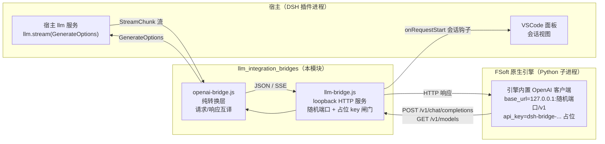
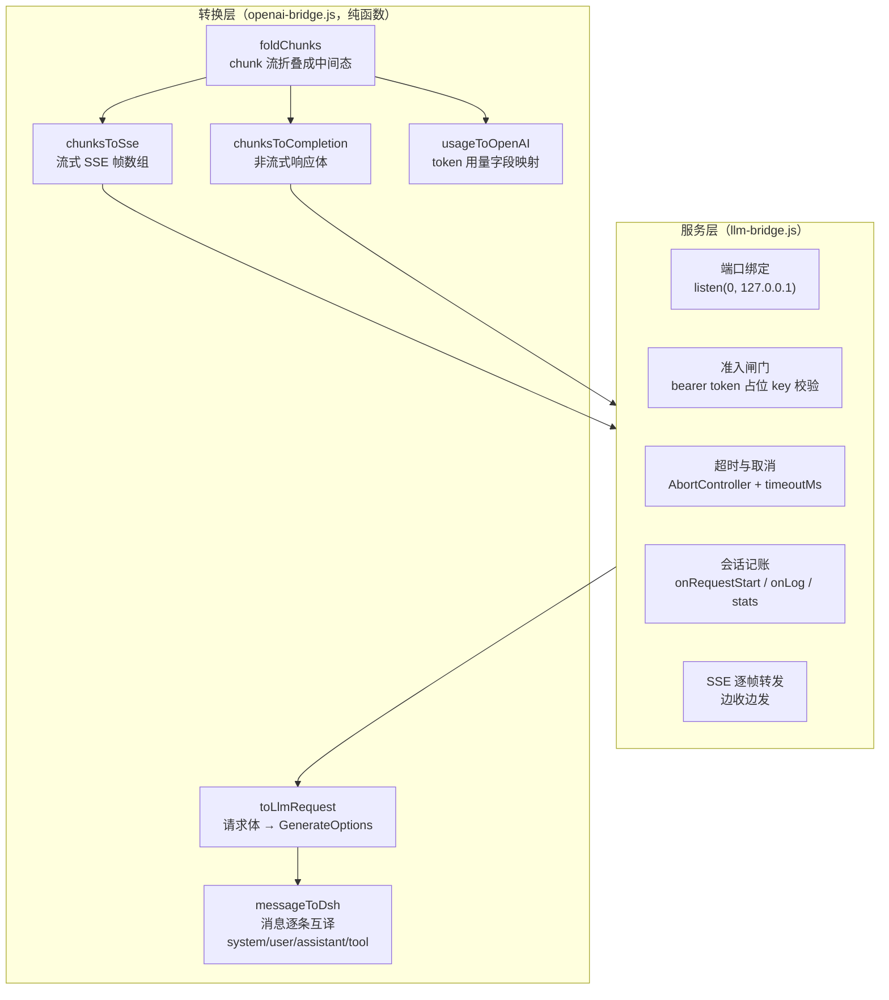
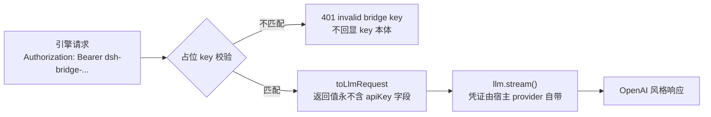
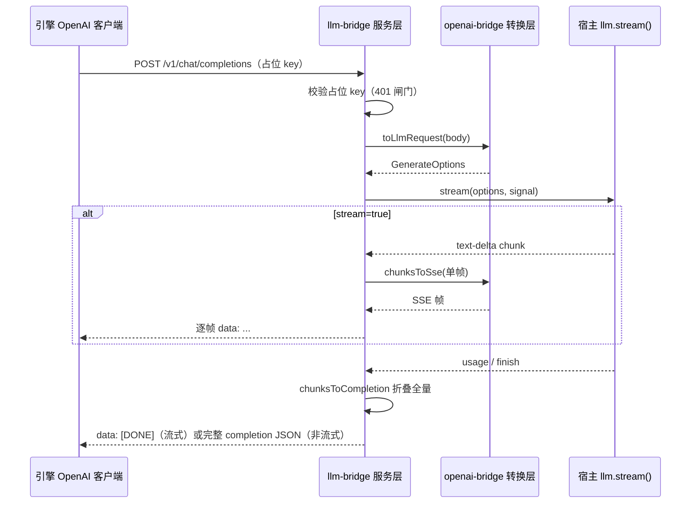

# LLM 集成桥（llm_integration_bridges）

## 简介

本模块是 FSoft 原生引擎与宿主模型服务（DSH `llm`）之间的**凭证隔离层**，由两个文件组成：

- `lib/engine/openai-bridge.js` —— **纯转换层**：把 OpenAI-compatible 的 chat 请求体翻译成 DSH 的 `GenerateOptions`，再把 DSH 的 `StreamChunk` 流翻译回 OpenAI 的非流式 JSON / 流式 SSE 响应。无 I/O、无网络、无密钥，逻辑可被 TDD 直接钉死。
- `lib/engine/llm-bridge.js` —— **HTTP 服务层**：在 `127.0.0.1` 的随机端口上起一个进程内 loopback 服务器，接收引擎发来的 OpenAI 请求，调用转换层，再用宿主注入的 `llm.stream()` 触发真实模型调用（真实凭证只存在于宿主 provider 内部，桥自始至终看不见）。

存在的根本原因：FSoft 原生引擎只认 OpenAI-compatible 的 `base_url` + `api_key`；而 DSH 插件自 0.10.1 起有一条硬约束——**插件既不保存也不传递密钥**。桥正是这两条要求之间的唯一接缝：引擎拿着一个桥自己生成的占位 key 打过来，桥把它换成宿主自己的凭证去调真实 provider。

## 模块定位与上下游

本模块在[代码引擎（code_engine_module）](../code_engine_module.md)中是一个叶子能力模块，不负责进程管理、协议行或产物落地：

- **上游调用方**：[引擎客户端（engine_client）](engine_client.md) 起 Python 子进程时，会把桥的 `url` 与 `placeholderKey` 以进程环境变量的形式注入引擎（见 [Python 原生运行时（python_native_runtime）](python_native_runtime.md)中 `entry.py` 对「不读本机凭证库、密钥只存在于进程环境变量」的守护）。
- **下游依赖**：只依赖 Node 内置模块（`node:http`、`node:crypto`）与宿主注入的 `llm` 对象，不读任何凭证文件、不 import 插件主入口。

## 架构分层

关键设计：**流式与非流式共用同一套 chunk 折叠逻辑**（`chunksToCompletion` 与 `chunksToSse` 都从同一份 chunk 流出发），避免两条路径行为分叉。

## 凭证安全边界

这是整个迁移「最不能破的一条」，由四道机制共同保证，缺一即等于把宿主凭证开放给本机任意进程：

| 机制 | 实现位置 | 作用 |
| --- | --- | --- |
| 绑定 `127.0.0.1` | `startLlmBridge` 中 `server.listen(0, '127.0.0.1')` | 阻断外网访问 |
| 随机端口 | `listen(0, ...)` 由操作系统分配 | 同机其它进程猜不到 |
| 占位 key 校验 | `PLACEHOLDER_KEY_PATTERN` + 每次启动 `randomBytes(32)` | 挡住误连 / 端口扫描；不复用、不落盘、不进日志 |
| 不碰凭证本体 | 桥只调用传入的 `llm.stream()` | 真实 key 只存在于宿主 provider 内部，桥从头到尾看不见 |

日志边界同样严格：

- 访问日志只记 `method / path / 状态 / 耗时`，**不记** Authorization；
- 401 错误体**不回显**收到的 key——避免把用户误配的真实 key 写进日志；
- `bearerOf()` 取出的 token 「取完即弃」，绝不写入日志、绝不放进请求对象、绝不传给 `llm`。

## 请求方向：OpenAI → DSH

`toLlmRequest({provider, model, reasoningEffort, body})` 把 OpenAI 请求体翻译成 `GenerateOptions` 的子集（`signal` / `sessionId` 由服务层补），逐条消息经 `messageToDsh` 互译：

| OpenAI 消息 | DSH 翻译 | 要点 |
| --- | --- | --- |
| `system` / `developer` | 抽到 `system` 槽（多段以换行合并） | DSH 的 one-shot system 语义 |
| `user` | `content` 摊平为 `ContentBlock[]` | `image_url` 等非文本部分显式跳过（引擎只发文本） |
| `assistant`（含 `tool_calls`） | 文本块 + `tool-call` 块 | `arguments` **保持原始 JSON 字符串**——DSH `ToolCallBlock` 如此定义，提前 parse 会破坏增量拼接；历史消息必须带 `source.kind='model'`（宿主 `LlmRuntime.forAdapter()` 会读 `message.source.replayState`，缺 source 会直接抛错），但桥不伪造 `replayState` |
| `tool` | `ToolResultMessage` | `toolCallId` 必须对上，否则工具循环断链 |
| `tools[].function` | `ToolSchema[]` | 缺这一步，agentic 工具循环退化成空谈 |

同时透传 `temperature` / `maxTokens`（原 `max_tokens`）/ `stop` / `reasoningEffort`。校验失败（缺 provider/model、messages 为空、除 system 外无消息）直接抛错，桥回 400。

## 响应方向：DSH → OpenAI

`foldChunks` 把 chunk 流折叠成「文本 + 按 index 拼接的工具调用 + usage + finish」的中间态：

- `text-delta` → 正文累加；
- `tool-call-delta` → 按 `index` 拼接 `argumentsDelta`，**只产出带 `name` 的调用**（无 name 的调用引擎无法执行，混进去只会制造莫名其妙的错误）；
- `usage` / `finish` → 分别记录用量与结束原因；
- `reasoning-delta` / `block-start` / `block-end` → **不进正文**（思考不该出现在文章里）。

用量映射有一个容易踩的坑：DSH 的 `TokenUsage` 是**互斥计数**（`inputTokens` 不含缓存），而 OpenAI 的 `prompt_tokens` 含缓存，因此 `prompt_tokens = inputTokens + cacheRead + cacheWrite`，缓存部分单列在 `prompt_tokens_details.cached_tokens`。

结束原因映射：`tool-calls → tool_calls`、`max-tokens → length`、`error/aborted → error`、其余 → `stop`。

## 路由、取消与超时行为

服务层只实现引擎真正用到的协议面（**不假装完整 OpenAI**）：

| 路由 | 方法 | 语义 |
| --- | --- | --- |
| `/healthz` | GET | 桥自身存活检查（不带任何模型信息）；免占位 key |
| `/v1/models` | GET | 引擎 / 探针的连通性检查，返回当前路由的单个模型 |
| `/v1/chat/completions` | POST | 非流式（缺省 / `stream: false`）与流式（`stream: true`）聊天补全 |
| 其它 | 任意 | 404 `unsupported route` |

取消语义（三条来源汇聚到同一个 `AbortController`）：

1. **客户端断连**：`res.on('close')` → `ac.abort()`——省 token，也让引擎的取消请求真正生效；
2. **单次调用超时**：`timeoutMs`（默认 10 分钟）→ `ac.abort()`；
3. 上游流式中途失败：若响应头已发出，只能用终止帧表达失败（发一个 `error` 事件 + `[DONE]`，HTTP 状态仍为 200）；未发头则回 502 `upstream_error`。

请求体上限 `MAX_BODY_BYTES = 32 MB`，超限回 413；非 JSON 请求体回 400。

## 会话记账与可观测性

桥通过两个可选钩子把「引擎到底跟模型说了什么」暴露给面板，且**绝不写入 Authorization 与占位 key**：

- `onLog(entry)` —— 结构化访问日志（method/path/status/ms）；
- `onRequestStart(task)` —— 每个 chat 请求开始时调用一次，入参只含 `name / model / provider / batchPrompt`，返回 `{onDelta, onDone, onError}` 句柄。

会话记录有两条体积控制：

- prompt 由 `messagesToPrompt` 拼成带 `[role]` 前缀的可读文本，上限 `MAX_SESSION_PROMPT_CHARS = 200k` 字符（原生通道单请求输入可达 110k–420k token，全文落盘是几百 KB × 每请求），截断处显式标注原长；
- 任务名用模型标识生成（`原生请求 · <model>`），因为原生通道没有「文章名」这种粒度。

所有回调都被沙箱包一层（`callSession` / `log` 内 try-catch）：**面板记账失败绝不影响正在跑的模型请求**。

启动后返回句柄：`{url, placeholderKey, port, stats(), close()}`。`stats()` 返回 `{requests, streamRequests, authRejected, failures, lastError}` 的快照。

## 与引擎环境的配合

桥注入引擎的方式是**进程环境变量**，而不是引擎自己的配置文件——这与 [Python 原生运行时](python_native_runtime.md)中 `entry.py` 绕开 `ConfigManager`（不读 `~/.codewiki/config.json` / keyring）的决策互为表里：密钥不落盘、不读本机凭证库。引擎运行环境本身由 [build_deployment_config](../../build_deployment_config.md) 中的 `tools/fsoft-engine/setup-env.sh` 一次性建好（venv + 冻结依赖快照 + editable 安装 FSoft 本体），桥则保证运行期模型通道始终走宿主凭证。

## 相关模块链接

- [代码引擎（code_engine_module）](../code_engine_module.md) —— 本模块的父模块
- [引擎客户端（engine_client）](engine_client.md) —— 注入桥 `url` / `placeholderKey` 的调用方
- [Python 原生运行时（python_native_runtime）](python_native_runtime.md) —— 凭证边界的 Python 侧实现
- [引擎契约（engine_contracts）](engine_contracts.md) —— 引擎结果的机读契约
- [质量门禁（quality_gates）](quality_gates.md) —— 产物入库前的裁决
