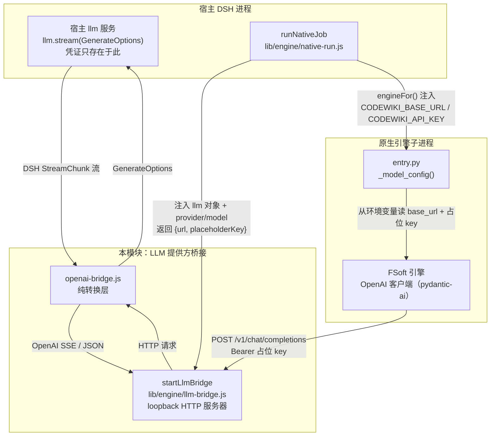
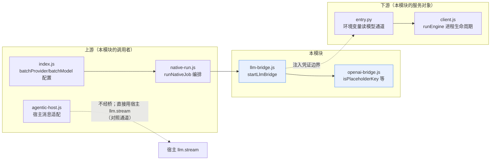
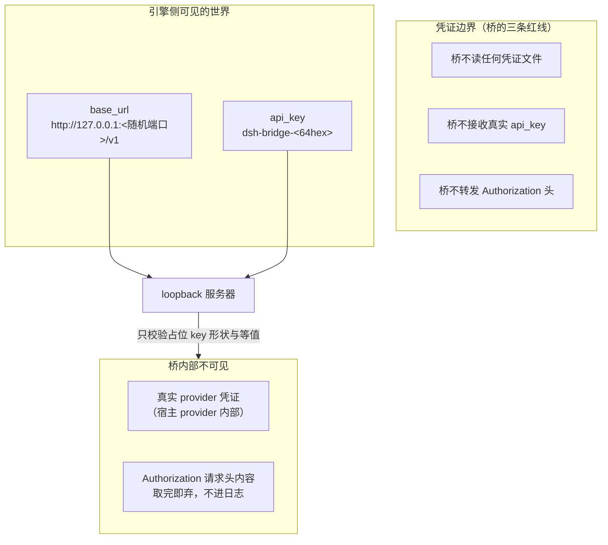
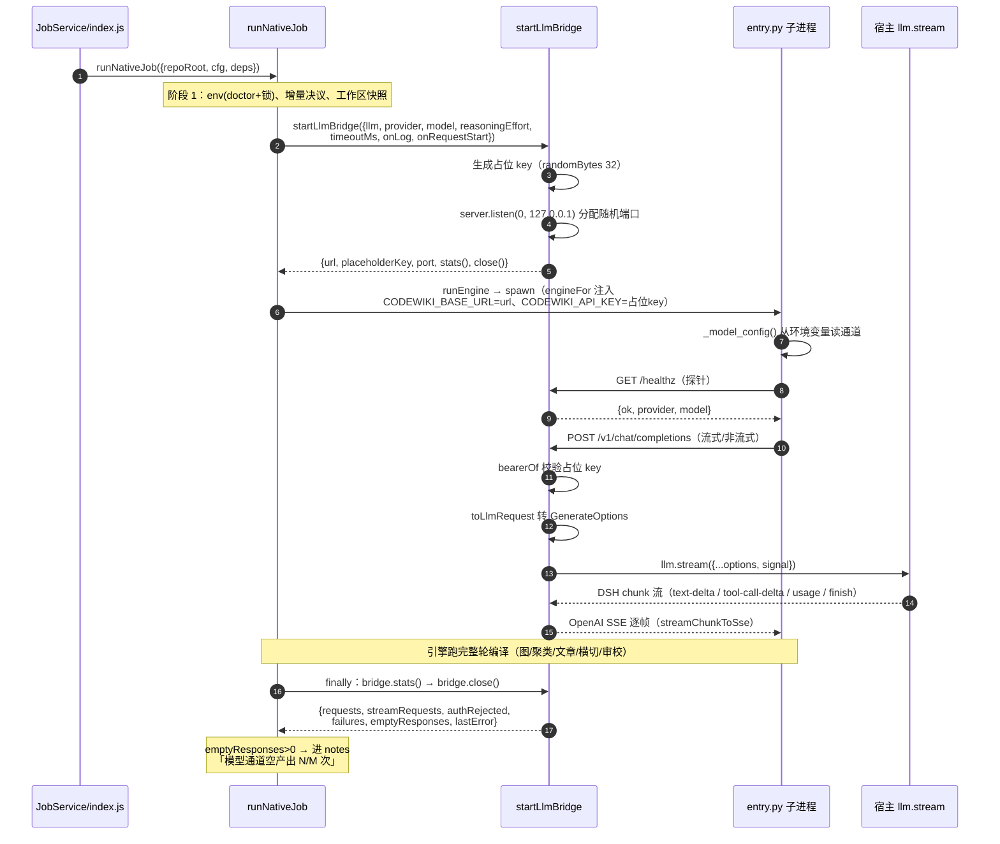
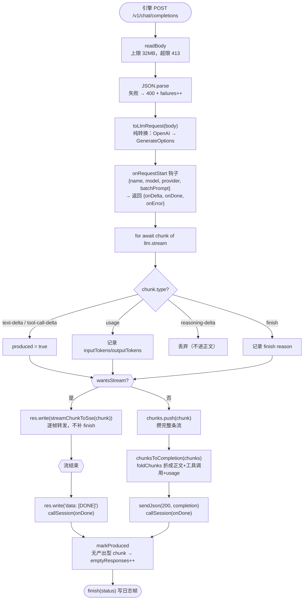
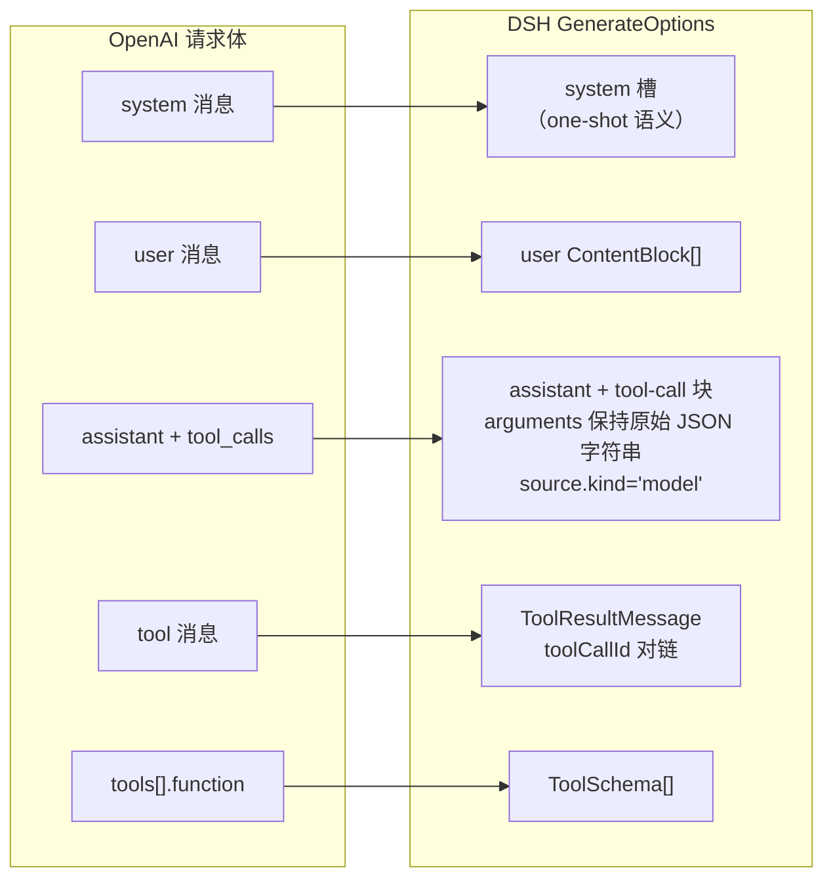
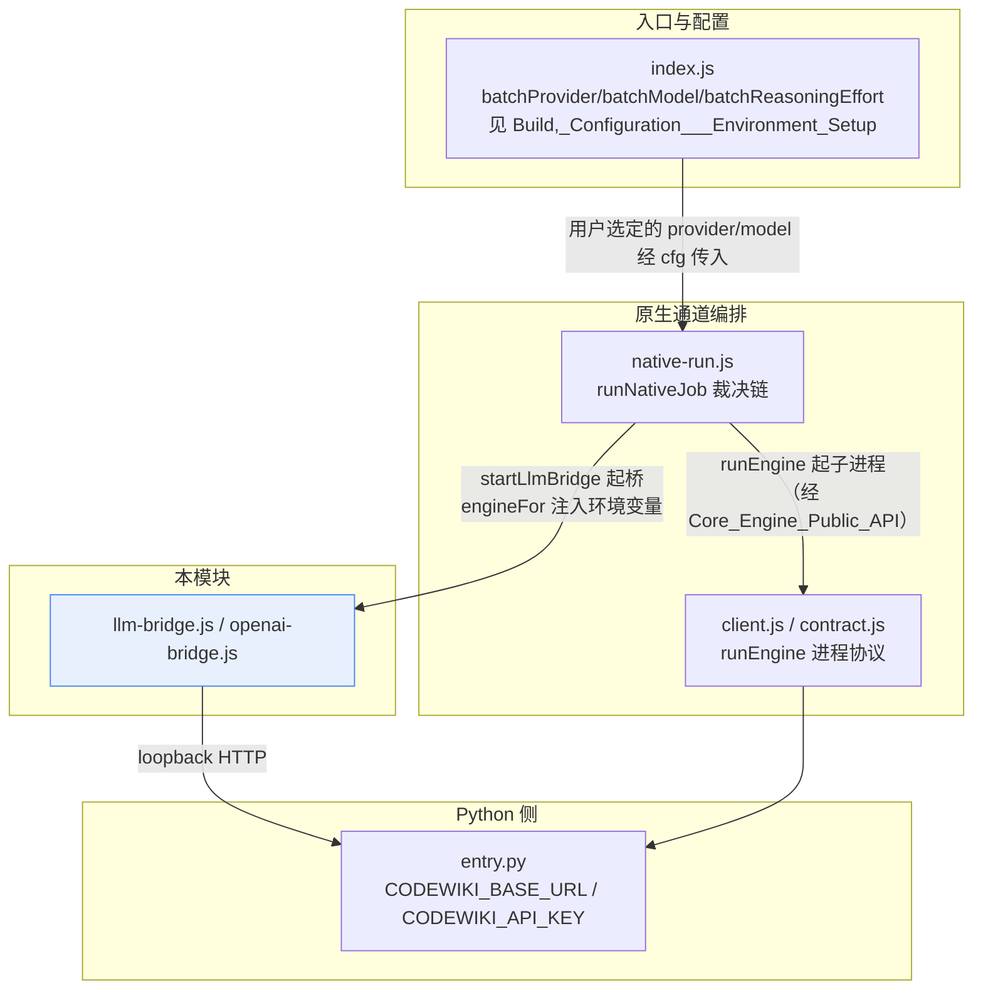

# LLM 提供方桥接集成（LLM Provider Bridge Integration）

## 引言

本模块是原生 CodeWiki 引擎（FSoft Python）与宿主模型提供方之间的**唯一模型通道**。它要解决的核心矛盾是：

- FSoft 原生引擎只认 OpenAI-compatible 的 `base_url` + `api_key` 配置；
- 宿主（DSH）的模型凭证保存在宿主 provider 配置里，插件**既不保存也不传递密钥**（0.10.1 起的硬约束）。

桥的解法是：在插件进程内起一个绑定 `127.0.0.1` 的 HTTP 端点，引擎拿着随机生成的**占位 key** 打过来，桥把 OpenAI-compatible 请求翻译成宿主的 `llm.stream(GenerateOptions)`（由宿主凭证去调真实 provider），再把 DSH chunk 流翻译回 OpenAI 响应。

模块由两个文件组成，职责严格分层：

| 文件 | 角色 | 对外组件 |
| --- | --- | --- |
| `lib/engine/llm-bridge.js` | 进程内 HTTP 服务器（I/O、鉴权、生命周期） | `startLlmBridge` |
| `lib/engine/openai-bridge.js` | 纯转换层（无 I/O、无网络、无密钥） | `isPlaceholderKey`、`toLlmRequest`、`chunksToCompletion`、`streamChunkToSse`、`PLACEHOLDER_KEY_PATTERN` |

调用方是原生编译编排层（[`Native_CodeWiki_Runtime_Lifecycle_Management`](native-codewiki-runtime-lifecycle-management.md) 的 `runNativeJob`），请求消费方是 Python 引擎入口（[`Python_Parallel_Agent_Execution_Runtime`](python-parallel-agent-execution-runtime.md) 的 `entry.py`）。

---

## 架构总览

### 模块上下文图



### 依赖关系



> 注意对照：[`Agentic_Article_Processing_Library`](agentic-article-processing-library.md)（Node 兼容通道的 agentic 写作）直接调宿主 `llm.stream`，**不经过本桥**。桥只服务于「子进程引擎必须用 OpenAI 客户端」这一条原生通道。

---

## 核心设计：凭证安全边界

这是整个模块「最不能破的一条」约束，也是理解所有路由设计的前提。



**为什么必须 loopback + 随机端口 + 占位 key 校验，三者缺一不可：**

- 绑定 `127.0.0.1` → 阻断外网访问；
- 随机端口 → 同机其它进程猜不到桥在哪；
- 占位 key 校验 → 挡住误连与端口扫描。

桥等于「用宿主凭证换任意模型调用」的开关，三者缺一都等于把宿主凭证开放给本机任意进程。具体实现：

- 占位 key 每次启动用 `randomBytes(32)` 随机生成，**不复用、不落盘、不进日志**；
- 所有 `/v1` 路径的请求先过 `bearerOf()` 取 token，同时校验形状（`PLACEHOLDER_KEY_PATTERN = /^dsh-bridge-[a-z0-9-]+$/`）与等值；
- 校验失败返回 401，错误体**不回显收到的 key**（避免把用户误配的真实 key 写进日志）；
- 结构化日志只记 `method / path / status / ms / chunk 计数 / usage`，绝不记 Authorization、请求体与正文（正文可能含源码与文章内容）。

---

## 运行时生命周期（与 `runNativeJob` 的接线）



生命周期要点（来自 `native-run.js` 的接线注释）：

1. **桥在 env 校验与增量决议之后才启动**——环境不一致时直接 failed，不跑引擎、不起桥；
2. **超时取 `min(引擎总超时, 10 分钟)`**——单次模型调用超时默认 10 分钟（`DEFAULT_TIMEOUT_MS`）；
3. **关闭顺序必须是「引擎退出后再关桥」**——先关桥会让还在读流的引擎拿到 502；
4. **`stats()` 必须在 `close()` 之前取走**——`emptyResponses` 是「上游 200 却什么也没产出」的唯一可量化源头；
5. 桥启动失败以 `engine-model` 错误码 failed，stage 记 `cluster`。

---

## 请求处理数据流（一次 chat/completions）



### 两条响应路径的语义分工

| | 非流式（`stream` 缺省/false） | 流式（`stream: true`） |
| --- | --- | --- |
| 转换函数 | `chunksToCompletion`（折整条已结束的流） | `streamChunkToSse`（逐帧中转） |
| 结束帧 | 一次性 JSON | `data: [DONE]\n\n` |
| `finish_reason` | 由折叠出的 `finish` chunk 决定 | 只在收到 `finish` chunk 的那一帧写 |
| 失败出口 | 502 + OpenAI 错误体 | SSE `error` 事件 + `[DONE]` |

> **为什么逐帧绝不补 `finish_reason`**：`chunksToSse` 类的「整条流」函数在缺 finish 时会自己补结束帧；逐帧转发时任何一个中间分片后面都还没有结束，替它补 `finish_reason` 会让 OpenAI 客户端（pydantic-ai）认为「这一轮到此为止」——工具调用还没发完就被截断，引擎报 `"Please return text or call a tool"` 并重试到上限。这是 `openai-bridge.js` 注释中钉死的一个实测事故。

---

## 纯转换层（openai-bridge.js）语义要点

本文件无 I/O、无网络、无密钥，是「最容易出错、可被 TDD 钉死」的部分。

### 请求方向：OpenAI body → GenerateOptions（`toLlmRequest`）



关键不变量：

- **assistant 历史消息必须带 `source.kind='model'`**（provider + model）——宿主 `LlmRuntime.forAdapter()` 会无条件读 `message.source.replayState`，缺 source 会抛 `Cannot read properties of undefined (reading 'replayState')`，整轮调用被判 error。桥没有 replay 能力，所以只填 provider/model，**不伪造 replayState**；
- **`tool_calls[].function.arguments` 保持原始 JSON 字符串**——DSH 的 `ToolCallBlock` 就是这么定义的，提前 parse 会破坏增量拼接；
- **assistant 带 tool_calls 时 content 可能为 null，但消息本身必须保留**（否则工具循环断链）；
- 返回值里**永远没有 apiKey 字段**。

### 响应方向：DSH chunk 流 → OpenAI

| DSH chunk | OpenAI 去向 | 处理 |
| --- | --- | --- |
| `text-delta` | `choices[0].delta.content` / `message.content` | 直接拼接 |
| `tool-call-delta` | `delta.tool_calls[index]` | 按 `index` 拼接 `argumentsDelta`；**只产出带 name 的调用**（无 name 的调用引擎无法执行） |
| `usage` | `usage` 字段（流式帧 `choices: []`） | `prompt_tokens = inputTokens + cacheRead + cacheWrite`（`inputTokens` 不含缓存，OpenAI 的 prompt_tokens 含缓存），缓存单列 `prompt_tokens_details.cached_tokens` |
| `finish` | `finish_reason` | `tool-calls→tool_calls`、`max-tokens→length`、`error/aborted→error`、其余→`stop` |
| `reasoning-delta` / `block-start` / `block-end` | **不映射任何帧** | 思考内容不该出现在文章正文，也不该伪造结束 |
| 纯工具调用响应 | `content: null` | OpenAI 语义（不是空串） |

### `isPlaceholderKey`

```javascript
PLACEHOLDER_KEY_PATTERN = /^dsh-bridge-[a-z0-9-]+$/
```

判断一个字符串是否为桥自己生成的占位 key。桥服务端的鉴权是「形状 + 等值」双检；该导出函数供外部（测试、排障脚本）识别占位 key 用。

---

## 可观测性与统计

桥维护一组进程内统计（`stats()` 返回快照），是排障「假 done」的关键证据：

| 统计字段 | 含义 | 异常形态 |
| --- | --- | --- |
| `requests` | chat/completions 总次数 | 与引擎预期调用数对不上 → 引擎没走桥 |
| `streamRequests` | 其中流式次数 | — |
| `authRejected` | 占位 key 校验失败次数 | >0 → 引擎拿到的 base_url/key 不对 |
| `failures` | 4xx/5xx/上游异常次数 | 与 `lastError` 一起看 |
| `emptyResponses` | 上游 200 但**没有任何产出型 chunk**（只有 reasoning/usage/finish）的次数 | 引擎会把这类调用记成「这一页无需改动」——「整轮 done 却一篇没写」的唯一量化源头 |
| `lastError` | 最近一次异常消息 | — |

每次请求结束还写一条结构化日志（经 `onLog` 回调，native-run 加上 `phase: 'bridge'`），字段含 `at / method / path / status / ms`，有产出时附 `chunks`（各 chunk 类型计数）与 `usage`。

**chunk 类型计数的存在意义**：它是判断「模型真的返回空」与「桥丢包」的唯一手段——没有它，一次空产出既可能是上游没给内容，也可能是桥没把 tool-call 转出去。

### 会话记录钩子（`onRequestStart`）

原生通道的模型请求只经过桥，因此面板「会话」视图靠这个钩子取数：

- 每个 chat 请求开始时调用一次，返回 `{onDelta, onDone, onError}` 句柄；
- 记录内容只含 `name`（`原生请求 · <model>`）、`model`、`provider`、`batchPrompt`（messages 拼成可读文本，超过 **200,000 字符显式截断并标注原长**）；
- **绝不**含 Authorization 与占位 key；
- 回调全程包在沙箱里：面板记账失败绝不影响正在跑的模型请求。

---

## 路由表（协议面）

只实现引擎真正用到的部分，不假装完整 OpenAI：

| 路由 | 方法 | 用途 | 是否校验占位 key |
| --- | --- | --- | --- |
| `/v1/chat/completions` | POST | 非流式与流式聊天补全 | 是（唯一准入闸门） |
| `/v1/models` | GET | 引擎/探针连通性检查，返回 `[{id: model, owned_by: provider}]` | 是 |
| `/healthz` | GET | 桥自身存活检查（返回 `{ok, provider, model}`，**不含任何模型目录信息**） | 否 |

未登记路由 → 404 `unsupported route`；请求体超限 → 413。

### 取消与超时语义

- **客户端断连**（`res.on('close')`）→ `AbortController.abort()` 中止上游调用：省 token，也让引擎的取消语义真正生效；
- **单次调用超时**（默认 10 分钟）→ 同一个 abort；
- 已开始的 SSE 流中途失败：发 `data: {error:...}` + `data: [DONE]` 终止（OpenAI 的做法），而不是硬断连接。

---

## 与系统其它模块的关系



- **上游编排**：[`Native_CodeWiki_Runtime_Lifecycle_Management`](native-codewiki-runtime-lifecycle-management.md)（`runNativeJob`）是唯一调用方，负责桥的启停时机、统计回收与终态合成；
- **进程协议**：[`Core_Engine_Public_API___Result_Validation`](core-engine-public-api-result-validation.md)（`runEngine`）只管子进程的 spawn/stdin-stdout JSON-lines，不碰模型通道；
- **引擎消费**：[`Python_Parallel_Agent_Execution_Runtime`](python-parallel-agent-execution-runtime.md) 的 `entry.py` 从进程环境变量 `CODEWIKI_BASE_URL` / `CODEWIKI_API_KEY` / `CODEWIKI_MAIN_MODEL` / `CODEWIKI_CLUSTER_MODEL` 读通道——**密钥只活在进程环境里**，entry.py 刻意绕开 FSoft 的 `ConfigManager`（后者会去读 `~/.codewiki/config.json` 或系统 keyring，正是凭证边界要防的）；
- **产物落地**：桥统计中的 `emptyResponses` 由 `runNativeJob` 转成 notes，终态裁决仍由质量门与落地器决定（见 [`Wiki_Content_Health_Scanning___Plan_Application`](wiki-content-health-scanning-plan-application.md)），桥证据**不参与裁决、只作可观测性**；
- **对照通道**：[`Agentic_Article_Processing_Library`](agentic-article-processing-library.md) 直接调宿主 `llm.stream`，不经桥——桥只服务「子进程必须说 OpenAI 协议」的原生通道。
