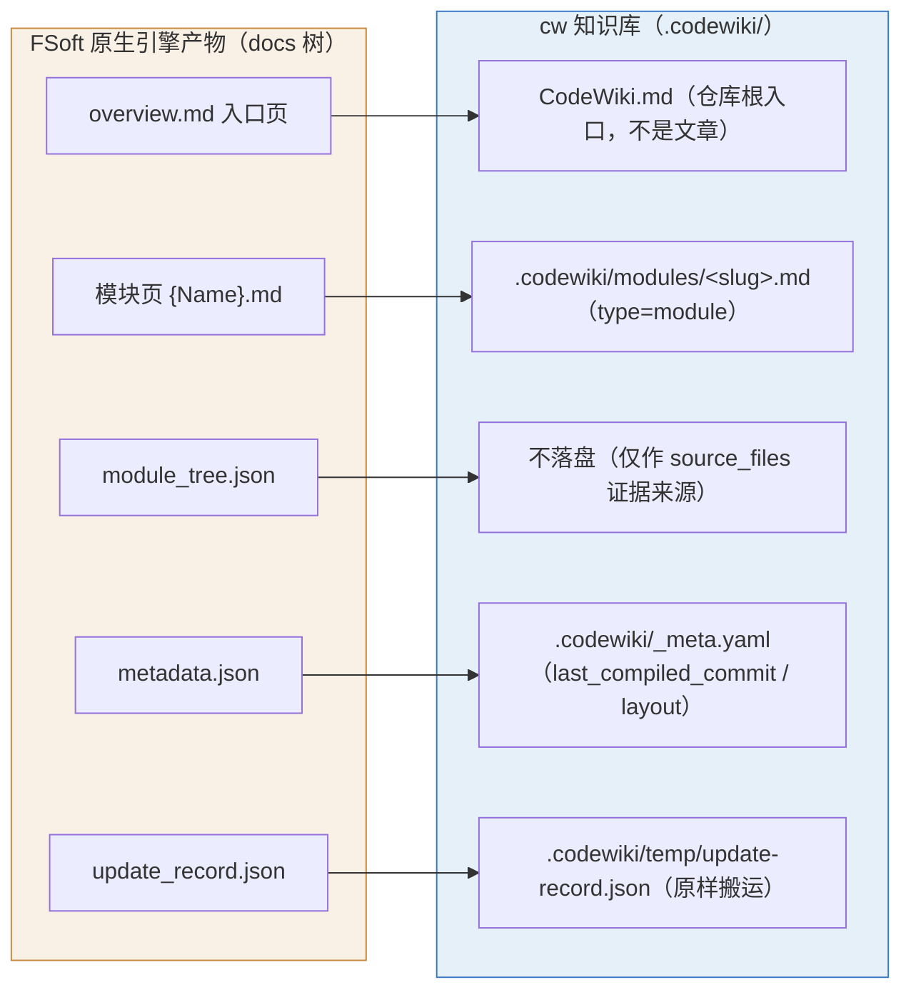
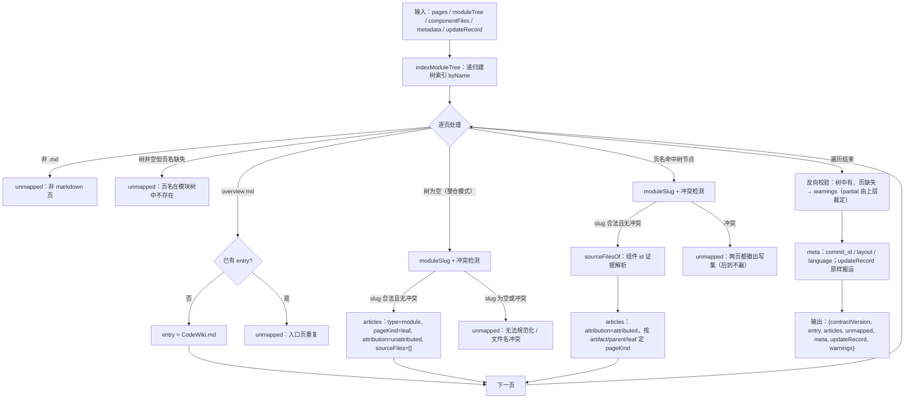
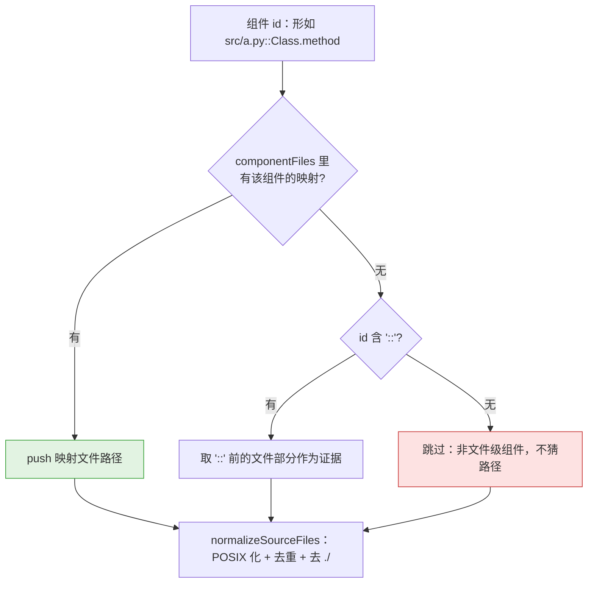
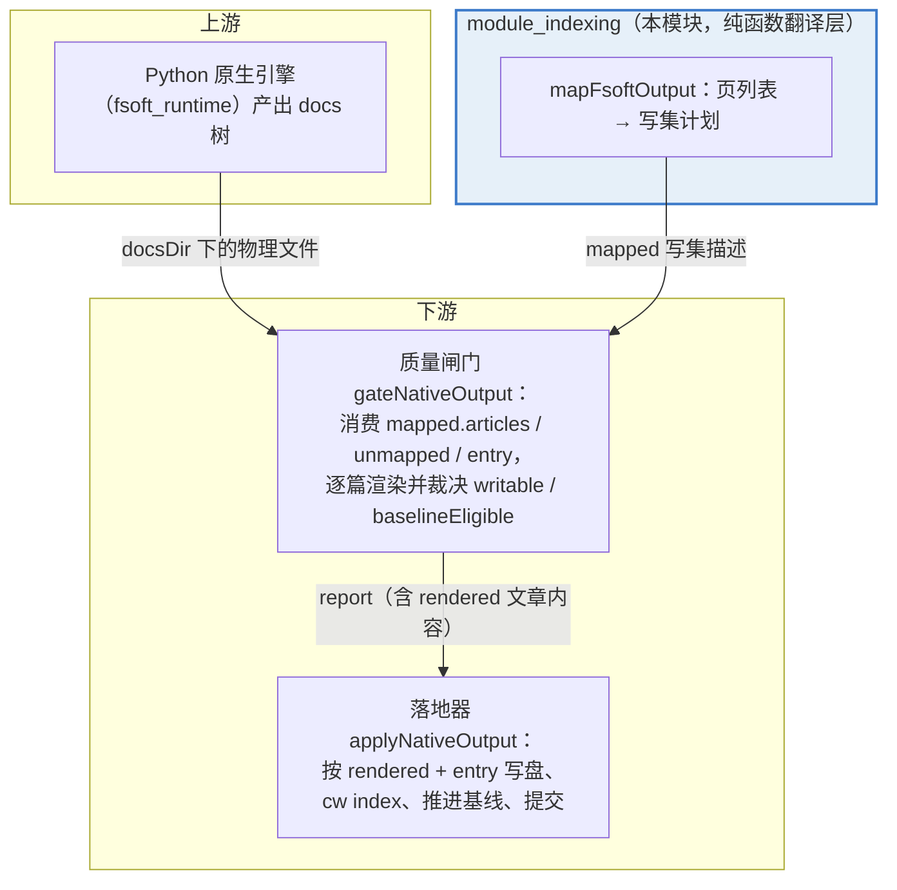

# 模块索引与产物映射（module_indexing）

## 简介

`module_indexing` 是原生引擎落地管线中的**阶段 0「格式翻译」层**，全部逻辑集中在 `lib/engine/mapping.js`。上游 FSoft 原生引擎（Python 子进程）产出的是一棵 docs 树（`overview.md` + 模块页 + `module_tree.json` + `metadata.json` + `update_record.json`），而 `cw` 知识库要求的是仓库内 `.codewiki/` 目录下的五类文章与顶层 `CodeWiki.md` 入口。两种产物模型并不相同，本模块就是两者之间**唯一**的翻译边界——它保持窄而纯：一个纯函数（`mapFsoftOutput` / `indexModuleTree` 等），不读写文件、不 spawn 进程，只把引擎产物描述成一份可 JSON 序列化的「写集计划」，交给下游门控与落地器执行。

其核心安全价值在于四条硬规则：**不臆造 `source_files`、不静默丢弃页面、不覆盖 slug 冲突页、不改技术正文**。这四条规则直接保护了增量编译的正确性——因为 0.14.0 起的质量闸门正是靠 `source_files` 判定增量归属，任何一处编造都会让未消化的代码变化被静默基线化。

## 核心组件

| 组件 | 位置 | 职责 |
| --- | --- | --- |
| `indexModuleTree` | `lib/engine/mapping.js` | 递归遍历 FSoft `module_tree.json`，建「模块名 → 树节点」索引 |
| `mapFsoftOutput` | `lib/engine/mapping.js` | 主入口：把引擎产出页列表映射为 cw 写集描述（纯函数） |
| `moduleSlug` | `lib/engine/mapping.js` | 模块名 → kebab-case 文件名（如 `Core Application` → `core-application`） |
| `sourceFilesOf` | `lib/engine/mapping.js` | 组件 id → `source_files` 的唯一证据解析（宁缺勿造） |
| `normalizeSourceFiles` | `lib/engine/mapping.js` | 路径 POSIX 化、去重、去 `./` 前缀 |

## 产物映射模型

下表即文件头注释定义的「唯一翻译表」，是理解本模块行为的钥匙：

关键映射规则：

- **入口页**：`overview.md` → 仓库根 `CodeWiki.md`，整次编译只允许一个；重复出现的同名页进 `unmapped`。
- **模块页**：`{Name}.md` → `.codewiki/modules/<slug>.md`，`type` 恒为 `module`，`pageKind` 按树节点性质分三种：
  - `artifact`：模块树显式标注 `artifact`，或名称匹配 `/^artifacts?$/i`（FSoft artifact 页不冒充业务模块）；
  - `parent`：该模块在树中有 children（父模块页）；
  - `leaf`：普通叶子模块页。
- **整仓模式特例**：whole-repository 模式下 `module_tree.json` 就是 `{}`（FSoft 侧原文 "stays {} in whole-repository mode"），而 agent 仍写了自己的页。此时页名不在树里**不等于孤儿页**——页是真产物必须进写集，但归属证据为零：`sourceFiles: []`、`attribution: 'unattributed'` 并附 warning。硬给 `source_files` 才是错的（会伪造增量 ownership）；丢掉页更错（wiki 少一篇没人知道）。

## 处理流程

## `source_files` 证据解析（安全核心）

`source_files` 是增量编译的归属依据，解析逻辑 `sourceFilesOf` 采用「宁缺勿造」的证据链：

对应 warning 语义：

- 模块有组件但全部拿不到文件证据 → `'组件的 source_files 无真实映射证据（未臆造，按空处理）'`；
- 模块压根没有组件 → `'模块无组件，source_files 为空'`。

## 冲突与丢弃策略

| 情形 | 处置 | 理由 |
| --- | --- | --- |
| overview 重复（两条路径同名 overview） | 后到者进 `unmapped` | 入口页只能一个 |
| slug 冲突（`A_B` 与 `A-B` 都 → `a-b`） | **两页都进 `unmapped`**，先到的也撤出写集 | 后到的赢 = 静默覆盖丢内容且无法回溯 |
| 页名不在模块树中（树非空） | 进 `unmapped`，附原因 | 无法确定归属与 `source_files` |
| 模块树有、引擎没产出页 | 不进 `unmapped`，只进全局 `warnings` | 只报事实，partial 与否由上层裁定 |
| 非 markdown 页 | 进 `unmapped` | 不属于文章 |

## 输出契约

`mapFsoftOutput` 返回的写集描述是可 JSON 序列化的，字段：

| 字段 | 说明 |
| --- | --- |
| `contractVersion` | 取自 [`engine_contracts`](engine-contracts.md) 的 `ENGINE_CONTRACT_VERSION`，供下游 `validateEngineResult` 校验 |
| `entry` | `{path: 'CodeWiki.md', source}` 或 `null` |
| `articles` | `[{source, wikiPath, type, pageKind, moduleName, sourceFiles, attribution, warnings}]` |
| `unmapped` | `[{source, reason}]`，机读原因，上层据此决定 partial |
| `meta` | `{lastCompiledCommit, layout, language}`（来自 `metadata.generation_info`） |
| `updateRecord` | `{path: '.codewiki/temp/update-record.json', outcome, pagesWritten, pagesRemoved, source: 'incremental'}` 或 `null` |
| `warnings` | 全局告警（模块树含某模块但未产出对应页等） |

## 在管线中的位置

要点：

1. **闸门是本模块的主要消费方**：`gateNativeOutput`（见 [`quality_gates`](quality-gates.md)）内部调用同一份映射逻辑，把 `unmapped` 升级为 defect（`unmapped-page`）、把空 `source_files` 升级为 degradation（`no-source-evidence`）——即本模块报出的「事实」会被闸门翻译成「裁决」。
2. **本模块不做写盘**：`entry` 的写入时机由落地器 [`plan_application`](plan-application.md) 控制（`entryMode: keep / skip / overwrite`），映射层只指出 `CodeWiki.md` 应来自哪个 `source`。
3. **契约版本对齐**：输出携带 `ENGINE_CONTRACT_VERSION`，与 [`engine_contracts`](engine-contracts.md) 的校验闭环配套——版本不符的写集会被直接拒绝。
4. **路径工具复用**：POSIX 化依赖 [State___Observability_Management/job_log_management](job-log-management.md) 中的 `toPosix`（`lib/git-paths.js`），保证跨平台（Windows `\` → `/`）路径一致。

## 设计不变量（迁移安全边界）

文件头注释明确列出四条硬规则，是本模块存在的全部理由：

1. **不臆造 `source_files`**——拿不到组件→文件证据就是空数组 + warning，绝不按目录名猜。0.14.0 的闸门靠它判增量归属，编造会让未消化的变化被静默基线化。
2. **不静默丢弃**——任何未映射页都进 `unmapped`，带机读原因。滑掉的页等于 wiki 少一篇而没人知道。
3. **不覆盖**——slug 冲突时两页都进 `unmapped`，不许后到的赢。
4. **不改技术内容**——只搬路径与类型，正文一字不动；规范化（链接重写）在引擎侧完成。

## 相关模块

- 上游：[`python_native_runtime`](python-native-runtime.md)（FSoft Python 引擎产出 docs 树）、[`engine_client`](engine-client.md)（`runEngine` 拉起原生运行时）
- 消费方：[`quality_gates`](quality-gates.md)（门控裁决）、[`plan_application`](plan-application.md)（落盘与基线推进）
- 契约：[`engine_contracts`](engine-contracts.md)（`ENGINE_CONTRACT_VERSION` 校验）
- 全局上下文：[Code_Engine_Processing_Pipeline](code-engine-processing-pipeline.md)、[code_engine_module](code-engine-module.md)
