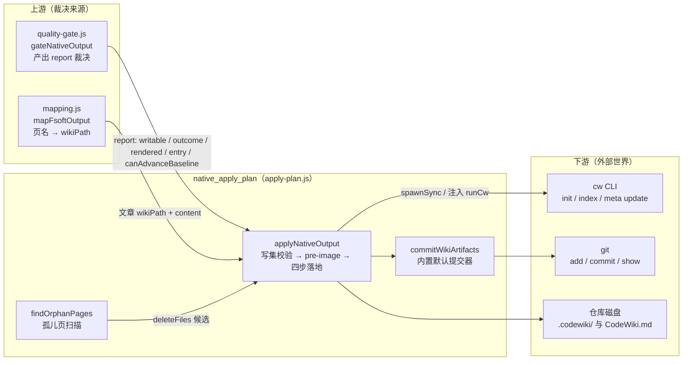
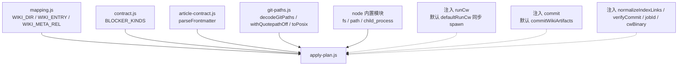
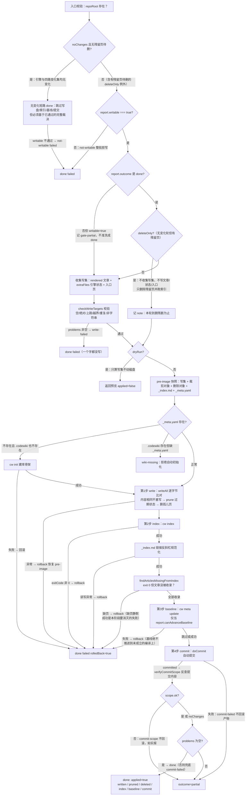
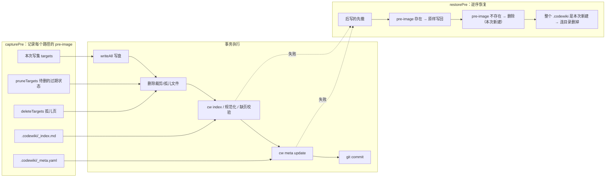
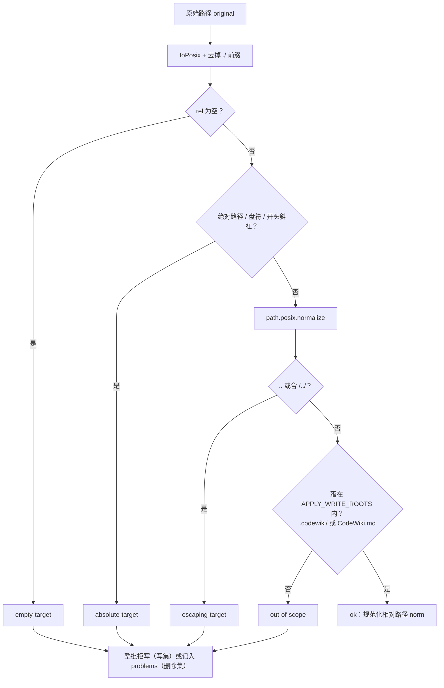
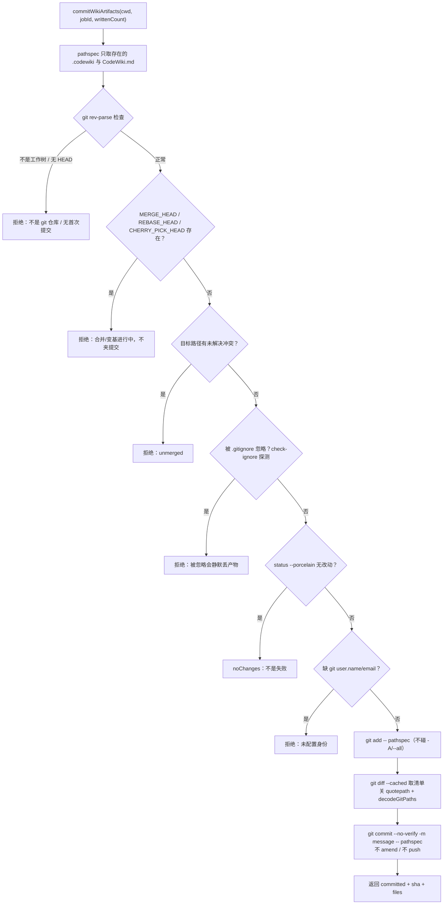

# native_apply_plan：原生编译产物落地器

## 简介

`native_apply_plan` 是 FSoft 原生引擎流水线中的**阶段 3：原生产物落地层**，唯一实现文件是 `lib/engine/apply-plan.js`。它的职责是把质量门给出的「采用裁决」（`gateNativeOutput` 的 report）真正写进仓库：按顺序完成 **写盘 → `cw index` → `cw meta update`（基线）→ 自动提交** 四步，并在每一步失败时按预定义的硬不变量回滚或如实报错。

它存在的根本原因（文件头注释明确说明）：**裁决说「这批页可以入库」，和「入库这件事真的成立了」是两回事**。中间四步各自都会失败——写盘（路径越界/权限/磁盘满）、`cw index`（索引建不起来就是坏库）、`cw meta update`（基线推进 = 宣布「这些变化已消化」）、自动提交（产物没入库别人拉不到）。0.14.0 的教训正是把「写成几篇」当成「成立」，于是「1 篇成功 + 19 篇失败」也报 done。本模块就是为了消灭这一类失败而单独拆出的一层。

核心导出：

| 导出 | 作用 |
| --- | --- |
| `applyNativeOutput` | 主入口：把一次采用裁决原子落地（写盘 → 索引 → 基线 → 提交，失败按不变量回滚） |
| `checkWriteTargets` | 写集校验纯函数（不碰磁盘）：空路径/绝对路径/`..` 上跳/白名单外/重复/非字符串 content |
| `checkDeleteTargets` | 删除集校验，与写集共用同一把路径判据 `checkTargetPath` |
| `verifyCommitScope` | 用 `git show --name-only` 反查实际提交内容，断言提交只动了 wiki 产物 |
| `commitWikiArtifacts` | 内置默认提交器：只把 `.codewiki/` 与根 `CodeWiki.md` 入库 |
| `findOrphanPages` | 扫描存量模块页，找出 `source_files` 全部已失效的孤儿页 |
| `toApplyBlockers` | 落地问题映射到契约 `BLOCKER_KINDS`（面板与终态判定共用词表） |
| `defaultRunCw` | 默认 cw 通道：同步 `spawnSync`，签名兼容阶段 4 注入的异步 `runCw` |

常量清单：`APPLY_VERSION = 1`、`APPLY_WRITE_ROOTS = ['.codewiki', 'CodeWiki.md']`、`APPLY_STAGES = ['write', 'index', 'baseline', 'commit']`、`APPLY_PROBLEM_KINDS`、`APPLY_RESULT_KINDS`。

---

## 在系统中的位置

本模块属于 [engine_runtime_orchestration](engine-runtime-orchestration.md) 子树，位于「质量门裁决之后、产物进仓库之前」的咽喉位置。上游是质量门与契约层，下游是 git 与 cw CLI 外部进程，阶段 4（插件主入口 `index.js`）通过依赖注入接管它的通道。

## 架构：三条硬不变量

本模块唯一的验收标准是文件头声明的三条硬不变量：

1. **写集封闭**：只允许写 `.codewiki/` 子树与仓库根 `CodeWiki.md`。绝对路径、盘符、`..` 上跳、白名单外路径一律**整批拒写**（不是跳过该条——写集不完整时部分写入等于制造一份没人在意的半成品）。
2. **索引/基线失败即回滚**：文章写盘之后 `cw index` 或 `cw meta update` 失败，磁盘必须回到应用前（旧文章写回、新建文件删掉、`_index.md` 与 `_meta.yaml` 恢复 pre-image）。否则库里留下「文章在、索引没有」或「文章在、基线已推进」的脏结构，下次编译会在脏库上误判「已消化」，而脏库永远不会自愈。
3. **提交失败不回滚**：自动提交失败时文章本身是好的、有用的（与索引/基线不同——那两步失败说明这批产物还没被库接受）。所以只记 `commit-failed` 阻塞并如实返回，绝不因为提交失败把有价值的文章删掉。

## 依赖关系

本模块**刻意不 import `index.js`**（插件主入口）：加载它会连带拉起宿主服务与 webServer，单测就成了「为了测一个写盘函数启动整个插件」。因此 `runCw` / `commit` / `normalizeIndexLinks` 全部可由调用方注入；但「可注入」不等于「默认什么都不做」——默认必须自带同语义的提交器，否则阶段 3 自己跑起来产物只落盘不入库、报告却仍显 done，正是「自动提交失败被改写成成功」的前身。

跨模块引用：

- 裁决输入契约来自 [result_contract_and_quality_gates](result-contract-and-quality-gates.md)（`contract.js` 的 `BLOCKER_KINDS`、`quality-gate.js` 的 report 结构）。
- 路径常量 `WIKI_DIR / WIKI_ENTRY / WIKI_META_REL` 来自 [workspace_state_and_integrity](workspace-state-and-integrity.md) 的 `mapping.js`。
- `decodeGitPaths / withQuotepathOff / toPosix` 来自 [job_repository_infrastructure](job-repository-infrastructure.md) 的 `lib/git-paths.js`（中文页名必须先关 quotepath 再解码，否则真实中文仓库会被误判「混进 wiki 之外的路径」）。
- 引擎进程编排的上游上下文见 [engine_client](engine-client.md) 与 [native_process_runtime](native-process-runtime.md)。

## 核心流程：applyNativeOutput 的四步事务

主入口 `applyNativeOutput({ repoRoot, report, docsDir, wikiPath, advanceBaseline, entryMode, dryRun, noChanges, extraFiles, pruneRoots, deleteFiles, beforeCommit, deps })` 的执行序列如下：

### 关键步骤说明

**写盘（write）**：`writeAll` 逐字节比对磁盘内容——相同的项跳过重写，避免「产物无改动」的空写产生 mtime 抖动和假提交。写盘之后紧接着做两件删除，同属一个事务：
- `collectPruneTargets`：裁剪 `pruneRoots`（受管状态目录，如模块树/依赖图）里「本轮写集没有」的过期文件。受管状态是**下一轮引擎的输入**，留着旧文件会让下一轮水合把已删的页复活。
- 删除 `deleteFiles`（孤儿页候选）：与裁剪共用 pre-image 与回滚语义。
- **`deleteOnly` 例外轮**：`noChanges` 且 `deleteFiles` 非空时，跳过整个写集收集（不写文章、不写 `extraFiles` 引擎状态、不写入口页、不跑 `checkWriteTargets`），只保留「删除残留页 → `cw index` → 自动提交」；基线不推进。动机：源码没有变化不等于库里没有残骸，而残骸只有落地器能删（要能回滚、要与索引同事务、要进同一个 commit）——真机五仓验证里四个仓库全是 no_change 轮、残留页一个都没清掉，正是因为旧实现无条件短路。

**索引（index）**：除了跑 `cw index`，还有两道防「假成功」的附加校验：
- `normalizeIndexLinksIn`：把 `_index.md` 里 `[[link|title]]` 链接头的 `\` 规范成 `/`（Windows 上 cw 会写出反斜杠链接，不规范化等于索引不可信）；读写异常直接抛、按索引失败回滚。
- `findArticlesMissingFromIndex`：vendor/codewiki 的 `cw index` 对 frontmatter 解析失败的文章是**静默跳过、退出码仍为 0**。本步骤比对「本次写的文章是否真的进了索引链接集」，缺页即整体回滚——这正是「缺页静默成功」的对策。

**基线（baseline）**：`cw meta update` 只在 `report.canAdvanceBaseline === true`（或被 `advanceBaseline` 覆盖）时执行。失败连文章一起回滚：留下「文章比基线新」的状态会导致下一轮把同一批变化重复消化一次。**`deleteOnly` 例外轮（无源码变化、只删残留页）一律不推进基线**：删残骸不涉及任何源码变化，推进基线等于凭空记一笔「这些变化已消化」，而它们本来就没有待消化的变化，记 `reason: 'no-changes'`。

**提交（commit）**：失败**不回滚**（不变量 3）。提交成立后用 `verifyCommitScope` 反查实际提交内容；混进 wiki 之外的路径只报 `commit-scope` 阻塞、不回滚。终态兜底：只要没提交成功（且不是无改动可提交），绝不允许干净的 `done`。

## 回滚与 pre-image 事务模型

回滚对象不只是「本次写的文件」：`cw index` 会重写 `_index.md`、`cw meta update` 会重写 `_meta.yaml`，这两份也是要恢复的（它们才是「库是否干净」的判据）；裁剪与孤儿删除同样纳入 pre-image，否则一次失败的落地会「删掉了页、索引仍指着它」。

## 写集安全：写与删共用一把尺子

`checkTargetPath(original, { scopeLabel })` 是写集与删除集**共用**的唯一判据。原本两侧各抄了四段同形 `if`（空 / 绝对 / `..` 上跳 / 白名单），收口成一个纯函数是为了避免**不对称**——某一侧补了判据另一侧没补，会演化出「写不许越界但删可以越界」这类肉眼看不出来的缺陷。删错比写错更不可逆。

删除集额外有两条语义约束：删除目标不许是目录（必须显式列出文件，否则回滚粒度丢失）；不存在的目标幂等跳过。裁剪根（`collectPruneTargets`）也必须落在白名单内，否则直接跳过——安全边界不允许裁到用户源码。

## 提交器：内置默认与阶段 4 注入的对齐

`commitWikiArtifacts` 是阶段 3 自带的小提交器，安全边界逐条**照抄** `index.js` 的 `autoCommitWiki`，一条都不放宽——因为阶段 4 会用注入的 `commit` 替换它，两边判据必须能对齐，否则「阶段 3 能提交、阶段 4 不能」会变成没人能解释的行为差异：

## 问题词表与终态语义

落地结果的问题类别（`APPLY_RESULT_KINDS`）经 `toApplyBlockers` 映射到契约的 `BLOCKER_KINDS`，面板与终态判定共用一套词表，写错的 kind 会让两边同时失明（函数内有枚举校验兜底抛错）：

| 落地问题 kind | 契约 kind | 语义 |
| --- | --- | --- |
| `write-failed` | `quality-gate` | 写盘异常或写集校验不过（含写集原子类别前缀） |
| `index-failed` | `index-failed` | `cw index` 失败 / 链接规范化失败 / 索引缺页 |
| `baseline-failed` | `baseline-failed` | `cw meta update` 失败 |
| `commit-failed` | `commit-failed` | 自动提交未成立（不回滚产物） |
| `commit-scope` | `commit-failed` | 提交成立但混进 wiki 之外的路径 |
| `not-writable` | `quality-gate` | 裁决本身不允许入库（writable=false） |
| `wiki-missing` | `index-failed` | `.codewiki` 骨架缺失且无法自动初始化 |
| `gate-partial` | `quality-gate` | 裁决是 partial 但 writable=true：照写，但终态不许洗成 done、基线不推进 |

`ApplyResult` 的终态规则：`outcome` 取 `done | partial | failed`；`done` 绝不允许带 blockers（有问题一律降为 `partial`）；`applied=true` 且 `baseline.advanced=true` 时 `canAdvanceBaseline=true`。未提交（且非 noChanges）时由兜底逻辑强行补一条 `commit-failed`——**产物没入库就是没交付**。

## 设计要点速查

- **dryRun**：只算写集与判定，不写盘、不跑 cw、不提交；返回里 `applied=false` 且带 `dryRun=true`，调用方必须把预览和完成分开看。
- **noChanges 短路**：引擎与四路变化集均无变化时，跳过写盘/索引/基线/提交，但必须基于已通过的完整裁决，否则报 failed。**唯一例外是 `deleteOnly`**：`noChanges` 但 `deleteFiles` 非空（有残留页待删）时不短路——不写文章、不写受管状态、不推进基线，但照常删残留页、跑 `cw index` 并随自动提交入库（`baseline.reason = 'no-changes'`）。
- **entryMode**：仓库根已有 `CodeWiki.md` 时 `keep`（默认，保留人工入口）/ `skip`（不写）/ `overwrite`。入口页必须存在（overview），拒绝生成只有文章的 wiki；入口正文会剥掉 frontmatter。
- **extraFiles**：引擎原始状态（模块树/元数据/依赖图/增量凭据）与文章共用同一份 pre-image、同一次回滚、同一个自动提交——这就是「原始图/模块树/metadata 与文章同事务」的实现方式。
- **findOrphanPages**：判据刻意保守——`source_files` 为空（whole-repository 模式无归属证据）跳过；只要还有一个文件存在就不是孤儿；frontmatter 缺失/坏掉的页不动（可能是人工页）。宁可漏删不可误删。
