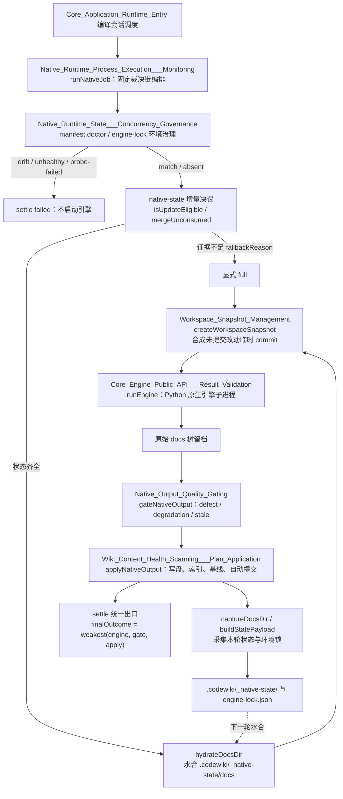

# 原生 CodeWiki 运行时生命周期管理

## 模块定位

本模块负责 CodeWiki **原生引擎通道**的完整运行时生命周期：从环境校验、增量决议、工作区快照、原生 Python 引擎执行、质量门裁决，到状态采集、原子落地与最终终态合成。

它的核心目标是避免两类历史缺陷：

- **假装成功**：引擎报告完成，但产物未入库、基线错误前移或状态被污染；
- **悄悄退化**：环境漂移、缺少增量凭据或未提交改动丢失时，系统静默退化成全量或重复编译。

因此本模块的治理原则是：**只读诊断、证据驱动、同事务落地、最弱一环裁决终态**。

## 架构总览

## 核心职责

| 职责 | 说明 |
|---|---|
| 环境治理 | 校验引擎版本、Python 版本、上游 commit 与依赖闭合；漂移或不健康时直接失败，不运行引擎。 |
| 增量治理 | 持久化模块树、依赖图、metadata 与上一轮文章；凭据齐全才允许组件级增量，否则显式全量并记录 `fallbackReason`。 |
| 工作区对账 | 将未提交改动合成临时 git commit，作为本轮 `consumedCommit`，避免“文章反映工作区、账本指向 HEAD”的脱节。 |
| 进程编排 | 固定编译裁决链，统一处理取消、超时、静默卡死与进程树终止。 |
| 质量门裁决 | 将产物问题分为 defect、degradation、stale；只有三类皆空时才允许推进基线。 |
| 同事务落地 | 文章、受管状态与环境锁共享同一 pre-image；索引或基线失败时一起回滚，成功时一起提交。 |

## 核心组件文档

- [原生运行时状态与并发治理](native-runtime-state-concurrency-governance.md)  
  环境锁、跨轮受管状态、增量资格判定、未消化改动携带与事务一致性治理。

- [原生运行时进程执行与监控](native-runtime-process-execution-monitoring.md)  
  `runNativeJob` 裁决链编排、终态合成、取消语义与跨平台进程树终止。

- [原生产物质量门](native-output-quality-gating.md)  
  `gateNativeOutput` 采用裁决、基线许可、defect / degradation / stale 分类与渲染契约。

- [工作区快照管理](workspace-snapshot-management.md)  
  用隔离 index 合成不挂 ref 的临时 commit，为脏工作区提供可追溯的内容对账基线。