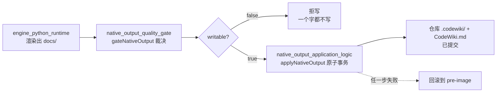
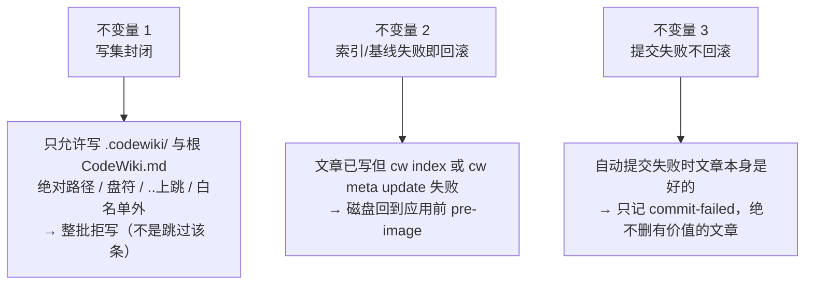
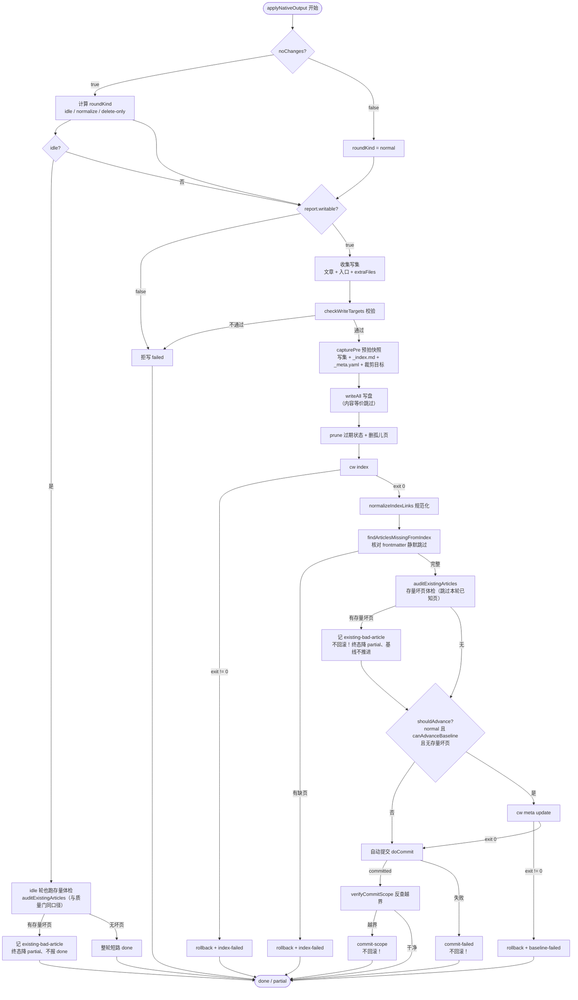
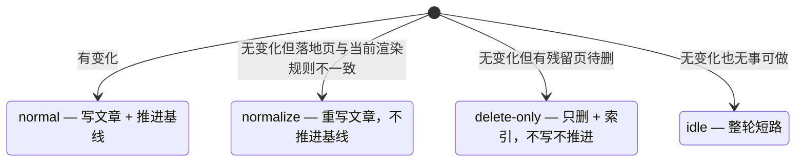
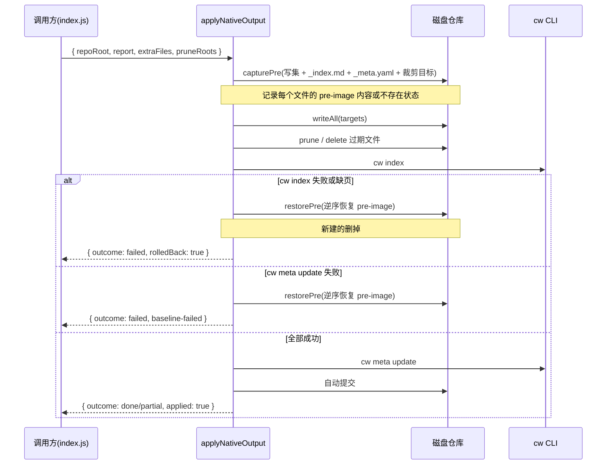
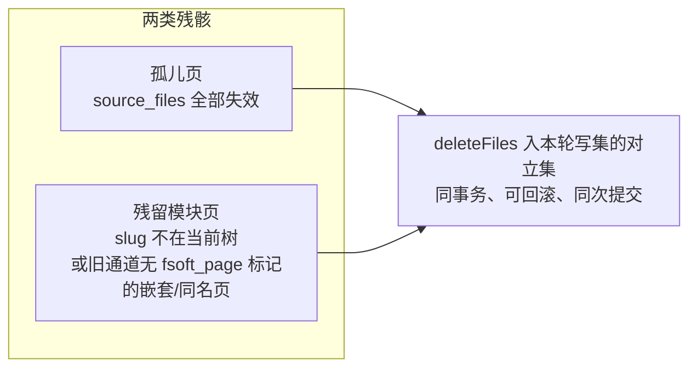
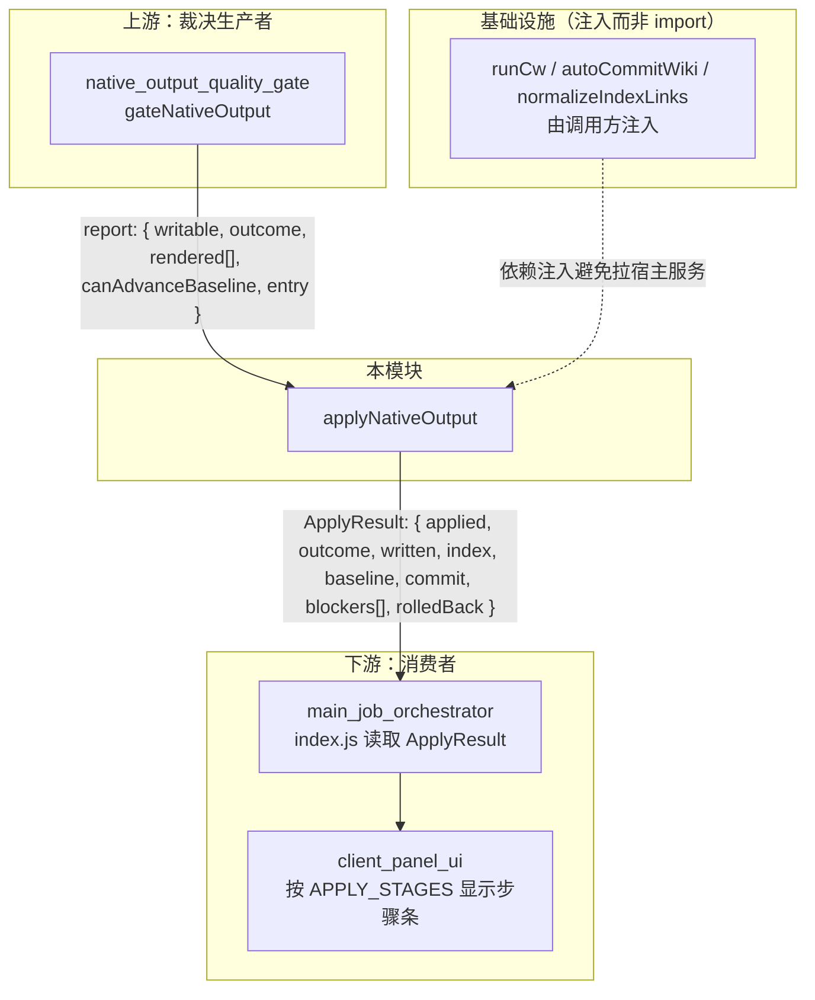

# 原生产物落地器（native_output_application_logic）

## 简介

`native_output_application_logic` 是 CodeWiki 编译管线中**把"采用裁决"真正变成"入库事实"**的阶段（阶段 3）。它位于质量门给出裁决之后、产物真正写进仓库之前，负责执行一条原子事务流水线：

**写盘 → `cw index` → `cw meta update`（基线推进）→ 自动 git 提交**

它存在的根本原因是：「质量门说这批页可以入库」和「入库这件事真的成立了」是两回事——中间四步各自可能失败（写盘越权、索引建不起来、基线记账错误、自动提交被 git 拒绝）。本模块的核心价值就是把这些失败全部显式化，并保证磁盘状态要么完整到位、要么回到应用前的样子。

核心入口：[`lib/engine/apply-plan.js`](../lib/engine/apply-plan.js)



---

## 三条硬不变量

这是本模块唯一的验收标准，所有设计都围绕它们展开：



### 不变量 1：写集封闭

渲染结果里的路径由引擎的 page 名映射而来，直接信它等于把「引擎能写仓库任意文件」写进契约。`checkTargetPath` 与 `checkWriteTargets` 是**纯函数**（不碰磁盘），把以下情况判成问题并整批拒写：

| 问题类别 | 含义 |
| --- | --- |
| `empty-target` | 渲染结果里出现空路径 |
| `absolute-target` | 绝对路径 / Windows 盘符 |
| `escaping-target` | `..` 上跳逃出白名单 |
| `out-of-scope` | 不在 `.codewiki/` 或根 `CodeWiki.md` 下 |
| `duplicate-target` | 同一路径写两次且内容不同 |
| `bad-content` | content 不是字符串 |

**为什么整批拒写而不是跳过坏路径**：一份残缺的写集落盘后，调用方拿到的报告会显得「大部分成功」，而缺的那几篇没人知道缺——这比整批拒写危险得多。

### 不变量 2：索引 / 基线失败即回滚

文章写盘之后若 `cw index` 或 `cw meta update` 失败，磁盘必须回到应用前的样子（旧文章内容原样写回、新建的文件删掉、`_index.md` 与 `_meta.yaml` 恢复 pre-image）。否则库里留下「文章在、索引没有」或「文章在、基线已推进」的脏结构，下次编译会在脏库上判「已消化」，而脏库永远不会自愈。

### 不变量 3：提交失败不回滚

自动提交是「产物入库」的最后一步。它失败时，文章本身是好的、有用的（与索引 / 基线相反——那两步失败说明这批产物还没被库接受）。所以只记 `commit-failed` 阻塞并如实返回，绝不因为提交失败把有价值的文章删掉。

---

## 核心组件

| 组件 | 位置 | 职责 |
| --- | --- | --- |
| `applyNativeOutput` | `apply-plan.js` | 阶段 3 主入口：完整执行四步事务流水线 |
| `defaultRunCw` | `apply-plan.js` | 默认 `cw` CLI 通道（同步 spawn 包装成统一接口） |
| `findOrphanPages` | `apply-plan.js` | 扫描孤儿页：`source_files` 全部失效的存量模块页 |
| `findStaleModulePages` | `apply-plan.js` | 扫描聚类重构残骸：slug 已不在当前模块树的引擎产出页；并回收无 `fsoft_page` 标记的旧通道（0.16.0 之前）模块页，结果项带 `legacy` 标记 |
| `auditExistingArticles` | `apply-plan.js` | 存量体检：扫 `.codewiki/` 下非 `_` 前缀的存量文章，error 级坏页记 `existing-bad-article`（不回滚、挡基线） |
| `checkWriteTargets` | `apply-plan.js` | 写集白名单校验（纯函数） |
| `checkDeleteTargets` | `apply-plan.js` | 删除集白名单校验（与写集共用 `checkTargetPath` 同一把尺子） |
| `commitWikiArtifacts` | `apply-plan.js` | 内置默认提交器：只 add wiki 两个路径，安全边界逐条对齐宿主 |
| `verifyCommitScope` | `apply-plan.js` | 用 `git show --name-only` 反查提交实际内容是否越界 |
| `toApplyBlockers` | `apply-plan.js` | 落地问题 → 契约 `BLOCKER_KINDS` 映射 |

### 导出的常量

```javascript
APPLY_VERSION       // 1
APPLY_WRITE_ROOTS   // ['.codewiki', 'CodeWiki.md']
APPLY_STAGES        // ['write', 'index', 'baseline', 'commit']
APPLY_PROBLEM_KINDS // 写集校验机读类别
APPLY_RESULT_KINDS  // 'write-failed' | 'index-failed' | 'baseline-failed'
                    // | 'commit-failed' | 'commit-scope' | 'not-writable'
                    // | 'wiki-missing' | 'gate-partial' | 'existing-bad-article'
```

---

## 四阶段落地流程



### 阶段分解

| 阶段 | 动作 | 失败行为 |
| --- | --- | --- |
| `write` | 写所有 `targets`，内容等价（行尾归一）的文件跳过重写 | 失败 → 回滚 pre-image |
| `index` | 跑 `cw index`，规范化 `_index.md` 链接分隔符，核对本轮写集全部被收录，并体检存量坏页 | 写集缺页 → 回滚 pre-image；存量坏页 → 不回滚，只记 `existing-bad-article` 挡基线（idle 短路轮同样跑此体检） |
| `baseline` | 跑 `cw meta update` 推进基线 | 失败 → 回滚 pre-image |
| `commit` | 用内置或注入的提交器提交 wiki 产物 | 失败 → **不回滚**，只记 `commit-failed` |

---

## 四种轮次（roundKind）

引擎报 `no_change` 时落地器不能直接整轮短路——源码没有变化不等于库里没有残骸。`applyNativeOutput` 用一个四值枚举统一处理：



| roundKind | 写文章？ | 推进基线？ | 备注 |
| --- | --- | --- | --- |
| `normal` | ✅ 只写 `defects === 0` 的页 | ✅ 若 `report.canAdvanceBaseline` | 有变化的正常轮 |
| `normalize` | ✅ **全写**（含缺陷页） | ❌ | 渲染规则改进后让库与规则对齐 |
| `delete-only` | ❌ | ❌ | 只清理源码已删的残骸页 |
| `idle` | ❌ | ❌ | 整轮短路 done；dryRun 下预览不落盘，`applied=false`（「无需动作」≠「已交付」）。短路前仍跑同一体检：库里有存量坏页则记 `existing-bad-article`、终态降 partial，杜绝「门说 0 缺陷、终态报 done、库里躺着坏文章」的假绿 |

> 为什么 `normalize` 轮要连缺陷页一起写：这一轮的职责是让库与当前渲染规则对齐，坏页同样是旧规则的产物，留在库里只会继续错下去（缺陷本身仍由门如实上报）。

---

## 回滚机制（pre-image 事务）



回滚的关键设计：

1. **逆序恢复**：后写的先撤，语义上更接近「撤销这次事务」。
2. **pre-image 不存在 = 本次新建**：回滚时删掉该文件。
3. **`.codewiki/` 若本轮才新建**：回滚时连目录一起删掉，避免留下空壳。
4. **裁剪与删除同入 pre-image**：被 prune 掉的过期状态文件、被删的孤儿页都可被回滚恢复，避免「索引失败回滚」只恢复文章不恢复被删状态。
5. **非法裁剪根必须进终态**：`collectPruneTargets` 对不合法的裁剪根（越界 / 规范化后为空）不再静默跳过——拒绝必须以 `write-failed`（`[prune-<kind>]`）记进 problems、降终态，否则「该裁的目录没裁」与「裁了但没报」长得一样，调用方对世界的认知错误会被掩盖。

---

## 孤儿页与残留模块页扫描

这两个函数是本模块相对其他阶段最独特的能力——**删除**而不只是写入。

### `findOrphanPages`

判据：`.codewiki/modules/` 下的页，frontmatter 里 `source_files` 非空、且**每一个**在仓库里都已不存在 → 这是源码被删干净的残骸页。

刻意保守：
- `source_files` 为空 = 没有归属证据（不是孤儿证据）→ 跳过；
- 只要还有一个文件存在 → 不是孤儿（部分失效由 gate 报）；
- frontmatter 缺失 / 坏掉的页不动（可能是人工写的页，删了找不回来）。

### `findStaleModulePages`

分两类残骸，结果项统一带 `legacy` 标记（旧通道页为 `true`，原生产出页为 `false`）：

1. **本引擎产出页**（frontmatter 有 `fsoft_page` 字段）：页名 slug **不在当前 module_tree 的任一模块**里 → 聚类重构后被改名 / 合并的旧模块页。
2. **0.16.0 之前 Node 通道生成的旧页**（无 `fsoft_page` 标记）：命中两条可证特征之一——① `title` 恒等于自己的文件名 slug（旧通道 frontmatter 模板是 `title: <模块名>`）；② 落在 `modules/` 的子目录里（原生通道的模块页永远 flat，映射只产出 `modules/<slug>.md`）——再叠加两道闸（`type: module`、`source_files` 非空）才当成旧页回收。

它解决 `findOrphanPages` 覆盖不到的情况：聚类重构让模块改名后，旧页的 `source_files` 指向的文件**全都还在**，只是不再归属任何模块。

两条刻意的保守修正：

- **嵌套页不靠 slug 豁免**：原生页永远是 flat，落在子目录里只可能来自旧通道；旧树按子模块命名目录，重构后那篇页的 basename 很可能与新模块的 slug 撞上（真机上就这么漏掉过一篇）。所以嵌套页即使 slug 对得上当前树也不豁免。
- **没有 `fsoft_page` 不等于人工页**：旧通道页就是没有这个标记。但「没有标记就一律不动」对人工页的保护不能丢——两道闸（`type=module`、`source_files` 非空）就是对人的让步：宁可漏掉一篇写得像旧页的人工页，也不凭页名删人写的内容。旧页若把 title 写成「apply_plan（阶段 3 落地器）」这种描述性标题，① 抓不到、但②（嵌套位置）兜底，于是一篇 739 行的过期页不会在 1335 行的源码旁边永远留着。



---

## 与上游 / 下游的契约关系



### 依赖注入设计（不 import index.js）

本模块刻意不 import 插件主入口 `index.js`（那里会拉起宿主服务与 webServer，单测里就成了「为了测一个写盘函数启动整个插件」）。所有外部能力都通过 `deps` 注入：

```javascript
deps = {
  runCw,             // 阶段 4 注入 index.js 的异步 runCw；默认 defaultRunCw 同步 spawn
  commit,            // 阶段 4 注入分支合并式 autoCommitWiki；默认内置 commitWikiArtifacts
  verifyCommit,      // 默认 verifyCommitScope
  normalizeIndexLinks,
  cwBinary,          // 默认 process.env.DSH_CODEWIKI_CW ?? 'cw'
  jobId,
}
```

**注入的 `runCw` 刻意不接取消 signal**：原生通道（阶段 4）由 `index.js` 注入时**故意不传** `nativeAborters` 的 AbortController——落地事务（写盘→index→基线→提交）一旦开始就必须跑完，取消只终止引擎阶段。曾传了 signal，取消会 kill 掉正在跑的 `cw meta update` 触发回滚，把「已落盘的文章」连同基线一起撤掉而终态只报「已取消」。事务自身有 120s 超时兜底。

「可注入」不等于「默认什么都不做」——默认提交器 `commitWikiArtifacts` 的安全边界逐条对齐宿主版（只 add wiki 两个路径 / 不 amend 不 push / 合并冲突与无 HEAD 一律拒绝 / 检查 `.gitignore`）。否则阶段 3 自己跑起来产物只落盘不入库，报告却仍是 done。

### 问题类别到契约的映射

`toApplyBlockers` 把落地层问题统一翻译进 [native_output_quality_gate](native-output-quality-gate.md) 定义的 `BLOCKER_KINDS` 词表：

| 落地问题 kind | 契约 BLOCKER_KIND |
| --- | --- |
| `write-failed` | `quality-gate` |
| `index-failed` | `index-failed` |
| `baseline-failed` | `baseline-failed` |
| `commit-failed` / `commit-scope` | `commit-failed` |
| `not-writable` / `gate-partial` | `quality-gate` |
| `wiki-missing` | `index-failed` |
| `existing-bad-article` | `quality-gate` |

映射表未登记的 kind 会**直接抛错**——契约测试会枚举全表，写错 kind 会让面板与终态判定同时失明。

---

## 关键防御性细节

### 为什么 `cw index` 成功还要再核对一次收录

上游 `vendor/codewiki/src/main.rs` 的实现是逐篇 `frontmatter::parse`，**解析失败就 continue**，最后照样写索引并返回 0。于是 frontmatter 写坏的文章会静默缺席，落地器拿到 exit 0 判 done——这就是「缺页静默成功」。本模块的 `findArticlesMissingFromIndex` 会读 `_index.md`、比对每条 `[[link]]` 是否真的收录了本轮写集（`targets`，不只是实际落盘的 `written`——内容等价被 `writeAll` 跳过重写的页也必须在校验范围内）。链接只取 `[[` 之后到 `|` / `]` / 行尾的目标路径段：cw 写的 title 是原文照搬，标题里出现 `]`（如「数组下标 [i] 详解」）时整条匹配会漏判。缺页即整体回滚。

### 存量体检：为什么写集之外的坏页也要拦

上面那道闸只比对本轮写集——历史坏页从没被重写过就永远照不到，而 `cw index` 照样收它、读者照样点进去。`auditExistingArticles` 扫一遍 `.codewiki/` 下非 `_` 前缀的存量文章（与 cw 自身的跳过规则逐字一致：判相对 `.codewiki/` 的完整路径前缀，`modules/_draft.md` 这类页仍要查），对本轮已写与已渲染的页跳过（同一缺陷门里已记过一次账），只取 error 级 issue。

它跑在两个时机：`cw index` 成功之后（正常 / 规范化 / delete-only 轮），以及 **idle 无变化短路轮**——Node 通道在 `tickIndex` 开头无条件跑同一体检，落地器若随短路一起跳过，库里躺着的坏文章永远不会被发现、终态还报 done，即「假绿」。存量坏页不是本轮产物，两个时机都**只记问题、不回滚**（回滚会删掉本轮好文章）。

体检口径与质量门判「刚渲染出来的页」用同一套 `inspectArticle` 选项（`NATIVE_ARTICLE_OPTS`）：两处各写一遍时已经漂过一次，会出现「门说 defects=0、存量体检说这篇坏了」同时挂在一个终态里。

处置刻意与写盘失败不同：**不回滚**。存量坏页删不掉也修不了，而回滚会把本轮刚写好的文章一并撤掉——用一个既存缺陷否掉一批好产物。只记 `existing-bad-article` 阻塞，让终态降 `partial`、基线不推进（`shouldAdvance` 额外一票否决），等下次重编译把它修掉。

### 为什么内容比较要归一化行尾

CRLF/LF 是写入时机的产物（git `core.autocrlf=true` 时读出来就是 CRLF），不是内容偏离。`sameContent` 同时用在两处：
- `findStaleLanded` 判断哪些页真的需要按新渲染规则重写；
- `writeAll` 判断某个文件是否内容未变、可以跳过重写。

早先只在比对侧做归一、写入侧逐字节比较，会把仅行尾不同的页一起翻成 LF，制造无意义的 diff。

### 为什么自动提交要反查 scope

安全边界写在 `git add -- .codewiki CodeWiki.md` 的 pathspec 里，但「命令带了 pathspec」和「提交里真的只有这两个路径」是两件事（仓库钩子、并发暂存、`.gitignore` 变化都可能让它跑偏）。`verifyCommitScope` 用 `git show --name-only` 反查实际提交内容，把边界变成可断言的事实，并强制 `core.quotepath=false` + 解码（[job_and_repository_infrastructure](job-and-repository-infrastructure.md) 的 `decodeGitPaths`）以兼容中文模块名。

反查时还带 `--first-parent`：自动提交走「主题分支提交 → merge 回原分支」，编译期间用户在原分支有过提交时会合成真 merge commit，而 `git show --name-only` 对 merge commit 默认不输出与父提交的 diff——空清单会被当成「没有越界路径」，越界检查被洗白成 ok。

---

## 相关模块

- 上游裁决生产者：[native_output_quality_gate](native-output-quality-gate.md)（`gateNativeOutput` 输出 `report`）
- 引擎执行与工作区基础设施：[native_execution_and_workspace_infrastructure](native-execution-and-workspace-infrastructure.md)
- 契约与阻塞词表：[article_validation_and_contract](article-validation-and-contract.md)（`BLOCKER_KINDS`）
- git 路径解码与中文页名处理：[job_and_repository_infrastructure](job-and-repository-infrastructure.md)（`decodeGitPaths`、`withQuotepathOff`）
- 编排调用方：[main_job_orchestrator](main-job-orchestrator.md)（注入 `runCw` 与 `autoCommitWiki`）
- 引擎核心编排：[engine_orchestration](engine-orchestration.md)
