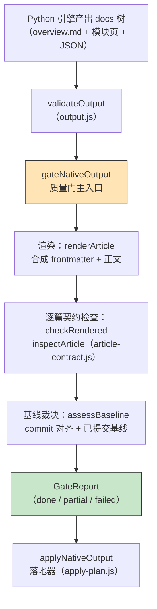
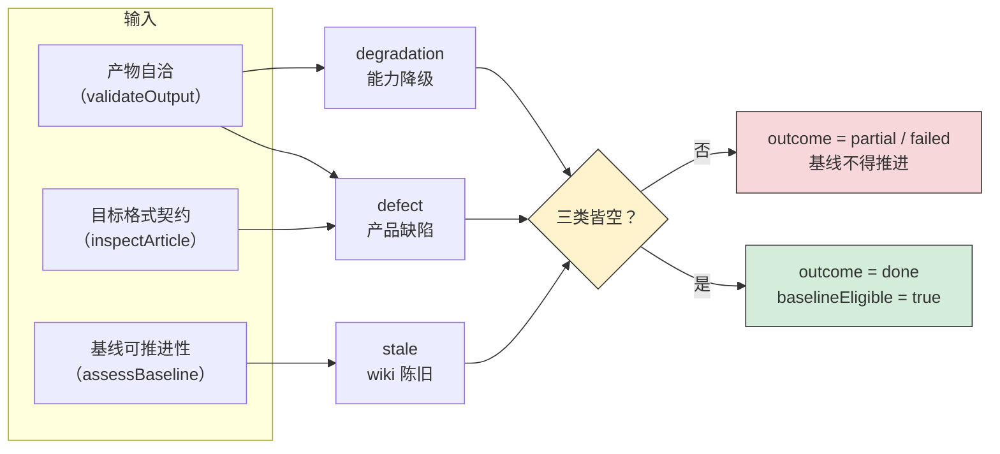
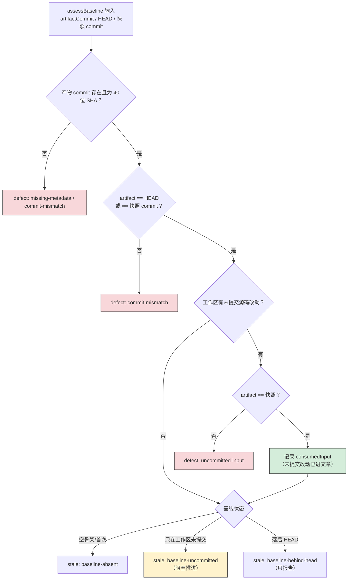
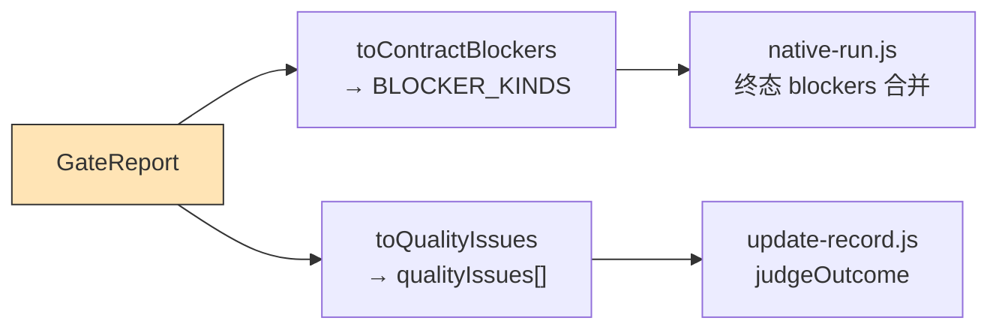
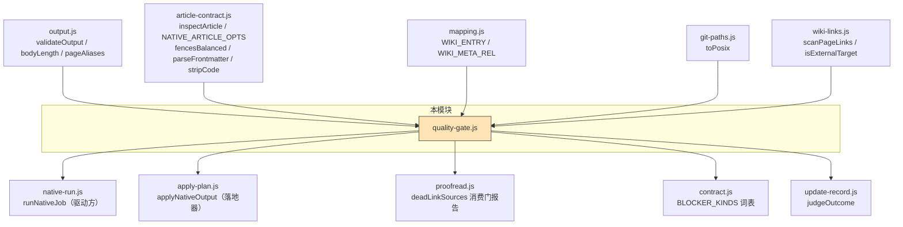
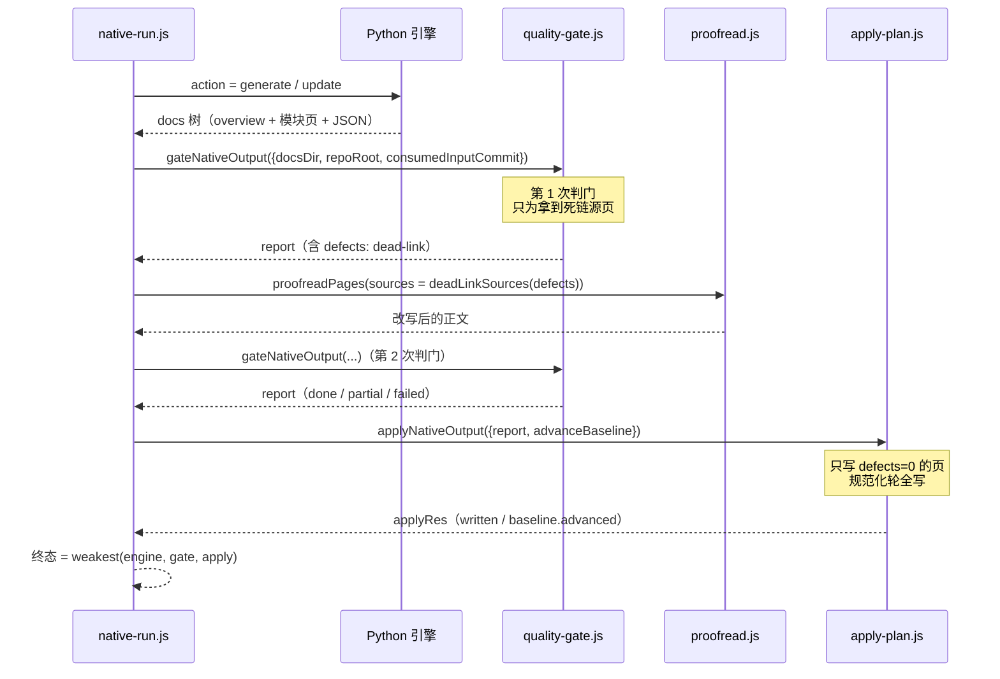

# 原生产物质量门（Native_Output_Quality_Gating）

## 简介

`lib/engine/quality-gate.js` 是原生 CodeWiki 运行时的**采用门**（quality gate）——它排在 Python 引擎把 docs 树交回来之后、产物真正写进 `.codewiki/` 与 `CodeWiki.md` 之前。本模块不做任何「修正」，只把三件事合成一份可机读的裁决：**这批产物能不能被 wiki 采用、基线能不能推进**。

它存在的核心理由来自 0.14.0 的教训：「1 篇成功 + 19 篇失败也报 done」。本模块把缺陷按**责任归属**分成三类（defect / degradation / stale），让运维能一眼看清「谁来修、修什么」，而不是把一切混进一个 blockers 数组导致「引擎被归咎于不是它的问题」或「wiki 的陈旧状态被当成产品缺陷」。终态仍然严格：**只有三类皆空才是 done**。

本模块属于 [原生运行时生命周期管理](native-codewiki-runtime-lifecycle-management.md)，上游依赖 [产物自洽校验](wiki-content-health-scanning-plan-application-mapping-output.md)，下游接 [计划应用器](wiki-content-health-scanning-plan-application-native-apply.md)，由 [原生编译编排](native-runtime-process-execution-monitoring.md)（`native-run.js`）驱动。

---

## 架构与定位



门的位置由文件头注释钉死：**引擎把 docs 树交回来之后、写进 `.codewiki/` 之前**。它是「产物能不能被采用」的唯一裁决点，落地器（apply）只负责「把裁决为可写的页真正写进仓库」，不再拥有否决权。

---

## 三类问题的分类原则（本模块存在的核心理由）

分类是**机读的**，不是措辞差异。三类问题的处置完全不同：

| 类别 | 含义 | 典型 kind | 处置 |
| --- | --- | --- | --- |
| **defect** | 本次引擎产物自身的问题 | `entry-missing`、`empty-body`、`article-missing`、`unmapped-page`、`source-missing`、`dead-link`、`article-contract`、`commit-mismatch`、`uncommitted-input` | 不算完整成功（`baselineEligible=false`） |
| **degradation** | 产物可用但证据不足 | `empty-module-tree`、`no-source-evidence`、`missing-section`、`empty-section-optional` | 可入库，但**增量 ownership 不可信，不得推进基线** |
| **stale** | wiki 既有状态陈旧（不是本次产物的错） | `baseline-behind-head`、`baseline-uncommitted`、`baseline-absent` | 如实报告；只有 `baseline-uncommitted` 会阻止推进 |

**关键差别**：`degradation` 里的页是真的、内容是真的，只是「没法归属」（whole-repository 模式下 `module_tree` 为空）。这与 `defect` 严格区分——否则「页写得没问题却被当成坏产物」会把可用的整批页面拦在仓库外。



---

## 核心组件

### `gateNativeOutput`（主入口）

对一批原生产物做采用裁决。纯组合：读产物（`output.js`）→ 渲染 → 契约 → 基线。

**签名与关键入参**：

```javascript
gateNativeOutput({
  docsDir,                 // 引擎产出的 docs 目录（必填）
  repoRoot = null,         // 仓库根：source_files 存在性、git 基线判定
  componentFiles = {},      // 组件 id → 仓库相对文件（source_files 唯一证据）
  overviewName = 'overview.md',
  baseline = null,         // readCommittedBaseline 结果（不给则现读）
  requireCommittedInput = true,
  consumedInputCommit = null, // 本轮合成的工作区快照 commit
  includeContent = true,   // 返回值是否带渲染后正文
})
```

**六步裁决链**（代码中的编号顺序）：

1. **产物自洽分流** —— `validateOutput` 的 problems 按 kind 分流到 defect / degradation。`empty-module-tree` 刻意降级成 degradation（页照写，但归属证据缺失）；未登记的新 kind 一律当 defect 上报，逼调用方补映射，**不许静默吞掉**。
2. **入口检查** —— 没有 overview 就没有 `CodeWiki.md`，整批不可入库（`entry-missing`）；入口正文空 / 围栏未闭合同样致命。
3. **逐篇渲染 + 契约** —— `renderArticle` 合成 frontmatter，`checkRendered` 走 `inspectArticle`（复用，不重写），再补一条「剥掉合成 frontmatter 后的空正文」兜底判据。
4. **空 source_files 降级** —— 页照写，但记 `no-source-evidence` degradation，增量归属不可用。
5. **基线裁决** —— `assessBaseline` 判 commit 对齐与已提交基线。
6. **终态合成** —— `writable=false → failed`；有 blockers → `partial`；三类皆空 → `done`。`baselineEligible` **只在 outcome=done 时为 true**。

**返回的 GateReport 关键字段**：

| 字段 | 含义 |
| --- | --- |
| `outcome` | `done` / `partial` / `failed` |
| `writable` | 入口是否健康（落地器是否可以动手写盘） |
| `baselineEligible` | 基线许可（严格：只在 done 时为 true；`canAdvanceBaseline` 是兼容别名） |
| `articles[]` | 逐篇裁决（`action: write/skip`、缺陷计数、sourceFiles、attribution） |
| `rendered[]` | **全部页**的渲染结果（含缺陷页；写不写由落地器按轮次决定） |
| `defects` / `degradations` / `stale` | 三类问题清单 |
| `blockers` | defect + degradation + 阻塞性 stale（`baseline-uncommitted`）的合并视图 |
| `counts` | 页数 / 可写 / 跳过 / 未映射 / 各类问题计数 |
| `baseline.consumedInput` | 本轮「吞掉」的未提交改动（快照 commit + 路径清单） |

> **设计要点**：`rendered` 收**全部**页而不仅是无缺陷页。早先只收 `action==='write'` 的页，落地器永远看不见「有缺陷的旧落地页」——渲染规则改了，库里的旧页继续是旧样子，no_change 轮又短路回去（真机 dsh-hindsight-on-demand 的 363 条死链即由此而来）。

### `assessBaseline`（基线裁决）

判「这批产物的基线能不能被推进」。核心规则：

- **产物 commit 必须对得上**：`metadata.generation_info.commit_id` 必须是 40 位 SHA，且等于当前 HEAD；若本轮有工作区快照（`consumedInputCommit`），等于快照也算「对得上」——那是「对上了比 HEAD 更完整的代码」，不是缺陷。
- **脏工作区的两条路**：产物 commit 等于本轮快照 → 未提交改动**已进文章**，记成 `consumedInput` 证据而非缺陷；产物对不上快照 → 真没覆盖，报 `uncommitted-input` 拦基线。
- **只有「基线未入库」这一条 stale 会阻断推进**：把工作区未提交状态记成「已消化」是不可逆的记账错误。`baseline-behind-head`（基线落后 HEAD）正是本轮要消化的对象，只报告不拦。



### `readCommittedBaseline`（只读已提交基线）

读**已提交**的编译基线 `git show HEAD:.codewiki/_meta.yaml`，**不是**工作区文件。

> **为什么不能用工作区**：工作区的 `_meta.yaml` 随时可能是「上一轮编译刚写、还没提交」的内容（自动提交是插件侧异步做的，中间存在「已写入、未提交」窗口）。把它当基线等于把一堆未提交产物宣布成「已消化」，而 git 里根本没有它们的记录——下次编译的 base 指向不存在的状态，变化要么重复消费要么永久失明。

返回 `{ ok, source: 'git-head'|'worktree-only'|'absent', commit, worktreeCommit, dirty, reason }`。`parseMetaCommit` 会把 YAML null（`null` / `~` / 空串）归一成真 null——cw init 写的 `last_compiled_commit: null` 若不归一，会变成字面量字符串 `"null"` 被当成真实基线。

### `renderArticle` + `rewritePageLinks`（渲染层）

把映射出的一篇文章渲染成 wiki 完整文本：**合成的 frontmatter + FSoft 原文**。三条硬约束：

1. **正文一字不动** —— 不删 H1、不改标题、不补章节。产物规范化只处理格式与路径，否则「模型写了什么」无法逐字复核。
2. **frontmatter 只填有证据的字段** —— `source_files` 原样来自映射（空就是空），绝不按目录名猜。
3. **可回溯** —— `fsoft_page` 记住正文来自原始树的哪个文件。

**`rewritePageLinks`** 解决真机实测的致命问题：引擎产物页名是 `agent_runtime.md`，落地时按 slug 规则改名成 `agent-runtime.md`，而正文跨页链接仍写原名——不改写就是「每一条跨页链接点开 404」（本仓 420 条内部链接曾有 412 条失效）。改写只动 `](href)` 这一段，`[文字]` 原样保留；解析基准是**引擎源页目录**（不是落地目录），否则层级布局的兄弟/父级链接一条都命不中。

**`yamlScalar`** 解决 YAML 转义：`cw` 用 serde_yaml 解析 frontmatter，真实页标题里含 `#`、`: `、Windows 反斜杠时裸标量会被解析成嵌套映射或截断成注释。只在确实不安全时才 `JSON.stringify`——JSON 字符串字面量是合法 YAML 双引号标量（YAML 1.2 是 JSON 超集）。

### `toContractBlockers` 与 `toQualityIssues`（输出适配器）

门的结论要被两个不同的下游消费，因此各有一个翻译器：

- **`toContractBlockers(report)`** → 翻成 [引擎契约](core-engine-public-api-result-validation.md) 的 `BLOCKER_KINDS`（`quality-gate` / `article-missing` / `unmapped-page` / `baseline-failed` / `engine-error`）。一一对应不了的一律归 `quality-gate`（宁可粗也不能漏），原 kind 留在 detail 里。`native-run.js` 用它把门 blockers 并入终态 blockers。
- **`toQualityIssues(report)`** → 翻成 update-record 的 `qualityIssues`（`judgeOutcome` 的输入之一）。

> **为什么需要后者**：`judgeOutcome` 只按「计划内文章写成了没有」判 done——一篇「可写但 source_files 为空」的页在它眼里就是成功，于是 outcome 被判成 done 并推进基线。而空 source_files 正是「增量归属不可用」的证据降级。门已把它算成 blocking，但两条判定路径不能一个严一个松，所以必须显式喂进去。



---

## 依赖关系



**依赖语义要点**：

- **复用不重写**：产物自洽判据全部来自 `output.js`（见 [映射与输出](wiki-content-health-scanning-plan-application-mapping-output.md)），门只做「分流与加格式契约」，不另写一套判定——否则「门判它是死链、改写器却认不出这条链接」的分叉会重演。
- **`NATIVE_ARTICLE_OPTS` 是唯一一处口径**：`requiredSections: []`（原生正文章节由上游 prompt 决定，不按本仓库 agentic 通道的 Overview/Key Components 判）、`allowEmptySourceFiles: true`（whole-repository 模式空 source_files 是诚实记录）。门与落地器的存量体检（`auditExistingArticles`）共用它，两处各写一遍时已经漂过一次。
- **git 只读**：`execFileSync('git', ['show'/'status'/'rev-parse'], { timeout: 15000 })`，全部失败静默返回 null 并转成一条 defect/stale，绝不抛出中断编译。

---

## 在编译流水线中的数据流



**校对回路**是门与 [语义校对](wiki-content-health-scanning-plan-application-proofread-links.md) 的固定配合：门先判一次只为拿「哪几篇有失效链接」，校对**修正文而非放宽判据**，改完必须重新判门——改不掉就照旧判 partial。门是纯读 `docsDir` 的，跑两次没有副作用。

**最终终态合成**（在 `native-run.js` 第 5 段）：`finalOutcome = weakest(engineOutcome, gateOutcome, applyOutcome)`，按 `cancelled < failed < partial < done` 排序取最弱的一环。门说 partial，终态就不许是 done——引擎自报 done **不能**替代质量门。

---

## 关键不变量（验收标准）

1. **只有三类皆空才是 done** —— 分类改变的是「谁来修」的定位，不是放宽闸门。0.16.1 曾允许 partial 也许可推进基线（打破「永远 partial ⇒ 基线永不推进」死循环），但那条例外把「没消化完」记成已消化，已被移除；死循环的正确解法是让**首次编译**走成 done（空骨架基线不算未入库）。
2. **基线许可只来自 done** —— `baselineEligible = outcome === 'done'`，没有任何例外通道。
3. **正文一字不动** —— 渲染只剥 BOM、改写链接、降级未命中链接；措辞与结构一律不动，否则「wiki 里这篇 ≠ 引擎产出那篇」永远无法逐字比对。
4. **未登记的问题类别不许静默吞掉** —— `pushDefect` / `pushDegradation` 遇到未注册 kind 直接抛错；`validateOutput` 新增的未映射 kind 一律当 `article-contract` defect 报出，逼维护者补映射。
5. **基线只读已提交** —— `readCommittedBaseline` 用 `git show HEAD:...`，工作区只用于对比 `dirty` 标志，绝不作为基线来源。

---

## 相关模块

- [原生运行时生命周期管理](native-codewiki-runtime-lifecycle-management.md) —— 本模块的父模块，管生命周期全貌。
- [原生运行时进程执行与监控](native-runtime-process-execution-monitoring.md) —— `native-run.js` 编排器，本模块的驱动方。
- [原生运行时状态与并发治理](native-runtime-state-concurrency-governance.md) —— 受管状态与锁，基线的跨轮凭据。
- [工作区快照管理](workspace-snapshot-management.md) —— `consumedInputCommit` 的来源，决定「脏工作区产物算不算对得上代码」。
- [映射与输出校验](wiki-content-health-scanning-plan-application-mapping-output.md) —— `output.js` 产物自洽判定，本模块的上游。
- [计划应用（native apply）](wiki-content-health-scanning-plan-application-native-apply.md) —— 落地器，消费 GateReport 真正写盘。
- [校对与链接体检](wiki-content-health-scanning-plan-application-proofread-links.md) —— 死链修正回路。
- [引擎公共 API 与结果校验](core-engine-public-api-result-validation.md) —— `BLOCKER_KINDS` 词表，`toContractBlockers` 的翻译目标。