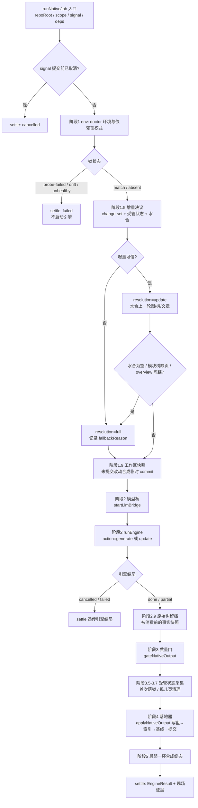
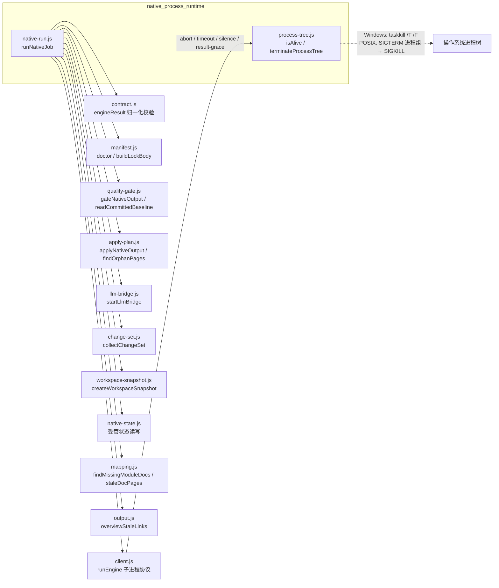
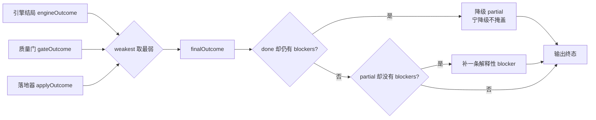

# 原生进程运行时（native_process_runtime）

## 1. 模块定位与职责

本模块是原生编译通道（`nativeEngine: true`，自 0.16.0 起为默认通道）的**运行时裁决层**，位于 `fsoft_engine_js_core → engine_runtime_orchestration` 之下，由两个文件构成：

| 文件 | 核心导出 | 职责 |
| --- | --- | --- |
| `lib/engine/native-run.js` | `runNativeJob`、`DEFAULT_ENGINE_ENTRY`、`DEFAULT_UPDATE_OPTIONS`、`DEFAULT_ENGINE_TIMEOUT_MS` | 把一次原生编译的**裁决链**固定成一条直线编排：环境校验 → 增量决议 → 引擎执行 → 质量门 → 落地提交，并合成严格终态 |
| `lib/engine/process-tree.js` | `isAlive`、`terminateProcessTree` | 受管子进程树的**终止与存活探测**：保证取消/超时时整棵进程树（含孙进程）被可靠回收 |

设计动机（见 `native-run.js` 头部注释）：上层 JobService（`index.js`）已有 4800+ 行，若把 doctor/锁校验/模型桥/runEngine/gate/apply 全塞进 tick 里，「终态到底由谁裁决」会再次含糊——0.14.0 修掉的缺陷正是「引擎说 done 就 done，产物没入库也报完成」。本模块只做一件事：让每一步的结论都不能被下一步洗白。

### 五条硬不变量

1. **锁不一致 / 依赖不闭合 → 直接 `failed`，不跑引擎**：跑出来的产物不可信。
2. **引擎 `done` 不能替代质量门**：gate 说 `partial`，终态就是 `partial`。
3. **落地器（apply）说 `partial`/`failed`，终态不许是 `done`**：产物没入库就是没交付。
4. **`failed`/`cancelled`/`partial` 一律不推进基线**：未完整消化的变化留到下一轮。
5. **取消是终态**：取消后不再 gate/apply，也不覆盖已写好的终态。

## 2. 架构总览

### 2.1 裁决链流程

### 2.2 依赖关系

相邻模块的详细行为请参阅对应页面，本页不重复其内部实现：

- 子进程协议与静默/超时抢救：[engine_client.md](engine-client.md)
- 产物写盘、索引、基线与提交事务：[native_apply_plan.md](native-apply-plan.md)
- 结果契约校验与质量门判据：[result_contract_and_quality_gates.md](result-contract-and-quality-gates.md)
- 模型桥（占位 key、会话钩子）：[llm_provider_bridges.md](llm-provider-bridges.md)
- 引擎锁、受管状态、映射与快照：[workspace_state_and_integrity.md](workspace-state-and-integrity.md)
- 被驱动的 Python 引擎本体：[fsoft_engine_python_runtime.md](fsoft-engine-python-runtime.md)
- 上层调用方（JobService 的 tick 调度）：[main_orchestrator.md](main-orchestrator.md)
- 四路变化集采集：[agentic_article_pipeline.md](agentic-article-pipeline.md)

## 3. 核心组件详解

### 3.1 `runNativeJob(options)` —— 一次原生编译的严格裁决链

全部依赖经 `deps` 注入（`deps.doctor / deps.runEngine / deps.gate / deps.apply / deps.bridge / deps.collectChangeSet / deps.snapshot` 等），真实实现直接从同层模块取，测试可替换假 `runEngine` + 真实 gate/apply，同时覆盖接线与裁决。

**入口参数要点：**

- `repoRoot`（必填，绝对路径）、`scope`（`full`/`stale`/`auto`）、`kind`、`requestId`（缺省按时间戳生成）、`signal`（AbortSignal → 终止受管子进程树）。
- `timeoutMs` 默认 `DEFAULT_ENGINE_TIMEOUT_MS = 180 * 60 * 1000`（3 小时）。该值是按真机实测修正的：本仓库唯一跑完整的编译 `job-mvt1mrvu-6` 耗时 articles 66.0min + crosscut 10.0min + review 68.9min + queued 29.2min ≈ 174 分钟；旧的 45 分钟预算会让任何中等仓库在「写文章」阶段刚开头就被砍掉。超时后由 client.js 的 partial 抢救路径回收已写出的文章。
- `docsDir`：引擎产物目录。**增量模式必须给独立目录**——把上一轮状态水合进仓库内 `.codewiki/` 会就地污染用户库，缺省则退全量。
- `moduleConcurrency`（0.16.14）：同层模块并行度，默认 1（严格串行），父模块仍等子模块完成。
- `requestLimit`：单模块写作 LLM 请求上限，>0 才下发（缺省引擎退回自身默认 100）。
- `language`、`resume`、`rawTreeRoot`（仓库外的原始树留档根）、`onProgress`/`onLog`（缺省为 `noop`）。

**关键阶段：**

1. **env 环境与锁校验**：通过 `probe`（实际是跑一次 `action='doctor'` 的引擎探测）取得引擎版本/Python/依赖事实，再由 `manifest.doctor` 与 `engine-lock.json` 比对。`probe-failed`（解释器缺失/入口崩）→ `engine-missing`；`drift`（版本与锁定不一致）→ `engine-deps`；`unhealthy`（`pip check` 未通过）→ 不重试、不装包、不绕过。`absent`（首次运行）**此处不写锁**——提前创建 `.codewiki/` 会让落地器把空目录判成「人工破坏的半截库」，真正落盘推迟到阶段 3.6 与产物同事务写入。
2. **增量决议（1.5）**：排三个可查事实——
   - **变化是什么**：`collectChangeSet` 四路（committed/staged/unstaged/untracked）+ 上轮 `unconsumed` 携带；
   - **能不能增量**：受管状态齐全、版本兼容、基线（`_meta.yaml` 里的已提交 commit）可达、且调用方要 `stale`/`auto`；
   - **消费成立吗**：只有引擎真报 `update_record.outcome=incremental` 且 gate/apply 全 `done` 才推进基线。
   
   决议结论写在 `resolution`（`full`/`update`）与 `fallbackReason` 里。注意「变化集为空」**不是跳过引擎的理由**——变没变由引擎的图 diff 说了算，change-set 只决定增量可不可信。水合后还会清理不属于当前模块树的旧页（`staleDocPages`），并检查缺页；同时判 `overview.md` 的**陈链**（`overviewStaleLinks`）：上游 `reusable_overview()` 只认「空页 / 未完成的 preamble」，聚类重构后模块改名、旧 overview 指向已消失的页仍会被判可复用而每轮跳过重建。缺页或陈链任一成立即转全量；陈链的处置是先把陈 overview 删掉（留着它，全量与增量都会因「可复用」而跳过重建）再转全量重建。同一基线 + 同一批缺口（缺页与陈链两份排序清单都相同）+ 无有效变化时**收敛**——跳过重复全量，但缺页与陈链仍由质量门如实判成 partial（不豁免）；修复凭据 `missingRepair` 经 `buildStatePayload` 落进 state.json，因此同时记录 `modules` 与 `overviewLinks` 两份清单。
3. **工作区快照（1.9）**：FSoft 只从 `<old>..<new>` 取 diff，但读的是工作区文件。此处把未提交改动合成一个不挂 ref 的临时 commit（`createWorkspaceSnapshot`），本轮 `commitId` 指向它，让「文章反映的内容」与「账本记的 commit」对齐；造不出快照不算失败，退回 HEAD 记账并记 note。
4. **模型桥（2）**：`startLlmBridge` 建立本地桥接，占位 key 每次随机、只经进程环境传递、不进日志；失败 → `failed`（stage=cluster，code=`engine-model`）。
5. **引擎执行（2）**：`resolution=update` 用 `update` 动作（读水合旧图做图 diff），否则 `generate`（从零建图）。两者不能互换：增量动作在空 docsDir 上会走更慢的 missing_page 全量重建；全量动作带旧状态跑会让「可比性」变假象。增量参数 `DEFAULT_UPDATE_OPTIONS = { rung: '3' }` 显式下发——3 = 组件级方法（图 diff 决定重写范围），显式给出可避免上游默认值变化导致增量语义静默漂移。桥在 `finally` 中关闭（先关桥会让读流中的引擎拿到 502），关闭前取走 `bridge.stats()`（含 `emptyResponses`：上游 200 但无正文的次数，是假 done 的来源之一，只进 notes 不参与裁决）。
6. **原始树留档（2.9）**：把引擎输出的整棵 docs 树在被消费前复制到调用方给的 `rawTreeRoot` 下（按 requestId 分目录）。留档失败只记 note——它是证据不是产物。
7. **质量门（3）**：`gateNativeOutput` 体检产物；`stateIncomplete`（受管状态缺图/树/metadata）时即使 gate 报 `done` 也翻成 `partial`。
8. **受管状态采集（3.5）**：采集点固定在 gate 之后、apply 之前，产出进 `apply` 的 `extraFiles`，与文章**同批写、同批回滚、同批提交**。「无变化轮」（引擎 `no_change` + 变化集空 + 无未携带账）沿用上一轮状态不重写，避免每次状态查询都制造一次纯记账提交。状态不完整时：不裁旧状态、不推进基线，并追加 blocker。
9. **首次落锁（3.6）**：`absent` 且本轮要落地时，把 `buildLockBody` 结果作为 `ENGINE_LOCK_REL` 一项塞进写集——修掉旧实现「锁留在工作区当未跟踪脏文件、变化集永远不干净」的缺陷。
10. **孤儿页（3.7）**：`findOrphanPages` 找出 `source_files` 全部失效的存量页，经落地器 `deleteFiles` 删除（走写集才能随事务回滚/提交）；本轮产物页一律不算孤儿。
11. **落地器（4）**：`applyNativeOutput` 完成写盘 → index → 基线 → 提交，自带失败回滚。`advanceBaseline` 由裁决决定（状态不完整时强制 `false`），不接受调用方硬开。
12. **合成终态（5）**：见 3.2。

**返回值**：`engineResult()` 归一化的 EngineResult，外加 `requestId`、三类事实分开记的 `baselineEligible`（质量门许可）/ `baselineAdvanced`（落地事实）/ 兼容老调用方的 `canAdvanceBaseline`、`artifacts`（docsDir / rawTreeDir / updateRecord / rawTree 留档 / rawTreeFiles）、`incremental`（决议现场）、`gate`、`apply`、`engineLock`、`notes`。所有早退分支（取消、环境失败）也经同一个 `settle()` 出口，保证终态合法且带现场证据。

### 3.2 终态合成规则（最弱一环说了算）

强弱排名 `RANK = { cancelled: 0, failed: 1, partial: 2, done: 3 }`，合成终态只能取最弱，绝不允许被后续步骤提升。blockers 三路汇合：引擎自报 blockers + `toContractBlockers(report)`（真实 gate 拦下的死链/空正文同样必须进终态）+ `applyBlockersOf(applyRes)`。增量降级（想要增量却走成全量、或引擎自报 `full_fallback`）**只在产物已不完整时**才加 `incremental-fallback` blocker——产物完整时全量重建确实覆盖了全部源码，强行降 partial 会让这类仓库永远绿不了、基线永远不推进。

### 3.3 `isAlive(pid)` 与 `terminateProcessTree(pid, options)`

- `isAlive`：`process.kill(pid, 0)` 只做存在性探测——不抛错即活着（含僵尸进程，仍视为占用）；`ESRCH` 已退出；`EPERM` 存在但无权限，仍算活着。非法入参（非正整数）直接返回 `false`。
- `terminateProcessTree`：解决「只 kill 直接子进程、孙进程变孤儿继续烧 token」的问题。
  - **Windows**：`taskkill /T /F /PID`（`/T` 递归整棵树、`/F` 强制；不加 `/F` 时无控制台进程收不到信号），随后给 1 秒回收窗口再判定。
  - **POSIX**：子进程以 `detached: true` 启动后自成进程组，先 `SIGTERM -pid` 打整组（宽限默认 3000ms），宽限内未退再 `SIGKILL -pid`；若进程没有独立进程组，逐级退化成只打 `pid` 自身。
  - 返回 `{ ok, rootAlive, method }`，`method ∈ noop / already-exited / taskkill / sigterm / sigkill`。**`ok=false` 表示根进程超时后仍活着，调用方必须据此报错，而不是假装取消成功**。

本模块只做终止，不做进程启动、协议、stdout 处理——保持小而可测；任何取消语义的 bug 都在这里暴露，而不是散落在业务里。实际调用方是 [engine_client.md](engine-client.md) 的 `runEngine`（abort/timeout/silence/result-grace 四条路径）。

## 4. 运行环境与构建依赖

本模块的「环境可信」假设来自仓库外的独立 venv 建设与锁定文件：

- `package.json`（`@local/dsh-codewiki`，Node ≥ 20）：声明自 0.16.0 起默认通道即原生引擎，依赖「本地 Python 3.10+ venv with closed deps」；Node 侧旧的 FSoft 算法重实现已于 0.16.0 阶段 7 删除。
- `tools/fsoft-engine/setup-env.sh`：在插件仓库**之外**构建可信引擎环境——因 FSoft 依赖树版本约束互相打架（正常解析必然 `ResolutionImpossible`），脚本按冻结快照 `--no-deps` 落盘、editable 安装引擎本体，再以 `pip check` 反向验证依赖闭合并做 import 冒烟。`doctor` 判出 `unhealthy`（依赖不闭合）时的修复指引正是该脚本。

引擎入口常量 `DEFAULT_ENGINE_ENTRY` 指向随包分发的 `lib/engine/python/entry.py`（协议层细节见 [fsoft_engine_python_runtime.md](fsoft-engine-python-runtime.md)）。
