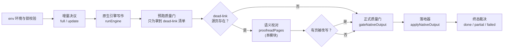
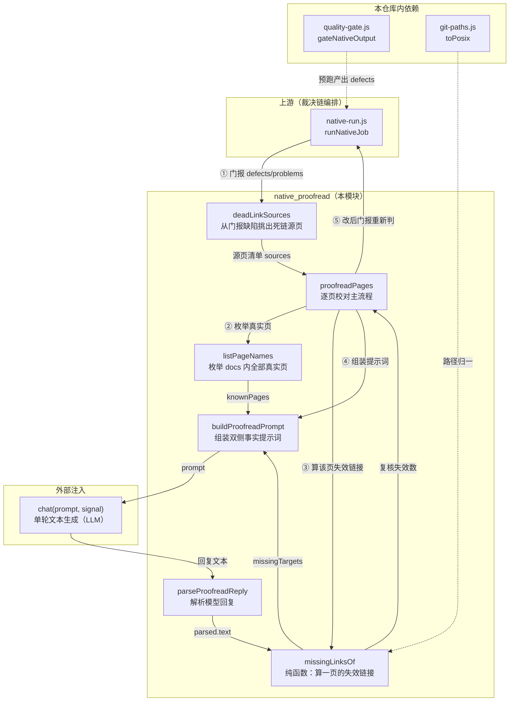
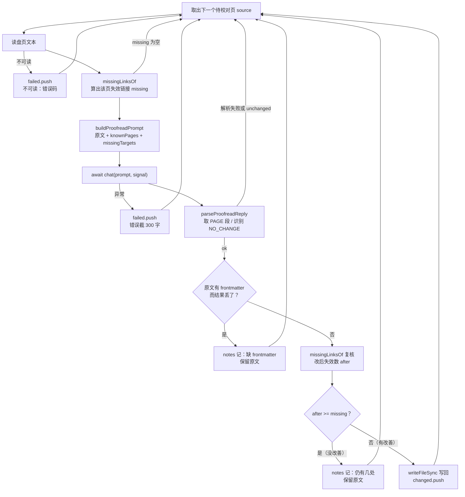
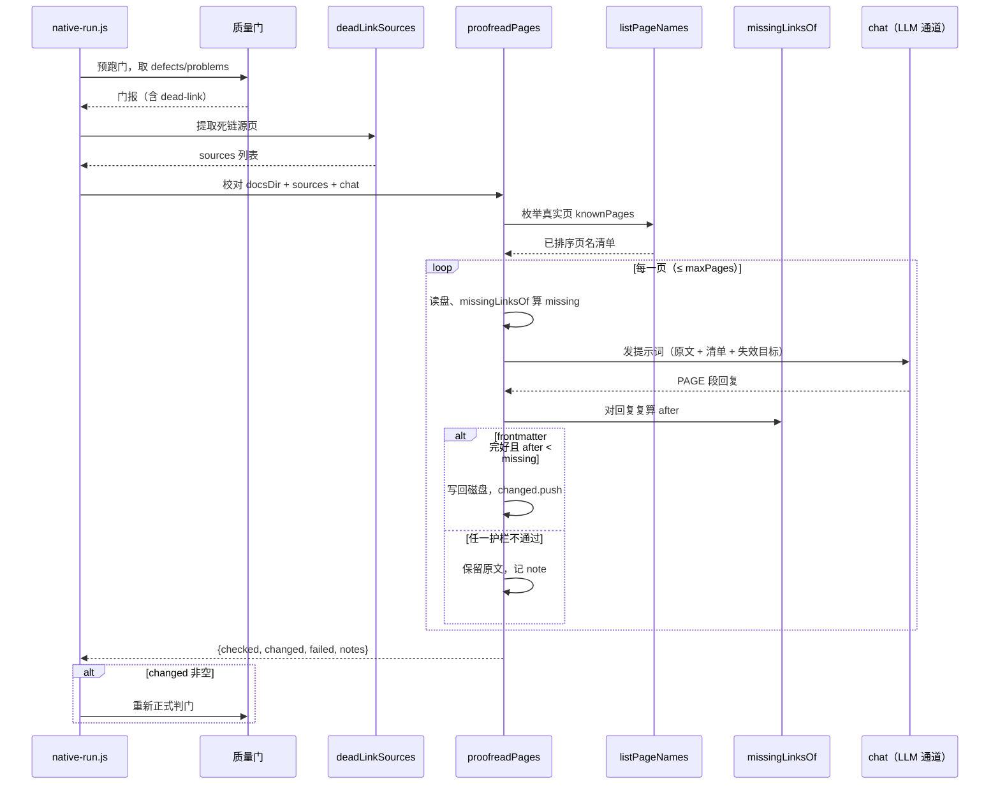

# native_proofread：原生引擎产物的语义校对层

## 简介

`native_proofread` 是原生编译裁决链上的**语义校对环节**：它只处理一类问题——模型写作时**编造出来的跨页链接**（正文里指向 docs 目录中根本不存在的页面）。这是 `fsoft_engine_runtime` 家族中 `engine_runtime_orchestration` 的一个叶子模块，全部代码集中在一个文件：`lib/engine/proofread.js`。

它存在的根因是一个真机观察到的产品现象：原生引擎写作时，模型会照旧版聚类的记忆编造页面名（如 `client_review_console/status_readouts.md`、漏写 `_ui` 后缀的 `settings_and_logs.md`），而模块树里根本没有那些页。[result_contract_and_quality_gates](result-contract-and-quality-gates.md) 模块（`lib/engine/quality-gate.js` 的 `gateNativeOutput`）如实把这些判为 `dead-link` defect，于是这些仓库每轮都停在「部分完成（partial）」——判据没错，是产物真的错。

**本模块的立场必须说清楚：它修的是正文，不是判据。** 校对后的正文仍要重新过一遍质量门，改不掉就照旧判 partial；绝不在渲染期或终态里豁免缺页/死链。它只管模型幻觉中唯一可以**只看本页 + 页名清单**就修对的问题：跨页链接目标不存在（改成真实页名，或把链接降级成纯文字）。正文事实错误需要读源码，那属于重写文章，不在校对范围。

## 模块定位

在原生引擎「一次完整编译」的裁决链中，校对层位于**引擎跑完之后、正式判门与落地之前**（`native-run.js` 的 `2.6` 段）：

这条链的完整编排由 [native_process_runtime](native-process-runtime.md) 模块（`lib/engine/native-run.js` 的 `runNativeJob`）固定；本模块只被它消费，且通过依赖注入（`deps.proofreadPages`、`deps.chat`）接入，测试可替换为桩。

## 架构与组件关系

## 核心组件说明

### `proofreadPages({ docsDir, sources, chat, maxPages, signal })`

本模块唯一的主流程入口，异步函数。返回 `{ checked, changed, failed, notes }` 四个数组：

| 字段 | 含义 |
| --- | --- |
| `checked` | 实际发起了模型请求的页（确实有失效链接的页） |
| `changed` | 被改写并写回磁盘的页 |
| `failed` | 读盘失败 / 模型请求失败的页（带 error） |
| `notes` | 每篇一页的处置说明（改写几处、为何保留原文等） |

行为要点：

- **前置短路**：`chat` 不是函数、`docsDir` 里一页真实页都没有时，直接返回空结果——没有模型通道就不烧预算。
- **页数上限**：`maxPages` 默认为导出常量 `DEFAULT_MAX_PAGES = 6`。注释里明确写了理由：每篇一次模型请求，6 篇已能盖住真机上「一批页同时引用同一个被合并掉的模块」的形态，再多就变成整轮重跑。
- **队列过滤**：传入的 `sources` 必须落在真实页集合里才入队（防止校对一个门报里凭空出现的路径）。
- **取消响应**：每篇开始前检查 `signal?.aborted`，取消即停（但已写盘的页不回滚——写盘本身是逐页独立的）。

### 逐页处置流程

两道**保守护栏**值得特别注意：

1. **frontmatter 不丢**：校对本来就要动正文（与渲染层「正文一字不动」的硬约束不同），但模型若把 frontmatter 吃掉或改坏，这篇宁可不动，把问题留给质量门如实上报。判据是：原文以 `---` 开头而结果不是。
2. **无改善不写盘**：用同一套 `missingLinksOf` 对改后文本再算一遍失效链接，改后数量不少于改前就原样保留——防止模型用一种幻觉替换另一种幻觉，把坏产物洗成「看起来改过」。

### `missingLinksOf(text, source, knownSet)`

纯函数，判定一页正文里哪些 Markdown 链接指向了 docs 内不存在的页：

- 正则只认 `[文字](目标页)` 形式的内联链接，目标须为 `.md` 页（可带 `#锚点`）；
- 带协议头（`http:`、`mailto:` 等）的外链一律跳过；
- 以 source 所在目录为基准把相对路径 resolve 成 POSIX 绝对相对路径；
- resolve 后越出 docs 根（`../` 开头）的链接跳过——不干涉 docs 之外的引用；
- 不在 `knownSet` 里的目标收进结果集，排序返回。

`proofreadPages` 对**改前与改后都用同一个函数**复算，因此「失效数减少」这个验收条件与门的判定口径天然对齐，不另立判据。

### `listPageNames(docsDir)`

枚举 docs 目录下所有 `.md` 页（POSIX、排序），构成供模型选真实页名的全集。刻意排除：

- 隐藏目录（`.` 开头）；
- `temp/` 引擎工作文件目录——它们是中间产物，不是页，绝不能进候选清单（否则模型会把链接「修」到一个下一轮就消失的目录上）。

### `deadLinkSources(problems)`

从门报的缺陷数组里挑出所有 `kind === 'dead-link'` 的源页（`p.source`），POSIX 归一、去重、排序。它是桥接门与校对的适配函数——门可能把死链放在 `defects` 也可能是中间产物 `problems`，调用方传哪一边都能用（见 `native-run.js` 里 `report?.defects ?? report?.problems` 的兜底）。

### `buildProofreadPrompt(...)` 与 `parseProofreadReply(...)`

提示词的设计原则是**刻意给足两侧事实**：本页原文、真实存在的页名清单、门报出的失效目标三者全给。注释里写明：只给其中一侧，模型只能靠猜——那正是它当初写错的方式。

对模型的四条硬性要求：

1. 只改链接，不改叙述、标题、代码块、表格结构、行号锚点文字与 frontmatter；
2. 失效目标的真实页若在清单里（包括后缀差异、父模块前缀差异），改成清单里的相对路径；
3. 清单里找不到对应页时，把链接降级为纯文字（保留原文措辞，去掉 `` 语法）；
4. 没有需要改的链接时，原样输出并在末尾单独一行写 `NO_CHANGE`。

返回格式被钉死为 `<PAGE>…</PAGE>` 包裹的完整正文（含原有 frontmatter），`parseProofreadReply` 负责抽取、识别末尾的 `NO_CHANGE` 标记并把它从正文里剥掉——模型原样返回正文时用这个标记省一次 diff，也让「到底改没改」有据可查。

## 数据与控制流

关键设计：**先跑一次门只为拿到「哪几篇有失效链接」**。门是纯读 `docsDir` 的，跑两次没有副作用（`native-run.js` 注释原话）。门没报错的轮次根本不发起校对——校对是修死链的一步，不是每轮都要走的例行检查，因此也不为每轮都烧模型预算。

## 安全边界与不变量

1. **修正文，不松判据**：校对后必须重新判门；改不掉的死链照旧判 partial。任何「校对成功 = 门豁免」的短路都不允许存在。
2. **只改链接，不动叙述**：提示词层面约束 + 两道代码护栏（frontmatter 不丢、无改善不写盘）双保险。
3. **候选页全集是权威**：`listPageNames` 排除了 `temp/` 与隐藏目录；模型只能从真实页清单里选目标，绝不允许它自由发挥编造新页名。
4. **失败不污染终态**：校对本身抛异常时，`native-run.js` 只记 note（「不影响本轮终态，门会如实上报死链」），绝不因为校对失败把一轮本来能走的编译拖死。
5. **范围封闭**：只管「跨页链接目标不存在」。正文事实错误、叙述失真不在校对范围——那需要读源码，属于重写文章。

## 与系统其他模块的关系

- 上游编排：[native_process_runtime](native-process-runtime.md)（`runNativeJob`）在 `2.6` 段调用本模块，并把校对结果并入 `notes`；若发生改写，会重跑 `gateNativeOutput` 再进落地。
- 判据来源：[result_contract_and_quality_gates](result-contract-and-quality-gates.md) 的 `gateNativeOutput` / `validateOutput` 产出 `dead-link` 缺陷——`deadLinkSources` 是两者之间的桥。门本身从不为本模块放水。
- 落地衔接：[native_apply_plan](native-apply-plan.md)（`applyNativeOutput`）消费的是**校对后再判门**的报告，因此写进 `.codewiki/` 的文章已经吸收过校对修正。
- 路径归一：[job_repository_infrastructure](job-repository-infrastructure.md) 的 `lib/git-paths.js` 提供唯一的 `toPosix` 实现，本模块所有路径比较（源页、链接解析、页名清单）都走它，避免 Windows 反斜杠与 POSIX 路径比较失配。
- LLM 通道：`chat` 由调用方注入（生产环境来自 [llm_provider_bridges](llm-provider-bridges.md) 对应的桥接层），本模块不直接接触任何模型凭证。
