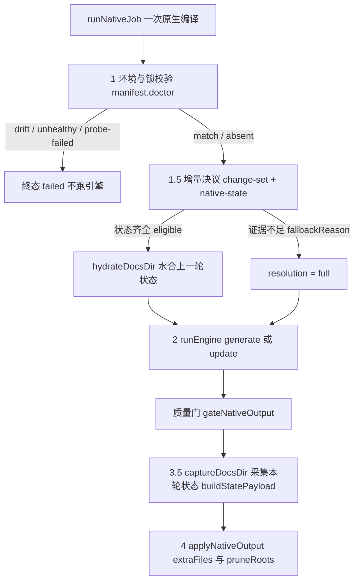
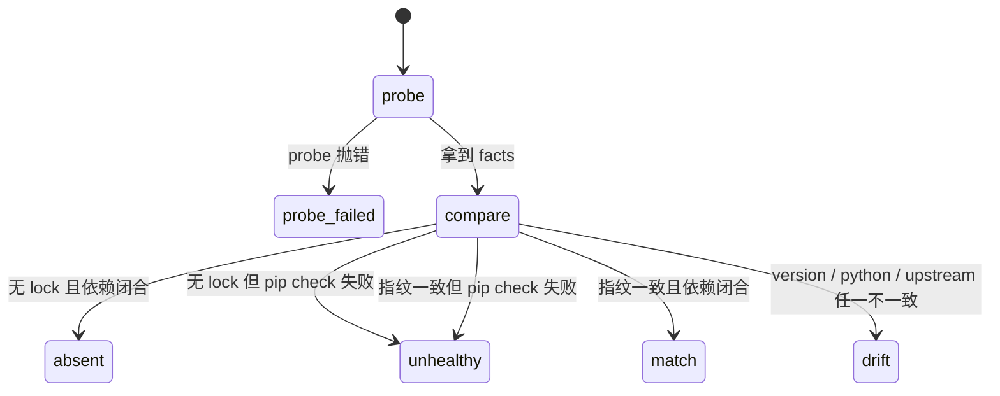
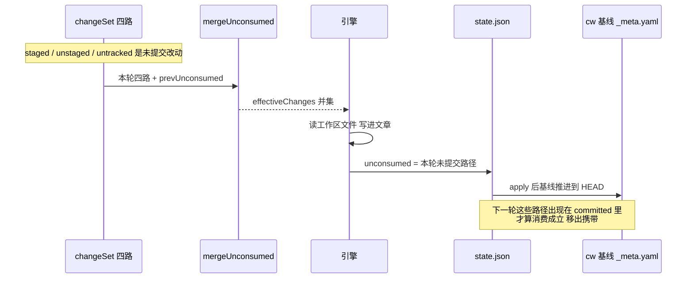
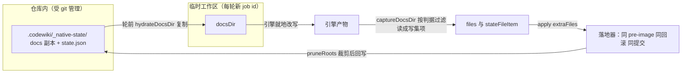
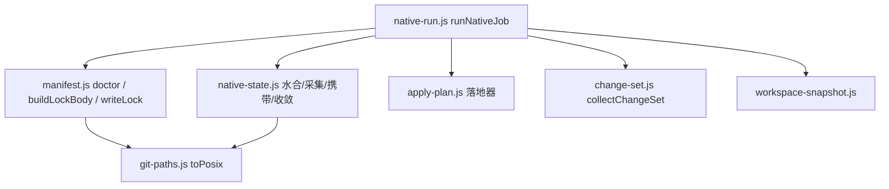

# 原生运行时状态与并发治理

> 所属：[CodeWiki 引擎子系统](codewiki-engine-subsystem.md) → [原生引擎运行时生命周期管理](native-codewiki-runtime-lifecycle-management.md)
> 核心文件：`lib/engine/manifest.js`、`lib/engine/native-state.js`
> 核心组件：`doctor`、`writeLock`、`stateDocFiles`（以及 `native-state.js` 全套跨轮状态函数）

## 简介

本模块为原生（FSoft）引擎通道提供两项「治理」能力，回答两个必须用事实回答、而不能靠猜的问题：

1. **环境治理（manifest.js）**：现在跑的是哪个引擎、哪个 Python 环境、哪份上游源码？FSoft 是**外部**引擎，版本与依赖不由本仓库控制。没有清单时，同一份 wiki 在不同机器、不同 pip 状态下会产出不同结果，而错误会表现为「模型不听话」而不是「环境漂了」——最难查的一类问题。
2. **状态治理（native-state.js）**：跨轮增量需要的上一轮模块树、依赖图、文章存在哪里？引擎的 docs 输出目录是每轮新建的临时目录（每轮一个新 job id），轮与轮之间本来什么都不留。不持久化这些状态，第二轮的组件级增量必然退化成全量——「每轮都在全量、又慢又贵，却一路绿到底」。

贯穿两个文件的治理原则：

- **只读诊断，不自动修复**：`doctor` 只报告事实，装依赖、修环境是 `tools/fsoft-engine/setup-env.sh` 的职责（见 [构建、配置与环境安装](build-configuration-environment-setup.md)）。
- **与产物同事务**：引擎锁与受管状态都不是「落地之后顺手写」，而是作为落地器写集的一项——同一份 pre-image、同一次回滚、同一个自动提交。
- **只记事实，不假装成功**：环境漂移直接 failed 且不跑引擎；状态不完整就显式全量并留下 `fallbackReason`，绝不假装 clean。

## 在裁决链中的位置

原生编译的固定裁决链（由 [原生运行时进程执行与监控](native-runtime-process-execution-monitoring.md) 的 `runNativeJob` 编排）中，本模块位于最前面的「环境与增量决议」段：



关键设计：锁不一致 / 依赖不闭合 → **直接 failed，不跑引擎**。跑出来的产物不可信，而且「先跑再发现环境漂了」会让用户看到一堆无意义的失败文章。

## 环境治理：引擎清单与锁（manifest.js）

### 三件事

| 职责 | 函数 | 说明 |
|---|---|---|
| 指纹 | `probeEnvironment` + `fingerprintOf` | 读引擎版本 + Python 版本 + 上游 commit，算一个稳定 hash |
| 比对 | `readLock` + `compareLock` | 当前指纹与落盘的 `.codewiki/engine-lock.json` 比，不一致就逐项报 diff |
| 落盘 | `buildLockBody` + `writeLock` | 原子写（先写临时文件再 rename，避免半截文件） |

### 指纹为什么这么设计

`fingerprintOf` 只吃**决定产物内容**的因素：

```text
manifest:1
version:<引擎 version>
python:<Python 版本>
upstream:<规范化的 40 位 commit>
```

然后取 SHA-256 的前 16 位 hex。三个关键决策：

1. **上游 commit 必须进指纹**：`codewiki 2.0.0` 这个版本号在源码从 git 直接安装时**根本不跟着变**（版本是 pyproject 里写死的）。上游换了 commit 而版本号不动，指纹若只看版本就会报 match——「换了引擎」被静默当成「环境没变」，产物差异再被误诊成模型不听话。
2. **`UPSTREAM_COMMIT` 是显式常量**（当前值 `1b4af43d6d20c8dbd758fe1d5f888cc6947ed11d`），不从运行时探测：引擎自报的 `engine.commit` 取自 `_git_commit(repo_path)`——那是**被编译仓库的 HEAD**，不是 FSoft 源码自己的 commit。把它当上游锁会让「本仓库提交了一次」反而像换了引擎。升级上游的契约是「改这个常量 + 跑契约测试」，而不是「pip install 到最新版然后祈祷」。`normalizeUpstreamCommit` 只认 40 位小写十六进制，认不出来返回 `''`（=未知），绝不把半截/大写的串当合法值写进锁。
3. **`pip check` 不参与指纹**：依赖闭合是「能不能跑」的闸门，不是「产物会是什么」的输入。把它算进指纹会让每次修依赖都像换了引擎。但它参与 `compareLock` 的状态判定（见下表 unhealthy）。

### compareLock 的状态机



| status | 含义 | native-run 的处置 |
|---|---|---|
| `absent` | 没有 lock（首次运行）且依赖闭合 | 放行；本轮落地时把 `buildLockBody(current)` 作为写集一项提交（不在这里直接写盘，见下文） |
| `match` | 指纹一致且依赖闭合 | 正常跑 |
| `drift` | version / pythonVersion / upstreamCommit 任一不一致 | **直接 failed，不跑引擎**（error code `engine-deps`，diffs 逐项列出 locked → current） |
| `unhealthy` | 指纹一致（或根本没有 lock）但 `pip check` 失败 | **直接 failed，不自动绕过**（error code `engine-deps`），advice 指向 `setup-env.sh` |
| `probe-failed` | 探测本身抛错（解释器缺失 / entry 崩） | failed（error code `engine-missing`），不降级去跑旧实现 |

注意「没有 lock」不等于「环境健康」：`pip check` 失败时即使没有 lock 也判 `unhealthy` 而不是 `absent`——否则调用方看到 absent 只会以为「首次运行」照跑不误，未闭合的依赖被整个吞掉。

`doctor()` 是一站式只读诊断：探测失败变成 `ok:false` 而不是抛错，并按状态给出 `advice`（drift =「确认后重写 lock」；unhealthy =「先用 tools/fsoft-engine/setup-env.sh 修复环境」；probe-failed =「检查 Python 路径与 FSoft 源码根」）。probe 函数由调用方注入（真实实现是跑一次 `action:'doctor'` 的引擎调用，见 [核心引擎公共 API 与结果校验](core-engine-public-api-result-validation.md)），这一层本身是纯的、可单测的。

### 锁的落盘时机（最容易错的一点）

`buildLockBody` 被单独拆出来（返回落盘正文而不写盘），是因为「落锁」的时机必须与产物同批：

- 旧实现由 `writeLock` 在 apply 之后直接写盘 → 文件落在提交之外，下一轮被当成「有未提交改动」再提交一次，无变化的一轮也凭空产生一个 commit（真机实测就是这么长出 `?? .codewiki/engine-lock.json` 的）。
- 现在锁作为 apply 的 `extraFiles` 一项：与文章共享同一份 pre-image → 索引/基线失败时一起回滚 → 提交时一起进同一个 commit。
- 也**不能在 doctor 阶段写**：`.codewiki/` 目录会先于 `cw init` 存在，落地器把「.codewiki 存在却没有 _meta.yaml」判成人工破坏的半截库（wiki-missing）并拒绝自动初始化——首次编译会在最后一步整批失败、还回滚掉所有文章。

`writeLock` 本身（tmp 文件 + `fs.renameSync` 原子替换）保留为备用路径，生产通道走 `buildLockBody` 进写集。

## 状态治理：跨轮受管状态（native-state.js）

### 为什么必须有这一层

FSoft 的组件级增量（`rung=3`，图 diff 决定哪些模块要重写）要读上一轮留下的四样东西才能算出「改了什么」：

| 状态 | 缺失后果 |
|---|---|
| `module_tree.json` | 引擎 `_update_options()` 里 `exists()` 为假就直接返回 None，整个增量退化成全量 |
| `temp/dependency_graphs/<repo>_dependency_graph.json` | 没有旧图可复制成 `*.prev.json` 做图 diff，退全量 |
| `metadata.json`（`generation_info.commit_id`） | updater 没有 old_commit，质量门没有 artifactCommit |
| 上一轮的文章（`.md`） | updater 是原地 patch，页面不在就走 missing_page 重建，等于白退全量 |

### 目录布局：为什么必须是 `.codewiki/_native-state/`

```text
.codewiki/
  _native-state/              ← 首段以 _ 开头，cw index 递归时整棵跳过
    state.json                ← 增量凭据（消费范围 / 未消化账 / 版本 / 回退原因）
    docs/                     ← 上一轮引擎产物的完整副本（水合源）
      module_tree.json
      metadata.json
      <所有 .md 文章>
      temp/
        reference_index.json
        artifact_index.json
        dependency_graphs/
          <sanitized_repo>_dependency_graph.json
  engine-lock.json           ← 环境锁（同在 .codewiki 下，受 git 管理）
```

关键约束：`cw index`（[Vendored CodeWiki Rust 实现](vendored-codewiki-rust-implementation.md)，`vendor/codewiki/src/main.rs:236-256`）会 WalkDir 递归整个 `.codewiki/`，收录所有 `.md` 且**只跳过相对路径以 `_` 开头的项**。状态若放在 `.codewiki/temp/native-state/`（首段是 `temp`），持久化的原始文章会被收成索引里的**第二份**副本。落地器的「索引必须收录本次写的 .md」校验带同样的 `_` 过滤（见 [Wiki 内容健康扫描与计划应用](wiki-content-health-scanning-plan-application.md)）。

### 状态清单与文件判据

| 常量 | 内容 | 理由 |
|---|---|---|
| `STATE_REQUIRED_DOCS` | `module_tree.json`、`metadata.json` | 硬依赖，缺任何一个 `isUpdateEligible` 直接 false |
| `STATE_TEMP_FILES` | `reference_index.json`、`artifact_index.json` | temp/ 下只保留增量真正要读的中间件 |
| `STATE_TEMP_DIRS` | `temp/dependency_graphs` | 依赖图整目录保留 |

其余 temp 中间件不入库：它们每轮都会重算，存进来只是让提交变大，且下次水合会把过期中间件当成有效输入。

- **`isStateDocPath(rel)`**：判据是「它是不是下一轮增量需要读的输入」，不是「它在 docs 里」——所有 `.md`、顶层 `.json`、temp 白名单进，其余排除；`dsh_leaf_checkpoint.json` 显式排除。
- **`graphFileName(repoRoot)`**：依赖图文件名必须逐字符对齐 Python 侧 `sanitize_repo_name`——它用的是 Unicode 字母数字（`c.isalnum()`），中文/日文仓库名原样保留（实测 fixture 里就是 `中文_空格_fixture_dependency_graph.json`）。所以这里用 `\p{L}`/`\p{N}` 而不是 `[A-Za-z0-9]`：后者会把中文仓库名的图判成「缺失」，每轮白退全量。
- **`stateDocFiles(stateDir)`**：审计用，返回「哪些路径属于受管状态」的清单（两个必选文档 + 依赖图目录），供排障与边界核对。

### 三条不变量（native-state.js 文件头）

1. **只有「完整成功」才允许消费状态**：partial / failed / cancelled 一律不把本轮采集的状态写成下一轮基线（否则未消化的变化被当成已消化）。
2. **状态不完整 → 显式 full**：缺图 / 缺 module_tree / 版本不符 / 基线不可达时留下 `fallbackReason`，绝不假装 clean。
3. **水合是复制而不是移动**：源在仓库里（git 管理，是下一轮的权威），目标在临时目录（引擎就地改写）。任何一侧被写坏都不影响另一侧——移动会让「这一轮失败」直接毁掉下一轮的输入。

## 增量决议与消费语义

native-state.js 的函数被 `runNativeJob` 串成裁决链（完整编排见 [原生运行时进程执行与监控](native-runtime-process-execution-monitoring.md)）。本模块提供四个关键判据：

### 1. 能不能增量：`isUpdateEligible`

依次检查，任一不通过就给出**显式 reason**（进 `fallbackReason`）：

1. `state.json` 可读且 `stateVersion` 兼容（磁盘残留 / 旧版本 / 手改 JSON → `unreadable` / `corrupt` / `version`，坏了返回 `ok:false` 而不是被信任）；
2. `module_tree.json`、`metadata.json` 在状态副本里存在；
3. 按当前仓库名算出的依赖图存在；
4. 引擎版本与状态里记录的一致——旧图/旧树是另一个版本的产物，diff 不可信；
5. 基线一致性：记录的 `consumedRange.baseCommit` 与本次 cw 基线不同时**不是错误**，而是带 reason 放行（以 cw 基线为准，未消费变化仍会并入）。

### 2. 未消化账携带：`mergeUnconsumed`

解决「文章与源码脱节、系统一路绿到底」的第二类丢变化：



- 引擎读的是**工作区实际文件**（未提交改动确实会被写进文章）；
- 但 cw 基线（`_meta.yaml:last_compiled_commit`）推进的是 HEAD；
- 于是「文章已覆盖未提交改动，基线却停在 HEAD」——下一轮从新 HEAD 算起，那些未提交改动永远算不进变化集。

解法：`unconsumed` 记录「已读进产物、但还没进任何 commit」的路径，每轮并入 effectiveChanges；只有当它们真的出现在 `git diff base..HEAD`（本轮 committed，含 renamed 的 `from` 端）才算 `consumedNow` 移出。

`state.json` **不记录本轮结局**，只记录「本轮开始时的已消费范围」与「本轮看见了哪些变化」：本轮失败 → 基线未前移（apply 回滚）→ 下一轮 change-set 仍从旧基线算起，变化自动重算（不丢）。本轮成功 → 基线前移 → 老的 pendingChanges 只作审计保留。

### 3. 缺页修复收敛：`missingRepair`

水合后检查模块树是否每个模块都有页、overview 有没有指向已消失页的陈链。缺页时转全量修复，但把凭据（`baseCommit` + 缺口清单 + `attempts`）记进 state.json：**同一棵树上的同一批缺口只尝试一次全量修复**，之后如实报 partial 并写 notes（需要强制重试用 `scope=full`），避免「一轮又一轮重跑几十分钟全量、结果还是 partial」。缺口补齐后凭据被显式清除（`null`）。

### 4. 无变化不假提交：`stateFingerprint`

`state.json` 的 `updatedAt` 每轮都变——照写会让无变化的一轮也产生一次真实提交。`stateFingerprint` 去掉 `updatedAt`/`notes` 做实质内容指纹，相同就沿用旧文本。native-run 的「无变化轮」（引擎报 `no_change` + effectiveChanges 空 + unconsumed 空）整体不重写状态文件；但只要还有一项未消化的账，本轮就必须照常采集——那份状态是下一轮唯一能把它算进变化集的凭据，跳过等于丢变化。

## 跨轮数据流：水合 → 引擎 → 采集 → 落地



- **`hydrateDocsDir`**：跑引擎之前，把状态副本复制进临时 docsDir（`overwrite: !resume`）。水合不到任何文件等同于缺图，退全量而不是让引擎拿空目录跑。
- **`captureDocsDir`**：gate 之后、apply 之前采集。此时引擎已写完 docsDir 而 apply 还没动仓库，写集项直接交给落地器当 `extraFiles`。文本按 utf8 读、utf8 写；检出 `U+FFFD`（非合法 utf8）的文件直接跳过并进 `missing`，而不是写回去一份坏数据。
- **`pruneRoots` 裁剪**：状态目录是下一轮引擎的输入，必须等价于「上一轮引擎的最终产物」。本轮引擎删掉的文章/图若留在状态里，下一轮水合会把它原样搬回 docs——已删的页复活、旧图覆盖新图。裁剪同样纳入 pre-image，回滚会恢复。
- **`stateIncomplete`**：采集时缺硬依赖（图/树/metadata）→ stateFiles 置空、不裁剪上一轮仍完整的状态、不推进基线。文章可以保留，但「下一轮无法增量」必须在结果里可见（blocker 级）。状态采集异常同理——**绝不**悄悄退化成「不持久化」，那等于把唯一的增量凭据删掉再宣布已消化。

## 并发与事务治理

本模块的「并发治理」有两层含义：

1. **一轮编译内部的事务原子性**。[CodeWiki 插件是单项目串行执行](core-application-runtime-entry.md)（`runPool` 串行调度，引擎侧的 `moduleConcurrency` 只是同层模块写作并行），所以 `.codewiki/_native-state/` 是跨轮共享的 git 管理状态——治理的核心是不让共享状态被半成产物污染：

| 机制 | 实现 | 保护的不变量 |
|---|---|---|
| 同写集 | 采集到的状态文件 + 首次锁作为 apply 的 `extraFiles` 项 | 状态与文章共享同一份 pre-image；索引/基线失败时随文章一起回滚 |
| 同提交 | 写集一起进同一个自动 commit | 不存在「产物已提交、状态留在工作区当脏文件」 |
| 裁剪 | apply 的 `pruneRoots=[_native-state/docs]` | 状态目录 == 上一轮引擎最终产物，旧页/旧图不复活 |
| 不完整不落账 | `stateIncomplete=true` → 不写、不裁、不推进基线 | 缺图/树时不把上一轮完整状态清空 |

2. **证据与产物分离**。`archiveDocsTree` 把引擎原始 docs 树拷到**仓库外**临时目录留档：后续 gate、采集、落地都在同一棵 docs 树上动手（裁剪过期状态、删孤儿页、按映射改写），没有这份留档就无法回答「这一轮的产物差异是引擎给的，还是我们在落地时加工出来的」。留档是证据不是产物——拷不动只记 note，绝不让一次编译失败；目标与源互不嵌套（防自拷、防读到上一轮旧副本）。留档目录**绝不能放仓库内**：`.codewiki/` 下任何非 `_` 开头目录都会被 `cw index` 收成第二份文章副本。

## 对外接口速查

### manifest.js

| 导出 | 形态 | 说明 |
|---|---|---|
| `doctor({probe, repoRoot, engineRoot, upstreamCommit})` | async | 一站式只读诊断，返回 `{ok, status, current, diffs, advice}`，不抛错 |
| `probeEnvironment({probe, engineRoot, upstreamCommit})` | async | 探测 facts 并算指纹；`probe` 由调用方注入（默认走引擎 doctor 动作） |
| `fingerprintOf(facts)` | sync | SHA-256(manifest/version/python/upstream) → 16 位 hex |
| `readLock({repoRoot})` | sync | 读 `.codewiki/engine-lock.json`，不存在/坏了返回 null |
| `compareLock({current, lock})` | sync | 返回 `{status, diffs, current, locked}` |
| `buildLockBody(current)` | sync | 构造锁落盘正文（生产路径：进 apply 写集） |
| `writeLock({repoRoot, current})` | sync | 原子写盘（tmp + rename，备用路径） |
| `normalizeUpstreamCommit(v)` | sync | 40 位小写 hex 校验，不合法返回 `''` |

### native-state.js

| 导出 | 说明 |
|---|---|
| `stateDocFiles(stateDir)` | 审计用：受管状态文件清单（`module_tree.json`、`metadata.json`、`temp/dependency_graphs`） |
| `readState(stateDir, repoRoot)` | 读 state.json，返回 `{ok, code, state, reason}`；code ∈ absent / unreadable / corrupt / version |
| `isUpdateEligible({stateDir, repoRoot, baseCommit, engineVersion, headCommit})` | 增量资格判定，返回 `{eligible, reason, state, missing}` |
| `hydrateDocsDir({stateDir, repoRoot, docsDir, overwrite})` | 状态副本复制进临时 docsDir，返回 `{hydrated, retained, skipped}` |
| `captureDocsDir({docsDir, stateDir})` | docs 里符合判据的文件读成 `{rel, content}` 写集项；硬依赖缺失进 `missing` |
| `buildStatePayload({...})` | 组装下一轮 state.json 凭据（consumedRange / pendingChanges / unconsumed / missingRepair…） |
| `stateFileItem(payload, stateDir)` | payload → `{rel, content}` 写集项 |
| `stateFingerprint(text)` | 去 `updatedAt` 的实质内容指纹（无变化不重写） |
| `mergeUnconsumed({changeSet, prevUnconsumed})` | 未消化路径跨轮合并，返回 `{unconsumed, consumedNow, effectiveChanges, carried}` |
| `graphFileName(repoRoot)` | Unicode 对齐 Python 侧的依赖图文件名 |
| `archiveDocsTree({docsDir, destDir})` | 原始树留档（仓库外），失败返回 `{ok:false, error}` |
| 常量 | `NATIVE_STATE_DIR='.codewiki/_native-state'`、`NATIVE_STATE_VERSION=1`、`STATE_REQUIRED_DOCS`、`STATE_TEMP_FILES`、`STATE_TEMP_DIRS` |

## 依赖关系



## 与其他模块的关系

- **编排入口**：[原生运行时进程执行与监控](native-runtime-process-execution-monitoring.md) —— `runNativeJob` 把 doctor、增量决议、水合、采集、落锁串成固定裁决链；本页只讲判据与语义。
- **落地同事务**：[Wiki 内容健康扫描与计划应用](wiki-content-health-scanning-plan-application.md) —— `applyNativeOutput` 的 `extraFiles` / `pruneRoots` / pre-image 回滚是本页「同事务」承诺的实现方。
- **进程与协议**：[核心引擎公共 API 与结果校验](core-engine-public-api-result-validation.md) —— `runEngine` 起受管子进程；doctor 的 `probe` 就是一次 `action:'doctor'` 的引擎调用。
- **环境安装**：[构建、配置与环境安装](build-configuration-environment-setup.md) —— `setup-env.sh`（冻结 `locked-requirements.txt` + `pip check` + import 冒烟）是 drift / unhealthy 的修复手段。
- **工作区快照**：[工作区快照管理](workspace-snapshot-management.md) —— `consumedCommit` 与本模块的 `unconsumed` 是同一问题（未提交改动的记账）的两侧：快照尽量对齐基线，`unconsumed` 兜底。
- **质量门**：[原生产物质量门](native-output-quality-gating.md) —— `metadata.json` 里的 commit_id 是门的 artifactCommit 判据输入。
- **上游实现**：[Python 并行 Agent 执行运行时](python-parallel-agent-execution-runtime.md) —— 本模块持久化的图/树/增量语义与上游 `_update_options()`、图 diff 严格对齐。
