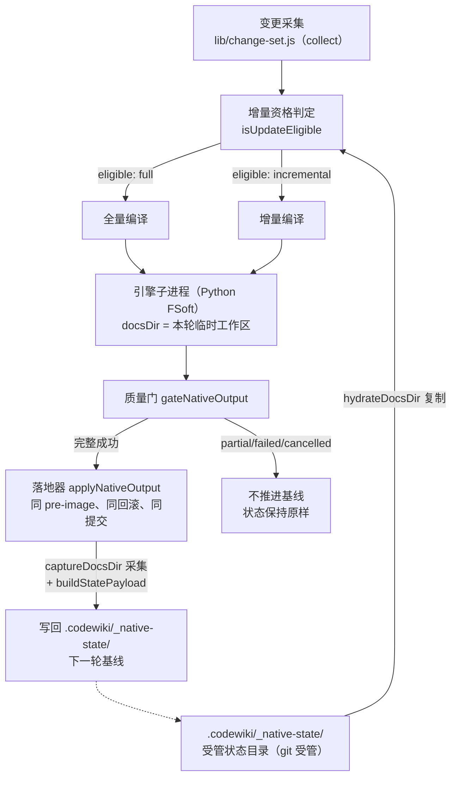
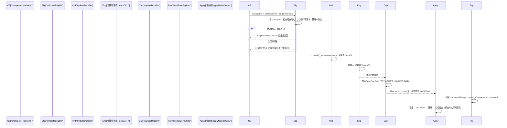
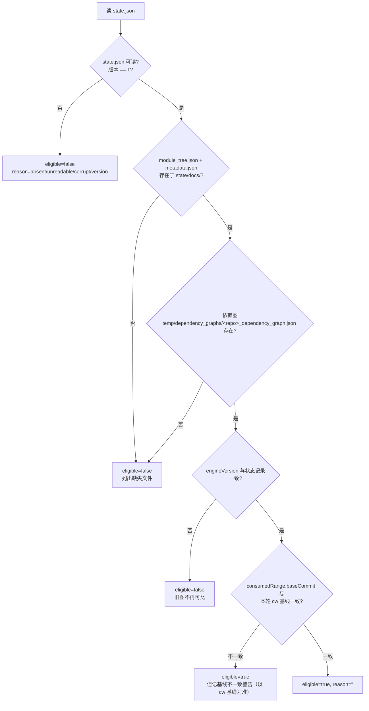
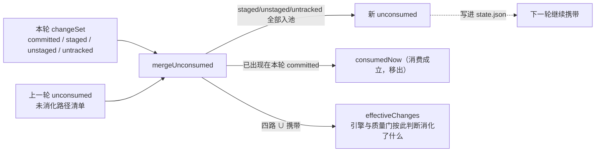

# 原生引擎跨轮受管状态管理（native_state_management）

## 概述

`lib/engine/native-state.js` 是原生引擎（FSoft Python 子进程）**跨轮增量的持久化底座**。原生引擎的组件级增量不是「再跑一遍全量然后挑几篇改」——它必须能读到上一轮留下的四样东西：

1. `module_tree.json` —— 上一轮的模块树（缺了它，引擎内部 `_update_options()` 直接返回 `None`，整个增量退化成全量）；
2. `temp/dependency_graphs/<repo>_dependency_graph.json` —— 上一轮的依赖图（用于 graph diff）；
3. `metadata.json` —— 上一轮的生成信息（`generation_info.commit_id` 是 updater 的 old_commit）；
4. 上一轮的全部文章 —— updater 是**原地 patch**，页面不在就要走 missing_page 重建，等于白退全量。

而这些文件本都写在引擎本轮的临时 `docsDir` 里（每轮一个新 job id），轮与轮之间什么都不留。如果不把它们持久化，第二轮必然退全量 —— 那正是「每轮都在全量重编、又慢又贵，却一路绿到底」的根源。本模块就是为消灭这个问题而存在的统一增量持久化层。

## 在系统中的位置



上图中：**状态目录在仓库内受 git 管理（权威），docsDir 在本轮临时目录里（引擎就地消费）**，水合时是「复制」而非「移动」，任何一侧写坏都不影响另一侧。

## 核心设计决策

### 1. 状态目录为什么必须以 `_` 开头

`cw index`（`vendor/codewiki/src/main.rs`）会 `WalkDir` 递归整个 `.codewiki/`，收录所有 `.md`，**只**跳过仓库相对路径以 `_` 开头的项。若放在 `.codewiki/temp/native-state/`，持久化的原始文章会被 cw index 收成**第二份**文章——同一页在索引里出现两条链接。

因此状态目录固定为：

```js
export const NATIVE_STATE_DIR = '.codewiki/_native-state'
```

整棵子树首段就是 `_native-state`，cw index 自然跳过；落地器的「索引必须收录本次写的 .md」校验也带同样的 `seg.startsWith('_')` 过滤（见 [plan_application](plan_application.md) 的 `findArticlesMissingFromIndex`）。

### 2. 三条不变量

| # | 不变量 | 违反后果 |
|---|--------|----------|
| 1 | 只有「完整成功」才允许把本轮采集到的状态写成下一轮基线（consume） | partial/failed/cancelled 一律不推进，否则未消化的变化会被当成已消化 |
| 2 | 状态不完整（缺图 / 缺 module_tree / 版本不符 / 基线不可达）→ 显式 full，并在 `state.json` 留 `fallbackReason` | 绝不假装 clean，悄悄退全量会骗过用户 |
| 3 | 水合是**复制**而不是移动 | 源在仓库受 git 管理，目标在临时目录；本轮写坏不毁掉下一轮输入 |

状态文件与文章走**同一个** pre-image、同一次回滚、同一个自动提交（通过落地器的 `extraFiles`），因此「图 / 模块树 / metadata 与文章同事务」是结构性保证，而非约定。

## 目录布局与文件清单

```
.codewiki/_native-state/
├── state.json                    # 受管凭据（版本号、消费范围、未消化路径、审计字段）
└── docs/                         # 上一轮 docs 树的完整副本（水合源）
    ├── module_tree.json          # 【硬依赖】上一轮模块树
    ├── metadata.json            # 【硬依赖】上一轮生成信息
    ├── *.md                      # 上一轮全部文章（updater 原地 patch 的目标）
    ├── temp/reference_index.json # 白名单 temp 文件
    ├── temp/artifact_index.json  # 白名单 temp 文件
    └── temp/dependency_graphs/   # 白名单 temp 目录（按仓库名 sanitize）
        └── <repo>_dependency_graph.json
```

关键常量：

```js
export const NATIVE_STATE_VERSION = 1
export const STATE_REQUIRED_DOCS = Object.freeze(['module_tree.json', 'metadata.json'])
export const STATE_TEMP_FILES = Object.freeze(['temp/reference_index.json', 'temp/artifact_index.json'])
export const STATE_TEMP_DIRS = Object.freeze(['temp/dependency_graphs'])
```

**依赖图文件名对齐陷阱**：引擎只读 `<sanitize(仓库名)>_dependency_graph.json`。Python 的 `sanitize_repo_name` 用 Unicode `isalnum`，中文/日文会原样保留。因此 `graphFileName()` 必须用 `/[^\p{L}\p{N}]/gu` 而不是 `[A-Za-z0-9]` —— 后者会把中文仓库名的图判成「缺失」，每轮白退全量。

## 核心函数与数据流

### 一轮编译的状态生命周期



### 资格判定 `isUpdateEligible` 的检查项



设计要点：**每个不可增量的原因都要显式说出来**（进 `fallbackReason`），因为「悄悄退全量」会让用户以为增量生效了、实际每轮全量重编（又慢又贵）。

### 跨轮「未消化变化」机制 `mergeUnconsumed`

这是消灭第二类丢变化的关键。问题场景：FSoft 组件级增量读的是**工作区实际文件**构建新图，未提交的改动会被引擎看见并写进文章；但 cw 基线（`_meta.yaml:last_compiled_commit`）推进的是 HEAD。于是「文章已覆盖未提交改动，基线却停在 HEAD」—— 下一轮 change-set 从新 HEAD 算起，那些未提交改动就再也算不进变化集，文章与源码脱节而系统一路绿到底。

解法：



只有当路径真的出现在 `git diff base..HEAD`（即 committed）里，才算「消费成立」并移出携带清单。

### 原始树留档 `archiveDocsTree`

引擎把产物直接写进临时 `docsDir`，后续 gate / 采集 / 落地器都在它上面就地加工（裁剪过期状态、删孤儿页、按映射改写）。也就是说**原始产物被就地消费**，一旦落地器做了无法从 `.codewiki/` 反推的加工，就没有任何地方能回答「引擎到底给了什么」。

`archiveDocsTree({docsDir, destDir})` 把整棵原始 docs 树复制一份留档作为事实来源。关键约束：

- **destDir 必须在仓库外**：`.codewiki/` 下任何非 `_` 开头的目录都会被 cw index 收成文章副本；
- **源与目标互不嵌套**（两个方向都查），否则会把刚拷好的文件当源继续拷；
- **失败语义**：留档是证据不是产物，拷不动就记 `ok:false + error`，绝不因此让一次编译失败。

## `state.json` 数据契约

```json
{
  "stateVersion": 1,
  "repoRoot": "...",
  "consumedRange": { "baseCommit": "...", "headCommit": "..." },
  "pendingChanges": {
    "state": "...", "baseCommit": "...", "headCommit": "...",
    "committed": [], "staged": [], "unstaged": [], "untracked": [],
    "deleted": [], "renamed": [], "reason": "..."
  },
  "unconsumed": ["lib/foo.js"],
  "engineVersion": "...",
  "scope": "full",
  "effectiveScope": "incremental",
  "updateOutcome": "done",
  "fallbackReason": "",
  "notes": [],
  "updatedAt": "2025-..."
}
```

关键设计：`state.json` **不记录本轮结局**，只记录「本轮开始时的已消费范围」与「本轮看见了哪些变化」。原因是本轮结局（基线是否推进）的权威在 `.codewiki/_meta.yaml`，而 `state.json` 要在 apply 之前就落盘（与文章同一份 pre-image）。写成「本轮结局」就必须在 apply 之后再改一次文件，会造出第二个提交且回滚语义分叉。

配套的 `stateFingerprint(text)` 去掉 `updatedAt` / `notes` 后算实质内容指纹：只有实质内容变了才写新时间戳，避免「无变化路径也重写并产生一次真实提交」。

## 与周边模块的关系

| 关系 | 模块 | 说明 |
|------|------|------|
| 上游输入 | [Extension_Host_Execution_Orchestration/change_set_management](../../Extension_Host_Execution_Orchestration/change_set_management.md) | `collect` 产出的 ChangeSet 是 `mergeUnconsumed` 与 `buildStatePayload` 的输入 |
| 下游消费 | [python_native_runtime](python_native_runtime.md) | 引擎 Python 侧读水合后的 `module_tree.json` / 依赖图决定走增量还是全量 |
| 同事务落地 | [plan_application](plan_application.md) | 状态文件经 `captureDocsDir` 产出写集，作为 `extraFiles` 与文章同 pre-image、同回滚、同提交；落地器的写集白名单 `.codewiki/` 天然覆盖 `_native-state/` |
| 协议边界 | [engine_client](engine_client.md) / [engine_contracts](engine_contracts.md) | `docsDir` 是引擎子进程的写盘目标，本模块在它之外负责跨轮持久化 |
| 路径归一 | `lib/git-paths.js::toPosix` | 全模块唯一的 POSIX 归一实现（见 [job_log_management](../../State___Observability_Management/job_log_management.md)） |
| 原始树留档 | —— | `archiveDocsTree` 留档到仓库外临时目录，不经任何索引 |

## 公开 API 一览

| 函数 | 职责 |
|------|------|
| `stateDocFiles(stateDir)` | 返回状态文件的仓库相对路径清单（供审计「哪些路径属于受管状态」） |
| `isStateDocPath(rel)` | 判一份 docs 文件要不要进受管状态（白名单 temp、排除其余中间件） |
| `readState(stateDir, repoRoot)` | 读 state.json，边界上**必须检查**磁盘残留 / 旧版本 / 手改 JSON |
| `readStateText(stateDir, repoRoot)` | 读原始文本，用于「内容未变就不重写」的字节比较 |
| `isUpdateEligible({...})` | 判断能不能走真实增量；每种不可增量原因都产出人可读的 reason |
| `hydrateDocsDir({...})` | 把受管状态**复制**进本轮 docsDir（跑引擎之前） |
| `captureDocsDir({...})` | 把 docsDir 里的状态采集成写集 `{rel, content}[]`（utf8 校验拒收非文本） |
| `buildStatePayload({...})` | 组装下一轮 state.json 凭据 |
| `stateFileItem(payload)` | 把 state.json 内容包成一条写集项交给落地器 |
| `stateFingerprint(text)` | 去时间戳的实质内容指纹，避免无变化提交 |
| `mergeUnconsumed({changeSet, prevUnconsumed})` | 纯函数：跨轮未消化路径的合并与「消费成立」判定 |
| `archiveDocsTree({docsDir, destDir})` | 整棵原始 docs 树复制留档（证据，失败不阻塞编译） |
| `graphFileName(repoRoot)` | 依赖图文件名，Unicode 感知的仓库名 sanitize |

## 设计动机小结

本模块解决两类历史缺陷：

1. **每轮退全量**：`_update_options()` 找不到上一轮模块树 / 图 → 增量能力名存实亡。解决：跨轮持久化 + 显式 full 回退带 `fallbackReason`。
2. **丢未提交变化**：基线按 HEAD 推进，工作区未提交改动被引擎写进文章后再也算不进变化集。解决：`unconsumed` 携带机制 + 「committed 才移出」的消费成立判据。

二者共同保证：「文章与源码同进度」「增量真的是增量」「失败/取消绝不伪造已消化」这三条端到端语义成立。
