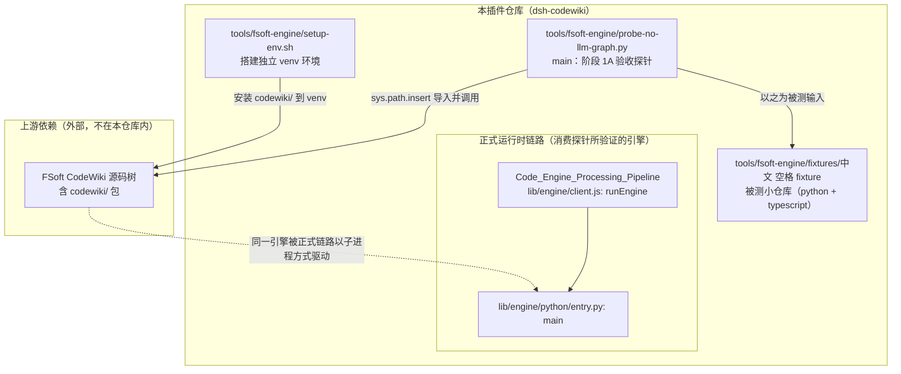
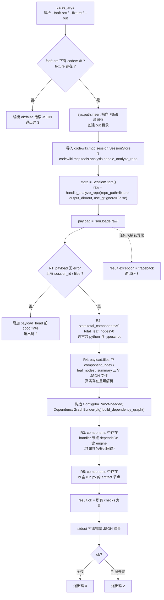
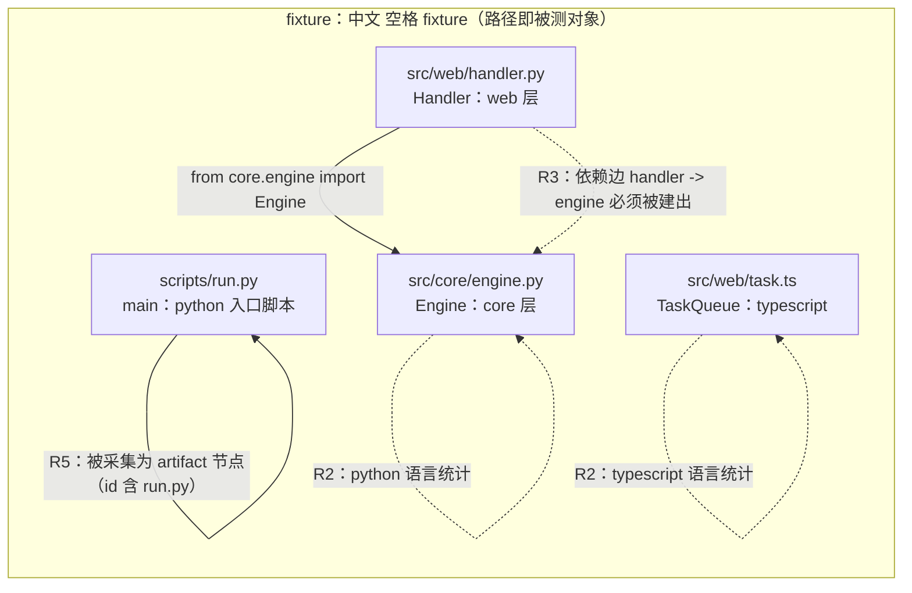

# probe_tools（探针工具集）

## 简介

`probe_tools` 是 [Testing___Probing_Tooling 测试与探针工具](testing-probing-tooling.md) 模块下的一个子模块，当前仅包含一个验收探针：`tools/fsoft-engine/probe-no-llm-graph.py`。它的唯一入口是文件中的 `main` 函数。

该探针是 **FSoft 原生引擎迁移到本插件过程中的「阶段 1A」引擎侧验收工具**，核心目标是：在**完全不依赖 LLM、不依赖 DSH 插件进程、不需要任何模型凭证**的前提下，验证上游 FSoft CodeWiki 引擎的原生依赖图分析链路（`handle_analyze_repo`，基于 tree-sitter 静态分析）能否在**含中文与空格的路径**下跑通。

设计动机是分层排障：整条迁移链路（图分析 → LLM 摘要 → 文章生成）的故障可能来自「模型链路」或「图/artifact 链路」两类。先把唯一完全无模型的一环跑通，才能在后续阶段 1B/1C 里把两类故障分开定位。

---

## 在系统中的位置



要点：

- 探针是**开发期/验收期**工具，不参与插件运行时；但它验证的 `handle_analyze_repo` / `DependencyGraphBuilder` 正是正式链路 [Code_Engine_Processing_Pipeline](code-engine-processing-pipeline.md) 中 `native-run`（见 [python_native_runtime](python-native-runtime.md)）与 `runEngine`（见 [engine_client](engine-client.md)）所驱动的上游 Python 引擎能力。
- 探针使用的 fixture 是 [testing_fixtures](testing-fixtures.md) 子模块的一部分（`中文 空格 fixture`），二者配合构成「探针 + 被测仓库」的完整验收组合。

---

## 命令行用法

```bash
python tools/fsoft-engine/probe-no-llm-graph.py \
    --fsoft-src <FSoft 仓库根，含 codewiki/ 包> \
    [--fixture <被测小仓库，默认仓库内 fixtures/中文 空格 fixture>] \
    [--out <工作/输出目录，默认 tools/fsoft-engine/out-1a>]
```

| 参数 | 必填 | 默认值 | 含义 |
| --- | --- | --- | --- |
| `--fsoft-src` | 是 | 无 | FSoft 源码根目录，其下必须存在 `codewiki/` 包目录；脚本会校验并以 `sys.path.insert(0, ...)` 导入 |
| `--fixture` | 否 | `tools/fsoft-engine/fixtures/中文 空格 fixture` | 被测小仓库路径，默认 fixture 本身就带「中文 + 空格」以验证非 ASCII 路径健壮性 |
| `--out` | 否 | `tools/fsoft-engine/out-1a` | 工作/输出目录，自动创建，引擎会在此落 workspace artifacts |

前置环境准备：在运行探针之前，通常先用同目录的 [setup-env.sh](build-deployment-config.md) 搭建独立 venv（冻结依赖快照 `locked-requirements.txt` + 约束 `constraints.txt`，再 editable 安装 `codewiki`，最后 `pip check` + import 冒烟）。注意 setup 脚本只在插件仓库**之外**建环境，不把 venv 提交进 git。

---

## 执行流程与判据

探针的 `main` 函数按「校验入参 → 导入引擎 → 跑分析 → 逐条判定 R1–R5 → 输出 JSON 结果」组织：



五条验收判据（R1–R5）汇总：

| 判据 | 键名 | 验证内容 |
| --- | --- | --- |
| R1 | `R1_analyze_returned` | `handle_analyze_repo` 返回非 `error` JSON，且含 `session_id` 与 `files` |
| R2 | `R2_nodes_and_languages` | 组件数 > 0、叶子节点数 > 0，语言集合同时覆盖 `python` 与 `typescript` |
| R3 | `R3_dependency_edge` | 依赖图中存在 `core.engine` → `web.handler` 方向的边（即 `handler` 组件声明依赖 `engine`） |
| R4 | `R4_workspace_files` | workspace 落盘的 `component_index.json` / `leaf_nodes.json` / `summary.json` 真实存在且可被 JSON 解析 |
| R5 | `R5_artifact_node` | `scripts/run.py` 被采集为 artifact 节点（id 含 `run.py`） |

> R3 的实现细节：除了主路径（遍历 `dependsOn`，节点 id 含 `handler` 且依赖中含 `engine`），还带一个回退分支（属性名可能是 `depends_on`），以兼容上游引擎的不同字段命名。R5 同理只按组件 id 是否包含 `run.py` 做宽松匹配。

退出码约定：

| 退出码 | 含义 |
| --- | --- |
| `0` | 全部判据通过 |
| `2` | 判据未通过（R1 失败会提前返回并附上 `payload_head` 前 2000 字符辅助排障） |
| `3` | 前置校验失败（`--fsoft-src` 缺 `codewiki/` 包、`--fixture` 不存在）或运行期未捕获异常（附完整 `traceback`） |

---

## 与 fixture 的对应关系

探针的 R2/R3/R5 判据不是任意的——它们精准对应 [testing_fixtures](testing-fixtures.md) 中 `中文 空格 fixture` 的结构：



即：fixture 故意同时包含 python（`engine.py` / `handler.py` / `run.py`）与 typescript（`task.ts`）两种语言、一段明确的跨层 import（`handler -> engine`）、以及一个独立的脚本入口 `scripts/run.py`，让 R2/R3/R5 有可判定的对错答案。同时 fixture 的目录名「中文 空格 fixture」本身就是对非 ASCII 路径的压力测试。

---

## 输出 JSON 结构

探针在 stdout 打印一份带 `indent=2` 的 JSON，便于人读与 CI 抓取：

```json
{
  "checks": { "R1_analyze_returned": true, "R2_nodes_and_languages": true, "R4_workspace_files": true, "R3_dependency_edge": true, "R5_artifact_node": true },
  "ok": true,
  "fsoft_src": "<绝对路径>",
  "fixture": "<绝对路径>",
  "payload_keys": ["files", "session_id", "stats"],
  "raw_len": 12345,
  "stats": { "total_components": 4, "total_leaf_nodes": 3, "languages": { "python": 3, "typescript": 1 } },
  "workspace_files": { "component_index": {"path": "...", "exists": true, "items": 4}, "leaf_nodes": {"path": "...", "exists": true, "items": 3}, "summary": {"path": "...", "exists": true, "items": 1} },
  "edge_sample": [{"id": "web.handler", "dependsOn": ["core.engine"]}],
  "edge_count": 2,
  "artifact_ids": ["scripts/run.py"],
  "payload_head": "/* 仅 R1 失败时附带 */",
  "exception": "/* 仅异常时附带完整 traceback */"
}
```

---

## 设计约束与注意事项

1. **完全无模型**：探针构造 `Config` 时把 `llm_base_url` / `llm_api_key` 置为 `"not-needed"`，`main_model` / `cluster_model` 置为 `"unused"`——明确表达「这条链路不该碰网络/凭证」。这也是它能在离线 CI 中运行的前提。
2. **不碰 DSH 插件进程**：探针直接以 `python` 解释器运行，绕过 [Extension_Host_Execution_Orchestration](extension-host-execution-orchestration.md) 与 [vscode_extension_client](vscode-extension-client.md) 这条插件主线，仅验证上游 Python 引擎本身。
3. **路径敏感性**：默认 `--fixture` 指向含空格与中文的目录，任何一步若对路径编码处理不当（`Path` 解析、`json.dumps(ensure_ascii=False)`、tree-sitter 读取）都会在 R1/R4 暴露。
4. **与环境搭建的耦合**：探针能否导入 `codewiki` 依赖先由 [setup-env.sh](build-deployment-config.md) 装好独立 venv；若直接用系统 python 跑，通常会因缺 `tree_sitter` / `openai` 等依赖而以退出码 3 失败。

---

## 相关页面

- 父模块：[Testing___Probing_Tooling](testing-probing-tooling.md)
- 配套 fixture：[testing_fixtures](testing-fixtures.md)
- 所验证引擎的正式运行时封装：[Code_Engine_Processing_Pipeline](code-engine-processing-pipeline.md)（尤其 [python_native_runtime](python-native-runtime.md)、[engine_client](engine-client.md)、[module_indexing](module-indexing.md)）
- 环境搭建脚本（同属 [build_deployment_config](build-deployment-config.md)）：`tools/fsoft-engine/setup-env.sh`
