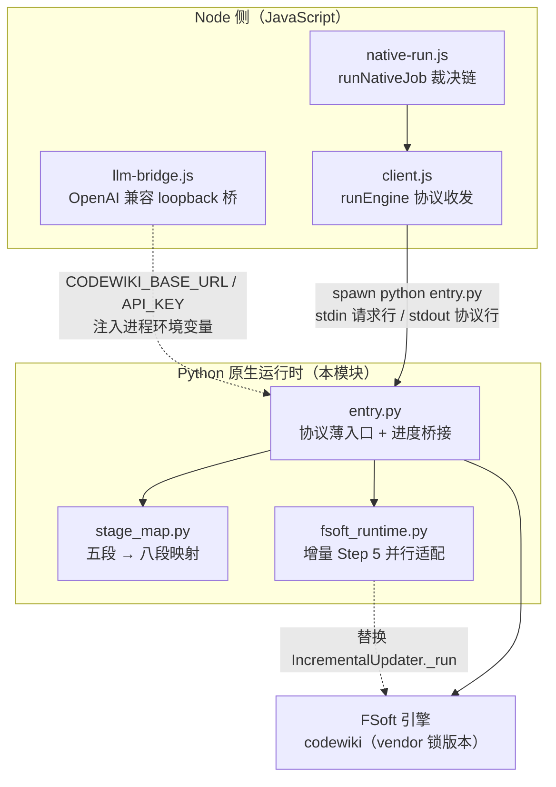
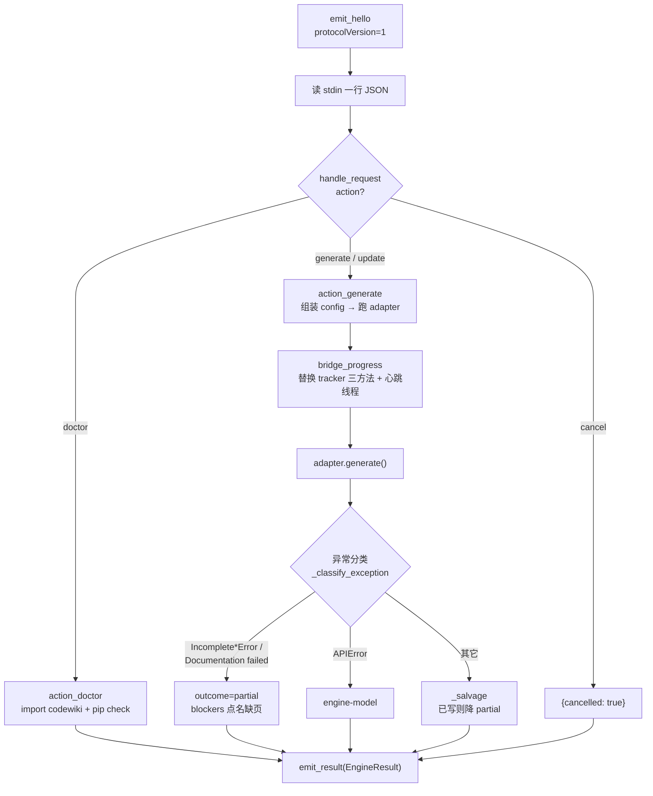

# Python 原生运行时（python_native_runtime）

## 概述

`python_native_runtime` 是 [Code_Engine_Processing_Pipeline/code_engine_module.md](code-engine-module.md) 的子模块，承担「Node 主进程 ↔ FSoft 原生引擎（`codewiki` Python 包）」之间的**跨进程协议边界**。它本身**不实现任何算法**——依赖图构建、模块聚类、文章写作、增量 diff 全部由 FSoft 自己完成；本模块只做四件事：

1. 把 Node 通过 stdin 发来的一行 JSON 请求（`doctor` / `generate` / `update` / `cancel`）翻译成一次 FSoft 调用；
2. 把 FSoft 的五段进度翻译成引擎八段契约的进度帧，以 JSON 行推回 Node；
3. 把成功 / 失败 / 取消翻译成结构化的 `EngineResult`，与 [engine_contracts](engine-contracts.md) 的语义完全一致；
4. 守住两条红线：**不读本机凭证库**、**不让 FSoft 的人类打印污染协议流**。

## 架构定位

Node 侧通过 `spawn` 启动 `python entry.py`，请求以**一行 JSON + 换行**从 stdin 注入，协议帧（`hello` / `progress` / `result`）以 JSON Lines 从 stdout 逐行读出。这条管道的语义由 [engine_client](engine-client.md) 的 `runEngine` 负责收发与超时/静默/取消裁决，本模块只负责 Python 这一端。

## 核心组成

### 1. 协议薄入口 `entry.py`

入口在**导入任何 `codewiki` 模块之前**就完成两件关键防护：

- **stdout 守卫**（`_ProtocolOnly`）：把 `sys.stdout` 换成只允许协议写出的替身——普通 `write` 全部改道 stderr（变成日志），协议行走保存下来的真实 stdout 句柄。因为 FSoft 大量用 `print` / `click.secho` 往 stdout 写人类文案，而 click 会缓存 text stdout 包装器，「事后替换」拦不住已缓存的引用。
- **UTF-8 钉死**：stdout/stderr/stdin 三条流都按 UTF-8 重配（`_popen_init_utf8` 还顺手给 FSoft 内部 `subprocess` 的 text 模式打默认编码补丁），避免 Windows locale（cp936/gbk）把中文路径的请求行误解码成乱码。

请求处理主循环的关键路径：

入口刻意**绕开 `ConfigManager`**：模型通道一律从进程环境变量读取（`CODEWIKI_BASE_URL` / `CODEWIKI_API_KEY` / `CODEWIKI_MAIN_MODEL` / `CODEWIKI_CLUSTER_MODEL`），密钥只活在内存里，不落盘、不读本机 keyring。桥的另一端由 [llm_integration_bridges](llm-integration-bridges.md) 的 `startLlmBridge` 提供——它在 Node 侧起一个 loopback HTTP 服务，把 `llm.stream` 适配成 OpenAI 兼容端点。

**单模块请求预算（`request_limit`）**：上游默认 100，但 `doc_guard.run_until_doc_written` 在模块没写出页面时会续发最多 2 次提醒，每次提醒都是一次独立 `agent.run(usage_limits=...)`，各自吃满一份预算——大模块会在 100 次请求处撞上限，pydantic-ai 抛「The next request would exceed the request_limit」，经 `_classify_exception` 翻成 `article-missing`，整轮从 done 掉成 partial（语义对、预算错：同一轮已写好的几十篇白写）。因此 `action_generate` 从请求行的 `requestLimit` 取值（硬顶 1000，非正值忽略），**未下发时用 300 而不是上游的 100**，避免「插件没传就退回旧坑」；`agent_retries=3` 与 `module_concurrency`（默认 1，硬顶 8）同样在此组装。

**进度桥接（`bridge_progress`）** 是入口里最重的一段逻辑，负责把 FSoft 的 `ProgressTracker` 事件翻成协议帧：

- 替换 `start_stage` / `update_stage` / `complete_stage` 三个方法（旁路观察，不改 FSoft 行为）；
- `writtenCount` 靠**产物指纹表**（`_doc_fingerprints`，按 `(size, mtime_ns)` 比对）真实清点本轮改动篇数，并做 2 秒节流；
- **心跳线程**：阶段 3（Documentation Generation）在 `verbose=False` 下一帧进度都不发，实测可跑 40 分钟以上——入口每 60 秒重发当前阶段与真实篇数，让 Node 侧能区分「慢」与「僵死」（这与 [engine_client](engine-client.md) 的 `silenceMs` 静默判定配套）；
- **细节探针**：把 `codewiki.src.be` logger 临时降到 INFO 并挂只读 handler，从日志文本抽出「正在写哪个模块 / 正在聚类哪个子树」拼进进度消息；任何观测异常都被吞掉，绝不因观测失败弄崩编译。

**终态合成**：异常分类（`_classify_exception`）按异常**类型**而非消息文本分派（文本随版本漂移）；崩溃或模型失败时走 `_salvage`——只要已写出文章就降成 `partial` 交付，而不是整轮判 `failed`，从而打破「failed → 不持久化状态 → 下一轮退回全量 → 再撞同一堵墙」的循环。

### 2. 阶段映射 `stage_map.py`

这是 Node 与 Python 唯一共享的**枚举口径**，纯函数、无副作用。FSoft 的 `ProgressTracker` 只有五段（依赖分析 40% / 模块聚类 20% / 文档生成 30% / HTML 5% / 收尾 5%），而契约（[engine_contracts](engine-contracts.md) 的 `ENGINE_STAGES`）有八段。映射规则：

| FSoft 阶段 | 权重 | 契约阶段 |
|---|---|---|
| 1 Dependency Analysis | 0.40 | `graph` |
| 2 Module Clustering | 0.20 | `cluster` |
| 3 Documentation Generation | 0.30 | `articles` |
| 4 HTML Generation | 0.05 | `validate` |
| 5 Finalization | 0.05 | `validate` |

两个关键设计：

- **进度上限压在 90%**：FSoft 只覆盖八段中的前四段；`index` / `baseline` / `commit` 由 Node 侧后续执行，留 10% 给收尾，避免「引擎说 100% 但 wiki 还没索引/提交」的假完成。
- **增量轮旁路识别**：FSoft 的增量更新复用 `start_stage(2, "Incremental Update")` 槽位——阶段号 2 是私有槽位，description 才是语义。`is_incremental` 按 description 认出增量轮后，一律按 `articles` 槽位报进度，否则 90 分钟的文章写作会被面板显示成「聚合类模块」且进度死钉在 36%。

`articles_ceiling()` 返回 articles 槽位的百分比上限（阶段 3 完成时的值），供测试与日志回放反向断言映射表与 `contract.js` 的 `ENGINE_STAGES` 集合完全一致。

### 3. 增量并行运行时 `fsoft_runtime.py`

上游 `IncrementalUpdater` 把所有叶子模块放在同一个 docsDir 里**严格串行**执行——一篇文章约 12 分钟，16 个节点串跑 180 分钟预算耗尽只写出 18 篇。本文件提供受控并行适配：

- **隔离工作副本**：每个叶子先拷贝一份 docsDir 到临时 workspace 跑模型调用，再按原顺序把真实页面变化（`page_hashes` diff）合并回主 docsDir；
- **冲突回退**：同一页被多个叶子修改时，后序叶子丢弃隔离分支结果、在已合并的现场**串行重跑**，保留串行语义；
- **叶子级断点**：`write_checkpoint` / `_load_completed` 把每个已完成叶子的账本 delta 落盘到 `dsh_leaf_checkpoint.json`；签名（adapter 版本 + revision + 选项 + 树 + 图 + 顺序）不匹配且无可恢复基线时**拒绝混用旧现场**；
- **源码锚点安装**：`install_incremental_runtime()` 通过 `inspect.getsource` + `exec` 只替换上游 `_run` 的 Step 5 段——锚点不匹配直接抛错拒绝安装，绝不静默退回另一套算法。

调用方式：`entry.py` 在 `is_update=True` 时先 `install_incremental_runtime()` 再构造 adapter。

## 与其它模块的关系

| 方向 | 模块 | 关系 |
|---|---|---|
| 上游（调用方） | [engine_client](engine-client.md) | `runEngine` spawn 本入口、收发协议行、做超时/静默/取消裁决 |
| 上游（编排） | [native_runtime_support](native-runtime-support.md) | 裁决链组装、注入环境变量、决定 `full` / `update` |
| 契约 | [engine_contracts](engine-contracts.md) | `EngineResult` / `EngineProgress` / `ENGINE_STAGES` 的形状由 Node 侧校验，`contractVersion` 两侧同步 |
| 模型通道 | [llm_integration_bridges](llm-integration-bridges.md) | loopback 桥提供 base_url 与占位 key，本入口只从环境变量读 |
| 产物落地 | [quality_gates](quality-gates.md) | 本入口产出的 docsDir 再由 `gateNativeOutput` 裁决产物自洽性与基线许可 |
| 状态采集 | [native_state_management](native-state-management.md) | 本入口在 `artifacts.stateFiles` 报出引擎**真实产出**的跨轮状态文件（module_tree / 依赖图 / update_record），供上层交叉校验 |

## 环境与部署依赖

本运行时所在的 venv 由仓库外的 `tools/fsoft-engine/setup-env.sh` 建立：冻结清单 `--no-deps` 全量落盘（绕开 pip 依赖解析的 `ResolutionImpossible`），再 editable 安装 FSoft 源码，最后以 `pip check` 反向验证依赖闭合 + import 冒烟。入口的 `doctor` 动作是这套门禁的运行时版本——装到一半的 venv 会让 FSoft 在生成中途才因缺包崩掉，代价是一整轮模型调用白烧，所以 `doctor` 先问清楚再放行。

## 关键不变量

1. **协议行整行落盘**：心跳线程与主线程并发写 stdout，`emit` 用 `_EMIT_LOCK` 显式串行化——半行 JSON 会让 Node 侧解析器丢帧，进度就此断掉。
2. **退出码只表达进程层结果**：语义以最后那条 `result` 行为准；协议破坏用 `0` 退出 + failed result 表达，让 Node 拿到结构化失败原因。
3. **观测失败绝不弄崩编译**：细节探针、指纹清点、用量提取、状态文件列举全部包 try/except——进度是观测值，不能因为它把编译搞崩。
4. **错误信息绝不拼凭证**：模型通道缺项的报错只说「环境变量未设置」，不打印值，避免密钥被写进 job 日志。
