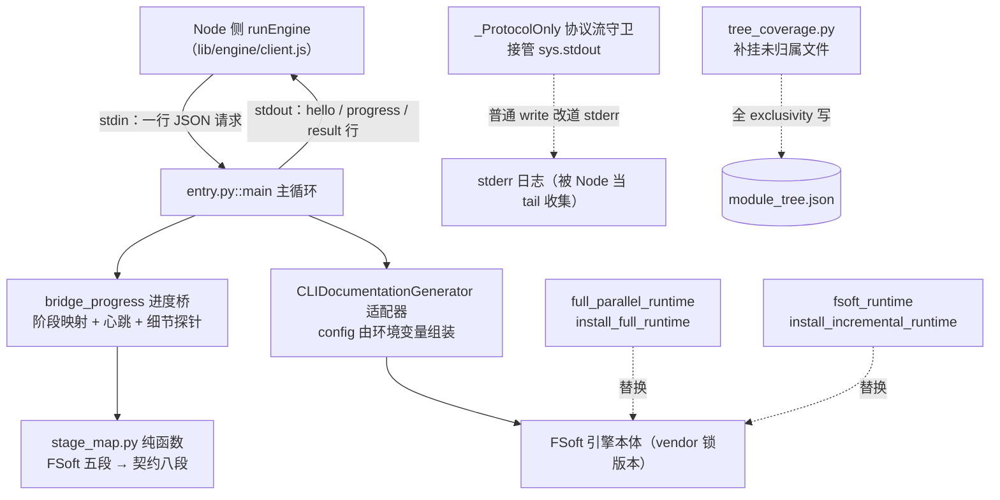
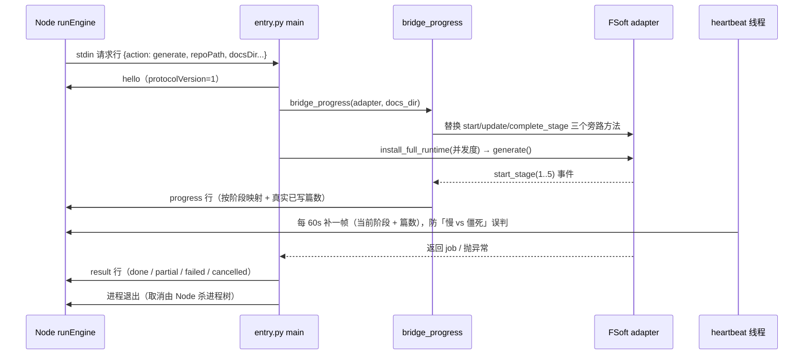

# Python 并行 Agent 执行运行时（Python_Parallel_Agent_Execution_Runtime）

## 模块定位与目的

本模块是 CodeWiki 引擎子系统中**驻留在 Python 解释器侧**的执行层，全部代码位于 `lib/engine/python/`。它把上游 FSoft 引擎（CodeWiki Python 实现，vendor 锁版本）作为子进程驱动起来，自身**不实现任何算法**——依赖图、模块聚类、文章写作、增量 diff 全部由 FSoft 本体完成。本模块只承担四件事：

1. **JSON-lines 薄入口**：把 Node 侧通过 stdin 发来的一行 JSON 请求（`doctor` / `generate` / `update` / `cancel`）翻译成一次 FSoft 调用，并把成功/失败/取消翻译成与 Node 侧同语义的 `EngineResult` 终态行；
2. **进度桥接**：把 FSoft 的五段进度翻译成引擎契约的八段阶段（见 [阶段契约模块](core-engine-public-api-result-validation.md)，同属本子系统），以 JSON 行推给 Node；
3. **并行运行时适配**：在不修改 vendor 源码的前提下，用源码锚点替换的方式，把 FSoft 全量生成与增量更新的串行叶子执行改造成受控并行；
4. **两条红线**：**不读本机凭证库**（模型密钥只活在进程环境变量里）、**不让 FSoft 的人类打印污染协议流**（stdout 在 import 任何 codewiki 模块之前就被接管）。

## 架构概览

整个模块的进程拓扑是：Node 通过 `spawn` 拉起 `entry.py` 解释器进程，**一个进程只处理一条请求行后退出**（见 `main` 的主循环），取消由 Node 侧直接杀进程树完成，而不是靠协议内的 cancel 消息。

## 子模块划分

本模块按「协议/入口」与「并行运行时适配」两条清晰边界组织为两组职责（因代码体量与耦合度直接在本页展开，不再拆子页）：

### 1. JSON-lines 入口与进度桥接（`entry.py` + `stage_map.py`）

**`_ProtocolOnly`** —— `sys.stdout` 的替身守卫，在 import 任何 codewiki 模块之前安装。普通 `write` / `flush` 全部改道 stderr（变成日志），`isatty()` 返回 False，`fileno()` 转发 stderr 句柄（防止某些库探测终端时抛错）。协议消息必须经 `emit()` 写出：先 `json.dumps(ensure_ascii=False)`，再持 `_EMIT_LOCK` 整行写入保存的真实 stdout（`_REAL_STDOUT`）并 flush——心跳线程与主线程并发写时，半行 JSON 会让 Node 侧解析器丢帧。

**`_popen_init_utf8`** —— 给 `subprocess.Popen.__init__` 打的默认编码补丁：只在 `text=True/tt=True` 且调用方未显式给 `encoding/errors` 时补 `encoding=utf-8, errors=replace`，二进制调用保持原样。用于兜底 FSoft 内部（如 `repo_analyzer.py`）在 Windows locale（gbk）下解码 git 输出导致的 `UnicodeDecodeError`。同文件顶部还把入口自己的三条 stdio 流钉成 UTF-8（stdout/stderr 用 `errors="replace"`、stdin 用 strict），因为中文路径的请求行被按 cp936 误解码会变成不可复现的「仓库路径不存在」。

**`main`** —— 主循环是「一进程一请求」：先发 `hello` 行 → 读一行 stdin → `handle_request` 分派（`doctor` / `generate` / `update` / `cancel`）→ 发 `result` 行 → 退出。请求形参两种形状都认：顶层平铺优先（契约实际形状），嵌套 `payload` 对象兜底（外部调用方兼容）。`cancel` 只是控制面应答 `{cancelled: true}`，真正的取消由 Node 侧杀进程树完成。

**进度桥（`bridge_progress`）** —— 替换 adapter 的 `progress_tracker` 三个方法（旁路观察，不改 FSoft 行为）：把 FSoft 五段事件翻成协议 progress 行。三个关键机制：

- **真实篇数**：`writtenCount` 按「进场指纹表 vs 当前指纹表」（`(size, mtime_ns)` 逐路径比对）算本轮真实改动篇数，而不是 docs 绝对篇数——增量轮通常只改写已有页面，绝对篇数会误报。普通 update 按 `_WRITTEN_RECOUNT_SEC = 2.0` 节流，阶段切换/完成必算。
- **心跳**：FSoft 阶段 3 的 `update_stage` 全部被 `verbose=False` 门控，一帧都不发，真机上可静默 40 分钟以上。挂在 `adapter.generate` 上的守护线程每 60 秒重发当前阶段 + 当前篇数（不谎报进展），让 Node 侧区分「慢」与「僵死」；任务结束在 `finally` 里停表。
- **细节探针**：`attach_detail_tap` 临时把 `codewiki.src.be` logger 降到 INFO 并挂只读 `_DetailHandler`，用正则从日志文本抽「正在写哪个模块/正在聚类哪个子树」拼进进度帧 message；同时把会放行 INFO 的既有 handler 提到 WARNING，避免噪音灌进 stderr。观测失败一律吞掉，绝不弄崩编译。

**异常分类（`_classify_exception`）** —— 按异常**类型**（而非文本）分类：`IncompleteGenerationError` / `IncompleteDocumentationError` 与「`Documentation failed for modules:` 开头的 RuntimeError」→ partial + article-missing blockers（已写页面照样交付）；`APIError` 族 / `ConfigurationError` → `engine-model`；`RepositoryError` → `engine-missing`；`KeyboardInterrupt` → cancelled；其余 → `engine-crashed`。`_salvage` 是崩溃自救：若已写出文章就降成 partial 交付（打破「failed → 不持久化状态 → 下轮退回全量 → 再撞同一堵墙」的循环），一篇没写才是 failed。`SystemExit(0)`（FSoft「无变更」路径）按正常 done 终态处理。

**`stage_map.py` 的 `articles_ceiling` 与配套纯函数** —— 本文件是 Node 与 Python 唯一共享的枚举口径：`ENGINE_STAGES` 必须与 `contract.js` 双向对账（测试断言两边集合一致）。`FSOFT_TO_ENGINE` 把五段映射成契约四段（4/5 都落 `validate`，因为 HTML 生成不做、finalization 是收口）；`percent_of` 与 FSoft 权重算法同构但整体压在 90%（剩 10% 留给 Node 侧的 index/baseline/commit 收尾）；`articles_percent(written, total)` 在 articles 槽位内按「已写/预期」插值；`is_incremental` 按 description 识别增量轮（FSoft 借用阶段 2 槽位跑整轮写作，按阶段号映射会谎报成 cluster）。`articles_ceiling()` 返回 articles 槽位的百分比上限（阶段 3 完成时的值）。

### 2. 并行 Agent 运行时适配（`full_parallel_runtime.py` + `fsoft_runtime.py` + `tree_coverage.py`）

**全量并行（`full_parallel_runtime.py`）** —— 上游 `_generate_modules_in_order` 是严格串行（单篇约 12 分钟）。本文件用源码锚点校验后替换该方法：按初始树递归 `_walk`——先并发（`asyncio.gather`）跑完所有子节点，再 `await _run_module` 写当前父页，父节点在等子模块时**不占信号量**，不会自锁。并发度由 `configure_full_runtime` 设置（`module_concurrency`，默认 1 = 上游串行，硬顶 8）。

**`_SharedTreeIO` 与 `_merge_tree`** —— 并行分支各自往 `module_tree.json` 保存子模块，必须 read-merge-write。`_install_shared_tree_io` 在 `FileManager` **类方法**上（而非模块引用上）串行化 `save_json`/`load_json`：只对 basename 为 `module_tree.json` 的文件加 `_TREE_LOCK`，其余文件直通原实现。`_merge_tree` 的冲突规则：父模块的 components 是子树并集，并行分支各补不同子模块时取并集；叶子节点的 components 若两边互不为真子集才报「归属不一致」（子集关系不冲突——某分支还没见到本轮新符号是常态）。`write_tree_exclusive` 提供「读→改→覆盖写」的无合并路径，供已自行算出完整目标树的调用方（如补挂）使用。每个模块真正开工前从**磁盘**重读树（兄弟分支可能刚写入新子模块），单模块失败只进 `failures` 列表不中断同批，最后仍按上游语义 `validate_module_file_coverage` + `organize_docs` + 有失败即 `RuntimeError` 上抛。

**增量并行（`fsoft_runtime.py`）** —— 只替换 `IncrementalUpdater._run` 的 Step 5 锚点（锚点不匹配直接抛错拒绝安装）。`run_leaf_agents` → `run_leaf_order` 按依赖序执行叶子：每个叶子先 `shutil.copytree` 出**隔离工作副本**（临时目录建于 docsDir 旁），在副本里并行跑 `LeafAgentRunner` 的模型调用，再按原序比对 page_hashes 合并真实页面变化。同一页被多个叶子修改（`changes & claimed`）或任务树被改动时，丢弃隔离分支结果、在已合并现场**串行重跑**该叶子——保留串行语义的同时，不必把 overview 当全局串行锁。

**断点续跑** —— `_signature` 对「适配器版本 + revision + 选项 + 新旧树图 + 执行序」做 SHA-256；`write_checkpoint` 以 tmp + fsync + `os.replace` 原子写 `dsh_leaf_checkpoint.json` 到 docsDir。`resume` 模式下 `_load_completed` 按 signature 恢复：签名一致就把已完成叶子的 record delta 逐个 merge 回主 record；签名变化且给了受管基线 `resumeBaselineDocsDir` 时，把 docsDir 整体回滚到基线再重跑全部叶子（拒绝拿旧现场混用）。全部完成后 `clear_checkpoint`。

**叶子覆盖补挂（`tree_coverage.py`）** —— `file_owner` 直接复用上游 `module_file_owners` 查某文件的首个认领叶子（无人认领返回 None）。`adopt_unowned_files` 解决历史遗留问题：上游 Step 2 的 repair 只处理本轮 diff.added，历史上没进树的文件会让每轮增量都在 `validate_module_file_coverage` 抛 `missing=[...]` 且不自愈。补挂顺序：先按上游自己的 `route_by_rules`（叶子类型过滤）路由，失败再按「同文件 → 同目录 → 邻居多数 → 目录最近邻」的 `_nearest_leaf` 规则挂到已有叶子。`fsoft_runtime.adopt_tree_coverage` 在 Step 5 前调用它，且通过 `write_tree_exclusive` 基于**磁盘最新树**覆盖写（不用快照、不走合并），失败只记 detector_notes 不崩整轮。

## 关键设计决策

### 协议流为什么必须在 import 之前接管

FSoft 大量使用 `print` / `click.secho` 向 stdout 写人类文案，而 click 会缓存 text stdout 包装器，「事后替换 sys.stdout」拦不住已缓存的引用。因此 `_ProtocolOnly` 在模块导入最前面就替换 `sys.stdout`：普通 write 全部改道 stderr（变成日志），协议行走保存下来的真实 stdout 句柄，且所有协议写出必须经 `emit()` 加锁整行落盘——心跳线程与主线程并发写时，半行 JSON 会让 Node 侧解析器丢帧。

### 为什么不用 ConfigManager

`ConfigManager` 会读 `~/.codewiki/config.json` 或系统 keyring。迁移后模型通道由 Node 侧的 loopback 桥（[LLM 供应方桥接集成](llm-provider-bridge-integration.md)，同属本子系统）注入，密钥只存在于进程环境变量（`CODEWIKI_BASE_URL` / `CODEWIKI_API_KEY` / `CODEWIKI_MAIN_MODEL` / `CODEWIKI_CLUSTER_MODEL`），不落盘。

### 退出码语义

进程退出码只表达**进程层**结果，语义以最后那条 `result` 行为准（与 [引擎公共 API 与结果校验](core-engine-public-api-result-validation.md) 的约定一致，同属本子系统）。协议破坏用 `0` 退出 + failed result 表达，让 Node 侧拿到结构化失败原因而不是一句「exit 1」。`CONTRACT_VERSION = 3` 必须与 `contract.js` 的 `ENGINE_CONTRACT_VERSION` 同步。

### 并行适配的安装方式

两个运行时都采用**源码锚点替换**：安装时用 `inspect.getsource` 检查上游方法的锚点注释（如 `# ---- Step 5: sequential leaf agents`），锚点不匹配直接抛错拒绝安装，**绝不静默退回串行**。全量轮与增量轮安装不同的适配器：全量按拓扑树同层并发（`module_concurrency`，默认 1 = 上游原始串行，硬顶 8）；增量给每个叶子独立临时工作副本并行调用模型，再按原序合并真实页面变化，写冲突时在已合并现场串行重跑。

## 请求数据流（generate 为例）

## 与系统其他模块的关系

| 关联模块 | 关系 |
| --- | --- |
| [Core_Engine_Public_API___Result_Validation](core-engine-public-api-result-validation.md) | 同属本子系统：`CONTRACT_VERSION` 与 `ENGINE_STAGES` 的对账对端，Node 侧 `validateEngineResult` 校验本模块发出的 result 行 |
| [LLM_Provider_Bridge_Integration](llm-provider-bridge-integration.md) | 同属本子系统：向本模块进程注入模型通道环境变量（base_url / api_key / model），本模块不碰本机凭证库 |
| [Native_CodeWiki_Runtime_Lifecycle_Management](native-codewiki-runtime-lifecycle-management.md) | 同属本子系统：Node 侧 native-run 拉起本进程、`process-tree` 负责杀树取消、quality-gate 消费本模块产出的原始树 |
| [Core_Application_Runtime_Entry](core-application-runtime-entry.md) | `worker` / `runPool` 调度闸门（parallelLimit）决定何时调用 native engine 通道 |
| [Vendored_CodeWiki_Rust_Implementation](vendored-codewiki-rust-implementation.md) | vendor 目录是 Rust 侧 CLI；本模块驱动的 Python FSoft 引擎以 venv 安装形态存在，搭建见 [构建与环境搭建](build-configuration-environment-setup.md) 的 `tools/fsoft-engine/setup-env.sh` |

## 观察性设计小结

本模块大量篇幅花在「让长跑可观测」上：进度帧携带**本轮真实改动篇数**（进场指纹表 vs 当前指纹表按 `(size, mtime_ns)` 比对，不是绝对篇数）、60 秒心跳帧、从 `codewiki.src.be` logger 旁路抽取「正在写哪个模块」的细节探针（只读 handler，观测失败绝不弄崩编译）。这些设计共同服务于 Node 侧「超时但有进度 → partial 自救」的判定——见 `entry.py` 中 0.16.5 / 0.16.9 真机事故的注释。
