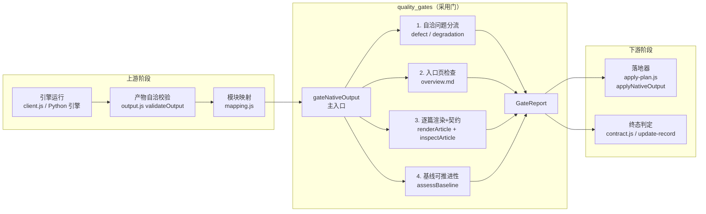
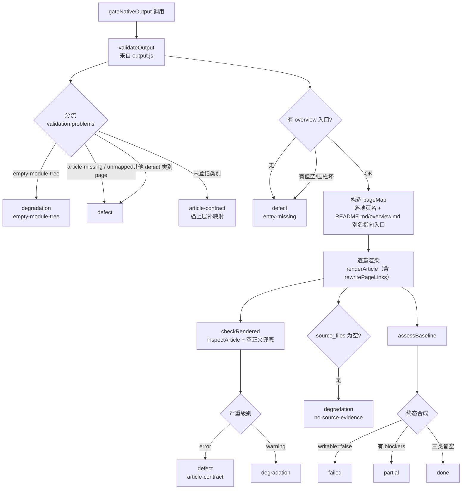
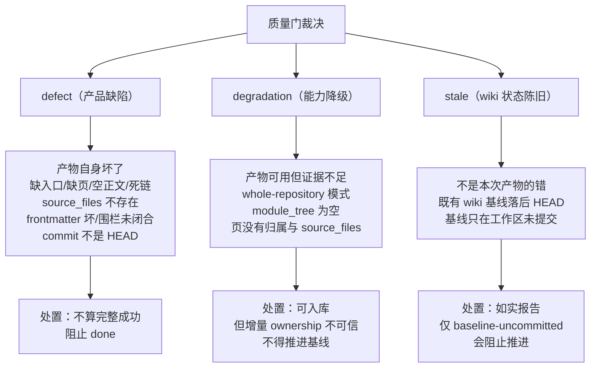
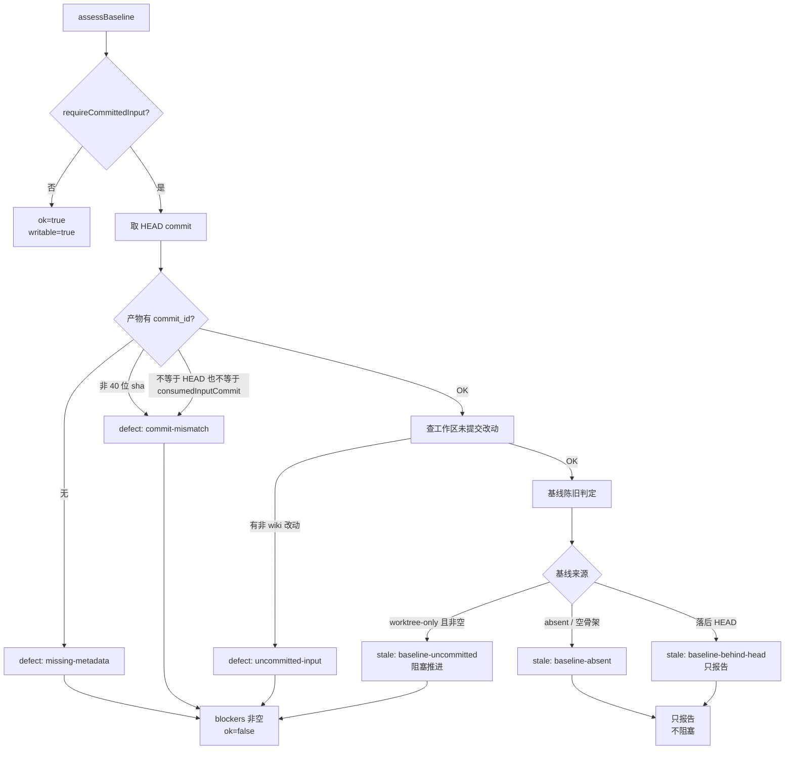
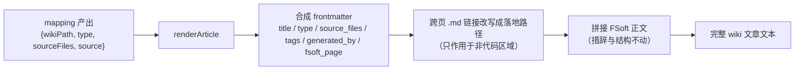
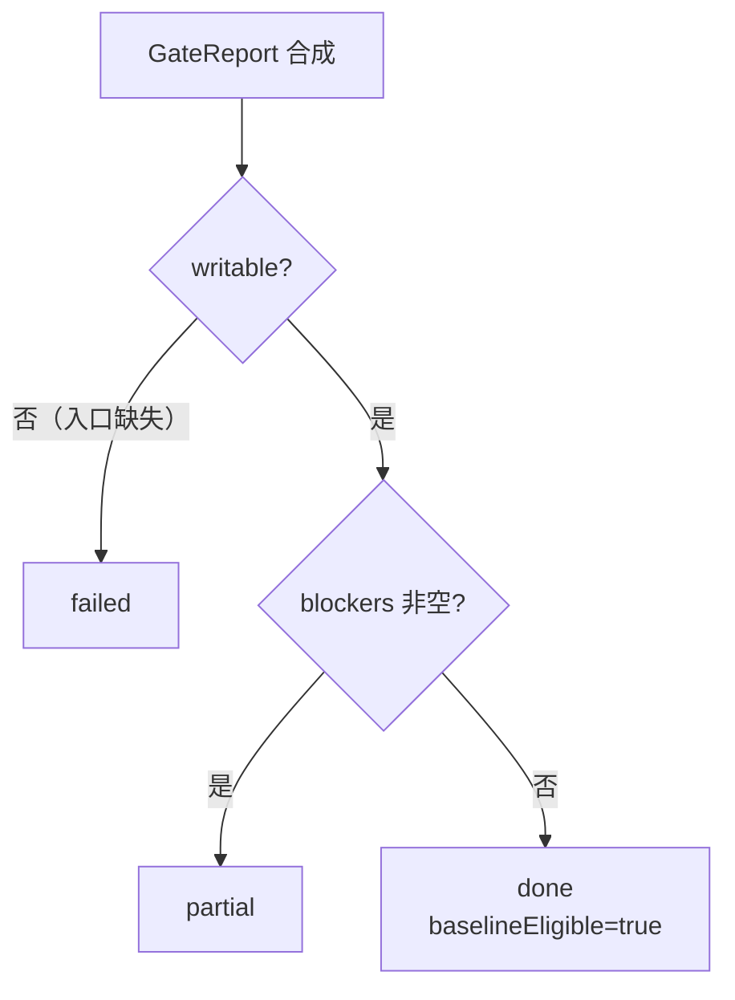
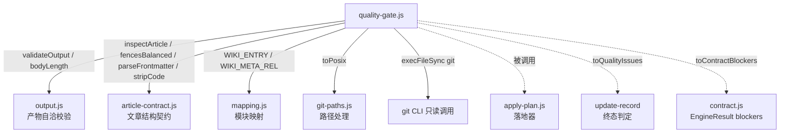

# 质量门（quality_gates）

## 简介

`quality_gates` 是引擎原生产物进入 wiki 之前的**采用门**（quality gate）。它的职责位置是：引擎把 docs 树交回来之后、产物真正写进 `.codewiki/` 与 `CodeWiki.md` 之前。它把三类独立来源的检查合成一份可机读的裁决报告（`GateReport`），决定这批产物能否被 wiki 采用、基线能否推进。

与上游[产物自洽校验](engine-output-processing.md)（`output.js` 的 `validateOutput`）的分界很关键：上游只判「产物自身是否自洽」（页在不在、正文空不空、链接指的东西在不在计划内）；质量门判的是「这批产物能不能被 wiki 采用」。

---

## 架构定位



### 在流水线中的位置


---

## 核心组件

### `gateNativeOutput`（主入口）

对一批原生产物做采用裁决。纯组合函数：读产物（`output.js`）→ 渲染 → 契约 → 基线。

渲染前先构造 `pageMap`（引擎原始页路径 → 落地后的 wiki 页路径），跨页链接据此改写。上游把入口页叫 `README.md` / `overview.md`，本 wiki 的入口却是 `CodeWiki.md`：正文里写 `./README.md` 指的就是根页（真机 `testing_fixtures.md` 就是这样引用父模块的），因此这两个名字在没被真实映射占用时被补成指向入口的别名——否则改写后它们会变成 `modules/README.md` 这个不存在的路径。契约层用的「允许链接集合」就是 `pageMap` 的全部落地值加上根页入口名。



### `toQualityIssues`（终态翻译器）

把 gate 的结论翻成 `update-record` 的 `qualityIssues`（`judgeOutcome` 的输入之一）。

关键原因：`judgeOutcome` 只按「计划内文章写成了没有」判 done——一篇**可写但 source_files 为空**的页在它眼里就是「成功」，于是 outcome 会被判成 done 并推进基线。而空 source_files 正是「增量归属不可用」的证据降级。本函数把 defect、degradation 以及阻塞型 stale（`baseline-uncommitted`）显式喂给终态判定，保证两条判定路径（gate 内部 vs. `judgeOutcome`）不会一个严一个松。

---

## 三类问题分类（核心设计）

这是本模块存在的核心理由。0.14.0 的教训是「1 篇成功 + 19 篇失败也报 done」；但反过来把一切塞进一个 `blockers` 数组同样有害——引擎会被归咎于不是它的问题，或者 wiki 的陈旧状态被当成产品缺陷。因此分类是**机读**的：



### 类别常量

| 类别 | 常量 | 含义 |
|------|------|------|
| defect | `GATE_DEFECT_KINDS` | 13 种稳定、可机读的产品缺陷类别 |
| degradation | `GATE_DEGRADATION_KINDS` | 4 种能力降级（证据缺失）类别 |
| stale | `GATE_STALE_KINDS` | 3 种 wiki 陈旧状态类别 |

新增类别**只允许追加**（消费者按 `kind` 分派，不允许靠 message 文本匹配）。

---

## 基线可推进性（`assessBaseline`）

判定「这批产物的基线能不能被推进」。基线推进 = 宣布「这些变化已消化」，写错就是不可逆的记账错误。



### 只读已提交基线（`readCommittedBaseline`）

读的是 `git show HEAD:.codewiki/_meta.yaml`，**不是**工作区文件。原因：工作区的 `_meta.yaml` 随时可能是上一轮编译刚写、还没提交的内容（自动提交是异步的，中间存在「已写入、未提交」窗口）。把它当基线等于把一堆未提交的产物宣布成「已消化」，而 git 里根本没有它们的记录——下次编译的 base 会指向一个不存在的状态，变化要么重复消费要么永久失明。

### 空骨架豁免（`isEmptyBaseline`）

`cw init` 写出的 `_meta.yaml` 初值 `last_compiled_commit: null`，这份文件没有任何历史进度，因此不存在「把未提交状态记成已消化」的风险。照 `worktree-only` 判成未入库基线会让**首次编译永远推进不了**——这正是 0.16.1 曾允许 partial 推进基线的原因（那条例外后来被收回，因为它把「没消化完」直接记成已消化）。

---

## 文章渲染（`renderArticle`）

把映射出的一篇文章渲染成 wiki 文章的**完整文本**：合成的 frontmatter + FSoft 原文。三条硬约束（测试钉死）：

1. **正文的措辞与结构一字不动**——不删 H1、不改标题、不补章节；只允许两类规范化：剥 BOM、把跨页 `.md` 链接改写成落地后的路径（改写只作用于非代码区域，入口别名按上一节所述指向根页）。
2. **frontmatter 只填有证据的字段**——`source_files` 原样来自映射（空就是空），绝不按目录名猜；`type` 由映射给；`tags` 空列表。
3. **可回溯**——`fsoft_page` 记住正文来自 FSoft 原始树的哪个文件。



### YAML 标量安全序列化（`yamlScalar`）

`cw` 用 serde_yaml 解析 frontmatter。真实页标题含 `# Core Engine (src/core/engine.py)`、`Support: batch & stream`、反斜杠 Windows 路径。plain scalar 一旦含 `: ` 或 ` #`，serde_yaml 会把整行解析成「键 + 嵌套映射」或截断成注释，整篇文章被判不合法。做法：只在确实不安全时才加双引号——`JSON.stringify` 就是正确的 YAML 1.2 双引号标量转义（YAML 1.2 是 JSON 的超集）。

### 原生通道的章节要求（`NATIVE_REQUIRED_SECTIONS = []`）

**不沿用** cw agentic 通道的 Overview/Key Components。FSoft 的正文由上游 prompt 决定（`## Introduction and Purpose`、`## 1. Purpose`…），而计划硬约束是「不改技术内容」——用别的通道的章节名去判它，产出的每一条都是**不可修复**的 warning，闸门会退化成噪声。章节的非空性由 `checkRendered` 单独判「至少一个非空二级标题」。

---

## 输出契约（`GateReport`）

```jsonc
{
  "version": 1,                  // GATE_VERSION
  "ok": true,                    // outcome === 'done'
  "outcome": "done | partial | failed",
  "writable": true,              // 入口页 OK 才可入库
  "baselineEligible": true,      // 只有三类皆空（done）才为 true
  "canAdvanceBaseline": true,    // 兼容字段，与 baselineEligible 语义一致
  "entry": { source, path, ok },
  "articles": [{ source, wikiPath, type, action: "write|skip", defects, degradations }],
  "rendered": [{ source, wikiPath, type, content }],  // 仅 includeContent=true 且无 defect 的页
  "defects": [{ kind, scope: "product", detail, source, target }],
  "degradations": [{ kind, scope: "product", detail, source, target }],
  "stale": [{ kind, scope: "wiki", detail }],
  "blockers": [...],             // defects + degradations + 阻塞型 stale
  "counts": { pages, articles, writable, skipped, unmapped, defects, degradations, stale },
  "baseline": { headCommit, artifactCommit, source }
}
```

### 终态判定规则（严格）



**只有三类皆空才是 done。** 分类改变的是「谁来修、修什么」的定位，不是放宽闸门——放宽正是迁移里最危险的方向。

---

## 依赖关系



| 依赖 | 用途 |
|------|------|
| [engine_output_processing](engine-output-processing.md) | `validateOutput` 产物自洽检查（不重写任何判定） |
| [../article_validation](article-validation.md) | `inspectArticle` 目标格式契约（frontmatter / 围栏 / 死链 / source_files），以及 `stripCode`（链接改写时屏蔽代码区域） |
| [module_indexing](module-indexing.md) | `WIKI_ENTRY` / `WIKI_META_REL` 路径常量 |
| [plan_application](plan-application.md) | 落地器消费本模块的 `GateReport`，只写 `writable=true` 的页 |
| [engine_contracts](engine-contracts.md) | `toContractBlockers` 把 gate 问题翻译成 `BLOCKER_KINDS` |

---

## 关键设计决策

### 1. 为什么必须分三类而不是一个 blockers 数组

把一切塞进一个数组会让运维在错的地方找原因：引擎会被归咎于不是它的问题（wiki 基线本来就落后 HEAD），或者 wiki 的陈旧状态被当成产品缺陷（首次编译的 `baseline-absent` 不是 bug）。

### 2. 为什么 `empty-module-tree` 是 degradation 而不是 defect

whole-repository 模式下 FSoft 本来就把 `module_tree` 留成 `{}`。这不是「产物坏了」，而是「归属证据缺失」：页照写，但增量 ownership 不可用，基线不得推进。页是真的、内容是真的，只是没法归属。

### 3. 为什么只有 `baseline-uncommitted` 阻塞推进

把工作区的未提交状态记成已消化是**不可逆**的——下次编译的 base 会指向一个不存在的状态。而 `baseline-behind-head` 正是本轮编译要消化的对象，`baseline-absent` 是首次编译的正常起点，这两条混进 blockers 会让每次增量都落 partial。

### 4. 为什么空 source_files 必须显式喂给 judgeOutcome

`judgeOutcome` 只按「计划内文章写成了没有」判 done。一篇可写但 `source_files` 为空的页在它眼里就是「成功」。两条判定路径（gate 内部 vs. `judgeOutcome`）必须一个严，否则归属不明的产物会被记成「已消化」。

### 5. 为什么 `NATIVE_REQUIRED_SECTIONS = []`

FSoft 的正文结构由上游 prompt 决定，计划硬约束是「不改技术内容」。用 cw agentic 通道的章节名去判它，产出的每一条都是不可修复的 warning，真实产物永远 partial。
