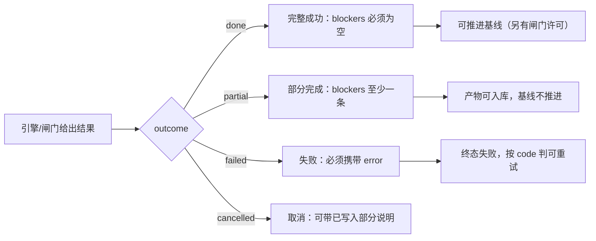
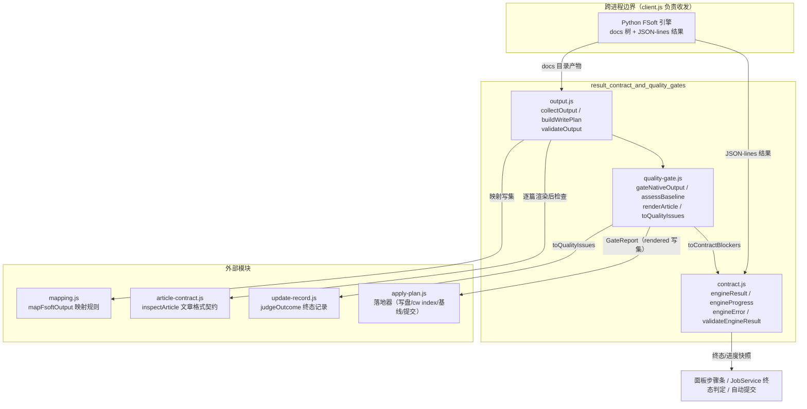
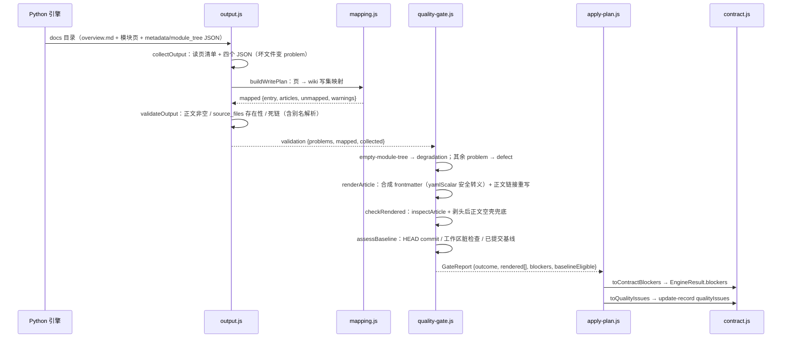

# result_contract_and_quality_gates（引擎结果契约与质量门）

## 简介

本模块是 FSoft 原生引擎（Python）与 Node 侧消费方之间的**结果边界**：它把「一次编译到底成功了没有」「产物能不能被 wiki 采用」「编译基线能不能推进」三件事钉成可机读、可校验、可测试的纯数据裁决。模块由三个文件组成：

| 文件 | 角色 |
| --- | --- |
| `lib/engine/contract.js` | 跨进程结果契约（阶段 0）：`EngineResult` / `EngineProgress` / `EngineError` 的构造、归一与校验 |
| `lib/engine/output.js` | 产物解析与自洽校验（阶段 2）：把引擎的 docs 目录读成结构化事实，判「页在不在、正文空不空、链接通不通」 |
| `lib/engine/quality-gate.js` | 采用门（阶段 3）：产物自洽 + 格式契约 + 基线可推进性，合成最终裁决 `GateReport` |

它的存在直接源于历史缺陷：「1 篇成功 + 19 篇失败也报 done」（0.14.0 教训）。契约把这类语义矛盾写成**构造期就抛错**的硬不变量，而不是靠每个消费方各自猜。

## 核心职责与语义不变量

### 终态四态与硬不变量

`contract.js` 固定了四个终态（`TERMINAL_OUTCOMES`），并由 `engineResult()`（构造即校验）与 `validateEngineResult()`（反序列化校验）双重保证：

- `done` — 完整成功，**不许带 blockers**（带了即自相矛盾，构造抛错）
- `partial` — 部分完成，**必须带至少一条 blockers**（否则等于伪装成功）
- `failed` — 失败，**必须带 error**
- `cancelled` — 取消，可带 blockers 说明已写成的部分

### 阶段枚举（契约而非实现细节）

`ENGINE_STAGES` 的顺序即推进顺序：`env → graph → cluster → articles → validate → index → baseline → commit`。面板步骤条、`job.stage` 映射、取消检查点全部按它对齐——这是一条跨 UI/进程/日志的共享词汇表。

### 机读错误码与重试语义

`engineError()` 把失败事实规范化为 `{code, message, stage, retryable}`。`ENGINE_ERROR_CODES` 中只有 `engine-timeout` / `engine-model` / `engine-unknown` 属于**可重试**（同一输入再来一次可能成功）；未登记的 code 一律归为 `engine-unknown` 并把原文保留在 `rawCode`，便于排障但不改变机读语义。

### 增量结局（updateOutcome）

`UPDATE_OUTCOMES` 描述一轮 update 的真实性质：

- `incremental` / `no_change` — 真增量成立（`CONSUMING_UPDATE_OUTCOMES`），基线可推进
- `full_fallback` / `detector_failure` — 引擎退了全量，**即使产物看着完整，基线也不能照推进**，否则下一轮的起点被抬到「其实没消化」的位置，这批变化永久丢失

未登记的 `updateOutcome` 字符串会在构造与校验两侧都被拒绝——把「引擎其实退了全量」洗成增量成功是契约明文禁止的。

### 阻塞原因类别（BLOCKER_KINDS）

`BLOCKER_KINDS` 是终态判定与面板文案共用的机读类别：`article-failed`、`article-missing`、`unmapped-change`、`unmapped-page`、`quality-gate`、`index-failed`、`baseline-failed`、`commit-failed`、`engine-error`、`cancelled`、`incremental-fallback`、`engine-timeout`。新增只允许追加（消费者按 `kind` 分派），不允许改名。

## 架构与组件关系

### 关键设计分界

- **contract.js 不碰文件、进程、模型**：纯函数才能被 TDD 钉死；反序列化边界（磁盘残留、旧版本对象）走 `validateEngineResult()`，返回逐条 errors 而不抛错。
- **output.js 只判「产物自洽」**：不重新聚类、不做图 diff、不改写正文；缺页就是缺页，绝不因「产物看起来差不多」把 problem 降级成 warning。目标格式（frontmatter/锚点/写集冲突）的闸门留给 quality-gate。
- **quality-gate.js 只做组合**：复用 `validateOutput`（不重写任何判定）+ `inspectArticle`（逐篇格式契约）+ `assessBaseline`（git 基线裁决），自己不发明新的产物判据。

## 质量门的三类问题分法

quality-gate 存在的核心理由是**分类而不是放宽闸门**：把一切塞进一个 blockers 数组会让「引擎被归咎于不是它的问题」或「wiki 的陈旧状态被当成产品缺陷」。

| 类别 | 含义 | 典型 kind | 处置 |
| --- | --- | --- | --- |
| defect（产品缺陷） | 本次引擎产物自身的问题 | `entry-missing`、`empty-body`、`dead-link`、`source-missing`、`article-contract`、`commit-mismatch`、`uncommitted-input` | 不算完整成功（partial/failed） |
| degradation（能力降级） | 产物可用但证据不足 | `empty-module-tree`、`no-source-evidence`、`missing-section` | 可入库，但**增量归属不可信，基线不得推进** |
| stale（wiki 陈旧） | 既有 wiki 的问题，不是本次产物的错 | `baseline-absent`、`baseline-behind-head`、`baseline-uncommitted` | 如实报告；只有 `baseline-uncommitted` 会阻止推进 |

终态仍然严格：**三类皆空才是 done**。`baselineEligible` 只有一种来源——`outcome === 'done'`（兼容字段 `canAdvanceBaseline` 同义）。

### 基线裁决的只读语义

`readCommittedBaseline()` 读的是 `git show HEAD:.codewiki/_meta.yaml`（已提交基线），**不是**工作区文件：工作区随时可能是上一轮刚写、还没提交的内容，把它当基线等于把未提交产物宣布成「已消化」，下次编译的 base 指向一个不存在的状态。`uncommittedSourceChanges()` 排除 wiki 自身产物（`.codewiki/`、`CodeWiki.md`），其余任何未提交改动都意味着产物对不上可追溯的 commit。`assessBaseline()` 还接受 `consumedInputCommit`：本轮若把工作区合成临时快照 commit，产物对的是快照树而非 HEAD，这不是「对不上代码」，基线推进仍由 `uncommitted-input` 拦住。

## 数据流：从引擎产物到采用裁决

### 渲染的三条硬约束

`renderArticle()` 把映射结果渲染成完整 wiki 文章，测试里钉死：

1. **正文一字不动**——只剥 BOM、把跨页链接重写成落地路径（引擎原始页名 `agent_runtime.md` → 落地 slug `agent-runtime.md`；不重写时真机实测 420 条内部链接 412 条失效）；措辞与结构一律不改。
2. **frontmatter 只填有证据的字段**——`source_files` 空就是空（显式写 `[]`），绝不按目录名猜。
3. **可回溯**——`fsoft_page` 记住正文来自 FSoft 原始树哪个文件，「wiki 这篇 ≠ 引擎那篇」可逐字比对。

`yamlScalar()` 使用 `JSON.stringify` 做安全转义（YAML 1.2 是 JSON 超集），只在确实不安全时加双引号——标题里出现 `: `、`#`、Windows 反斜杠路径时，plain scalar 会被 serde_yaml 解析坏，导致整篇文章被判不合法。

## 组件速查

### contract.js

| 导出 | 说明 |
| --- | --- |
| `ENGINE_CONTRACT_VERSION = 2` | 契约版本；`validateEngineResult` 对它严格相等检查 |
| `engineResult(input)` | 构造一次编译的完整结果；非法输入（终态矛盾、未登记枚举）**抛错** |
| `engineProgress(input)` | 推进中的阶段/计数快照（tick 与面板共用），字段只增不减 |
| `engineError(input)` | 可机读失败事实；`retryable` 由错误码决定 |
| `validateEngineResult(value)` | 反序列化边界校验；不抛错，返回 `{ok, errors[]}` |
| `describeEngineResult(result)` | 终态文案，与 `lib/update-record.js` 的 `describeOutcome` 同一口径 |

### output.js

| 导出 | 说明 |
| --- | --- |
| `OUTPUT_PROBLEM_KINDS` | 产物问题类别（11 种，见上表 defect 来源） |
| `collectOutput({docsDir})` | 递归读 docs 页（跳过 `temp/` 与隐藏目录）+ 四个 JSON；坏文件变 problem 不抛 |
| `buildWritePlan(...)` | 读 docs → `mapFsoftOutput`，产出 `{collected, mapped}` |
| `validateOutput(...)` | 产物自洽校验：入口缺失、空正文、未映射页、缺页、`source_files` 存在性、死链 |
| `pageAliases(pages)` | 引擎页名别名表（`X.ts.md`→`X.md`、子模块父前缀简写），**唯一命中**才给出，歧义时宁报死链 |

### quality-gate.js

| 导出 | 说明 |
| --- | --- |
| `gateNativeOutput({docsDir, repoRoot, ...})` | 主入口：纯组合「读产物 → 渲染 → 契约 → 基线」，返回 `GateReport` |
| `assessBaseline(...)` | 基线可推进性裁决；接受 `consumedInputCommit` 快照豁免 |
| `readCommittedBaseline(...)` | 读 `HEAD:.codewiki/_meta.yaml` 已提交基线（非工作区） |
| `renderArticle(...)` | 合成 frontmatter + 正文（链接重写、YAML 安全转义） |
| `toContractBlockers(report)` | 把 gate 的 blockers 翻成 `contract.js` 的 `BLOCKER_KINDS`；对不上的一律归 `quality-gate` 并保留原 kind |
| `toQualityIssues(report)` | 把 gate 结论翻成 update-record 的 `qualityIssues`（喂给 `judgeOutcome`） |

## 在系统中的位置

- **上游**：[engine_client](engine-client.md)（`lib/engine/client.js`）把 Python 引擎的 JSON-lines 翻译成 `engineResult` / `engineProgress`；协议不变量（退出码只表进程层、语义以 result 为准）在 client 侧实现，本模块提供数据模型。
- **下游落地**：[native_apply_plan](native-apply-plan.md)（`lib/engine/apply-plan.js`）消费 `GateReport`：写集封闭白名单、`cw index` 失败回滚、基线推进、自动提交。裁决说「可入库」与「入库真的成立」是两回事，分别由两个模块负责。
- **格式依赖**：`inspectArticle` 来自文章契约体系（`lib/article-contract.js`），`lib/update-record.js::judgeOutcome` 接收 `toQualityIssues` 作为终态输入之一；本模块保证「两条判定路径一个严一个松」的问题不复存在。
- **映射规则**：`mapFsoftOutput` 等四条硬规则（不臆造 source_files、不静默丢弃、不覆盖、不改技术内容）由 [workspace_state_and_integrity](workspace-state-and-integrity.md) 中的 mapping 模块冻结，本模块只消费不重复实现。

## 设计要点回顾

1. **契约破坏必须响**：构造期抛错（终态矛盾），反序列化期返回 errors（磁盘对象），两条路径都不许静默归一。
2. **纯函数边界**：contract 不碰 IO；output 只读不抛；quality-gate 唯一的 IO 是 git 只读命令（`git show` / `git rev-parse` / `git status`）与读产物文件。
3. **分类即运维定位**：defect / degradation / stale 分开，是为了让运维在对的地方找原因，而不是让闸门退化成噪声。
4. **基线记账不可逆**：未提交的工作区状态永远不能被记成「已消化」——这是本模块最严格的一条只读裁决。
