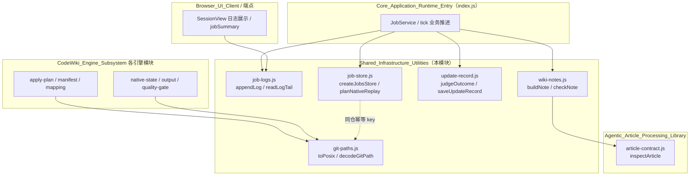
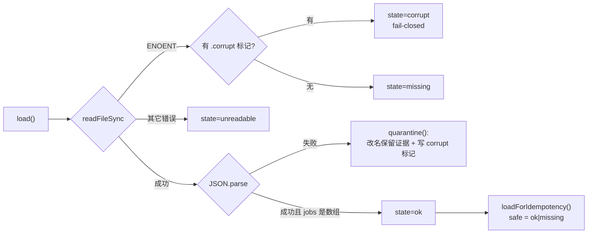
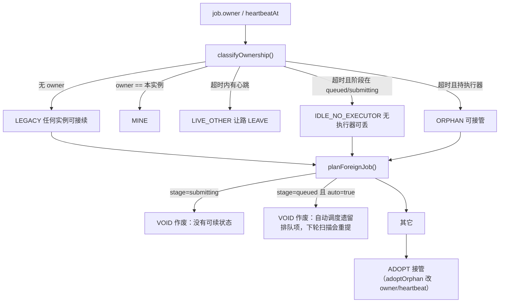
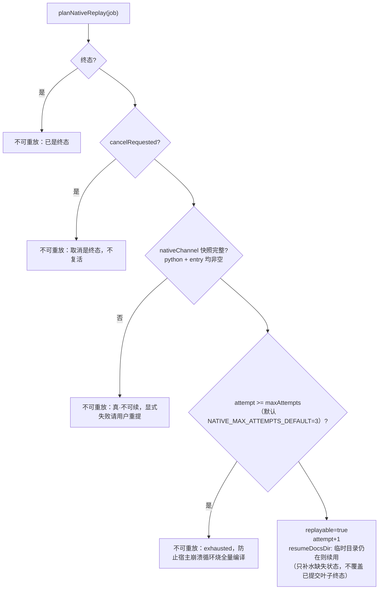
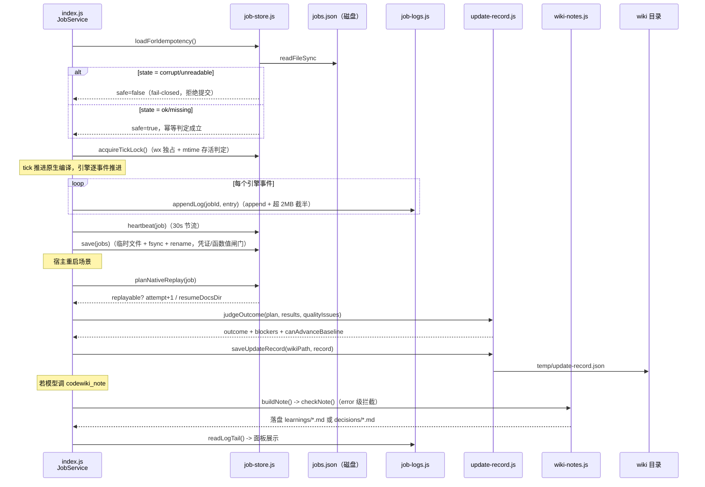

# 共享基础设施工具集（Shared_Infrastructure_Utilities）

## 引言

`Shared_Infrastructure_Utilities` 是整个 dsh-codewiki 插件的**横向基础设施层**。它不产生业务语义、不驱动编译流程，而是把散落在各模块里反复出现、且一旦各自跑偏就会造成难以排查的分歧的五类公共能力收口为唯一实现：

1. **Git 路径归一与解码**（`lib/git-paths.js`）——让跨平台路径比较、白名单判定、中文文件名在任何模块里结果一致；
2. **引擎事件日志落盘**（`lib/job-logs.js`）——把只活在内存里的引擎事件写成可复盘的 NDJSON 文件；
3. **作业持久化与跨进程协调**（`lib/job-store.js`）——`jobs.json` 的原子读写、损坏隔离、多实例所有权裁决与原生通道重放；
4. **编译更新记录**（`lib/update-record.js`）——一次编译"到底做了什么、为什么"的版本化机读记录与终态判定；
5. **wiki 笔记页写入**（`lib/wiki-notes.js`）——`learnings/` 与 `decisions/` 两类技能约定页的拼装与契约自检。

它们的共同设计原则是：**纯函数优先、IO 显式失败、硬不变量写在代码注释里**。Node 版本要求见 [package.json](../../../package.json)（`engines.node >= 20`）。

---

## 模块定位

> 与 `Core_Application_Runtime_Entry` 的关系：`job-store.js` 是从 `index.js` 的 `createJobService` 中**抽出来的可测层**——磁盘层、现场合并、重放裁决全部做成纯函数/小类，避免任何一条语义只能靠"起两个真宿主"来验证。

---

## 组件详解

### 1. `lib/git-paths.js` —— Git 路径归一与解码

铲平 git 路径输出的**两层落差**：

- **落差一：`core.quotepath`（默认 true）**。非 ASCII 路径在 `--name-only` / `--name-status` 输出里被写成 `"a/\344\270\255.md"`（八进制字节转义 + 双引号包裹），按字面量比较路径的代码（白名单、`startsWith('.codewiki/')`）会当场失配。
- **落差二：转义按字节做**，一个中文字符是三个 `\NNN`，必须把字节重新拼成 Buffer 再按 UTF-8 解码，不能逐字符还原。

| 导出 | 职责 |
| --- | --- |
| `GIT_QUOTEPATH_OFF` | 让 git 不做八进制转义的前置参数（`['-c', 'core.quotepath=false']`），必须紧跟 `git` 之后、子命令之前 |
| `withQuotepathOff(args)` | 给 git 参数表前置 quotepath 关闭（已关闭则不重复加） |
| `toPosix(p)` | 路径归一到 POSIX 分隔符的**唯一实现**（只换 `\` 为 `/`，不 trim、不去 `./`、不做 `path.posix.normalize`） |
| `decodeGitPath(p)` | 解开 git 路径转义；非"双引号包裹的转义串"原样返回（幂等）；解不开的保守原样返回 |
| `decodeGitPaths(list)` | 路径清单整体解码（保持顺序、丢弃空行） |

**为什么 `toPosix` 必须收口在这里**：`String(p ?? '').replace(/\\/g, '/')` 曾在 apply-plan / manifest / mapping / native-state / output / quality-gate 六个模块各抄一份，任何一处漏改，同一条路径在两份报告里就判不等。归一语义只有一种，就该只有一处实现。

### 2. `lib/job-logs.js` —— 引擎事件日志（NDJSON）

**为什么必须落盘**：引擎日志此前只留在 `job.nativeLogs` 的最近 20 条里——纯内存。一次 99 分钟的编译结束后只能查到最后 3 分钟；宿主重启或任务被截断（`MAX_JOBS_KEPT`）时全部消失。日志是事后解释"为什么慢、为什么 partial"的唯一依据。

**位置**：仓库外（`os.tmpdir()/dsh-codewiki-logs`，可用环境变量 `DSH_CODEWIKI_LOG_DIR` 覆盖）——和原生更新记录同源理由：`.codewiki/` 里多一个日志文件就会变成每轮脏工作区的未跟踪文件。

| 导出 | 职责 |
| --- | --- |
| `logFileOf(jobId)` | 某任务的日志文件路径（jobId 做文件系统安全化） |
| `appendLog(jobId, entry)` | 追加一条事件；字段固定（`at/jobId/phase/kind`）；写失败返回 `false` 而不抛（日志是观测，不能打断编译，但调用方须如实上报） |
| `readLogTail(jobId, limit)` | 读回最近 N 条（上限 5000，默认 200）；坏行跳过 |
| `logStats(jobId)` | 文件大小/更新时间（面板用） |
| `removeLog(jobId)` | 删除日志文件（强制 force，删不掉就留着） |

**容量治理**：单文件超过 `MAX_LOG_BYTES`（默认 2MB，可用 `DSH_CODEWIKI_LOG_MAX_BYTES` 覆盖，下限 64KB）时丢弃前一半、保留最近现场。

### 3. `lib/job-store.js` —— 作业持久化与跨实例协调层

`JobService` 的持久化/跨实例协调层。作业状态是**跨进程现场**——同一台机器两个宿主窗口各跑一个 `JobService`，共享一份 `jobs.json`。

**四条硬不变量**（代码注释中明确声明）：

- **A. 原子替换**：`jobs.json` 永远只由"写临时文件 + fsync + rename"替换，读到的要么是上一版要么是新版，不存在半写状态；
- **B. fail-closed**：读不出来时**不允许**当成"没有活动任务"——调用方必须能区分 `ok | missing | unreadable | corrupt`，幂等判定只在 `ok|missing` 上成立；
- **C. 凭证与函数值不入盘**：`JSON.stringify` 对函数静默丢弃，所以序列化时主动检测并抛 `JobsStoreError`；命中 `SECRET_KEY_RE` 的键名（`api[-_]?key|secret|passw|authorization|private[-_]?key|token$`）直接拒写；
- **D. 取消是终态**：任何重放裁决都必须先看 `cancelRequested`，绝不复活血。

#### 3.1 磁盘层

**写入路径**：同目录临时文件（同卷 rename 才原子）→ `openSync/writeFileSync` → `fsyncSync` → `renameSync`；Windows 上 rename 因目标被短暂占用会 EPERM/EBUSY，退避重试 4 次（10/30/60/100ms，同步 `Atomics.wait` 睡眠）；一次成功写入即清掉 `.corrupt` 标记——现场已恢复，幂等判定不必再 fail-closed。

**跨进程 tick 锁**：`.lock` 文件以 `wx` 独占创建，内容为 `pid|instanceTag|timestamp`；释放时校验归属（绝不删掉"已被别的实例接管"的锁）；存活判定只用文件系统 mtime 的真实时钟；超过 `staleMs`（默认 60s）的崩溃锁强删重抢。

#### 3.2 所有权与现场合并

其它关键函数：

- `normKey(p)`：路径身份 key（去尾分隔符 + 归一化；仅 win32 折叠大小写），与 `index.js` 的 `normPathKey` 同语义但独立一份，使本模块不反向依赖 `index.js`；
- `findActiveJob(jobs, cwd)`：同仓活动任务只取**最新**一条（历史遗留可能挂多条，该恢复最近那次提交）；
- `mergeJobLists({mine, disk, dirtyIds})`：磁盘版本覆盖内存版本的条件只有两条——本实例没改过（`dirtyIds`）且磁盘版本 `updatedAt` 更新；
- `heartbeat(job, ...)`：按 `HEARTBEAT_MS`（30s）节流，`jobs.json` 整文件重写不值得每 tick 写；
- `reassignSession(job, sessionId)`：同仓被另一会话再次提交时，完成唤醒发到**新会话**，归属历史保留最近 10 条。

#### 3.3 原生通道重放

`snapshotNativeRun` 只收"下次还能原样再下发的执行配置"（仓库/scope/kind/语言/并发度/引擎入口与超时）；**明确不收** llm 服务、bridge（随机端口 + 占位 key）、回调与凭证——它们属于"当前宿主"，重启后必须由新宿主重建。

### 4. `lib/update-record.js` —— 编译更新记录

**背景缺陷**：编译结束只留 `writtenCount/failedCount` 两个数字，"为什么这篇没重写""哪几个变更没人管"事后无法复盘。本模块把 `ChangeSet + UpdatePlan + 逐篇结果` 收成一份版本化记录（`UPDATE_RECORD_VERSION = 1`，相对路径 `temp/update-record.json`，位于 wiki 目录下）。

**终态语义**：

| outcome | 含义 | canAdvanceBaseline |
| --- | --- | --- |
| `done` | 完整成功：计划内必需文章全部写好、变更全部有归属、质量闸门全过 | ✅ |
| `partial` | 部分完成：已成功文章可入库，但"全部已消化"不成立 | ❌ |
| `failed` | 没有可交付成果（0 篇成功且有失败/缺页/阻塞） | ❌ |
| `cancelled` | 任务被取消 | ❌ |

`judgeOutcome()` 收集六类 blocker：逐篇失败（`article-failed`）、计划内缺页（`missing-article`）、未归属源码变更（`unmapped-changes`，非源码 `.md` 文件不计入）、文章缺 `source_files`（`missing-sources`）、质量闸门未过（`quality`）、索引/入口未过（`index`）、调用方硬阻塞（`extra`）。

> **设计注记**：`canAdvanceBaseline` 判据写成显式形式 `outcome === 'done' || (outcome === 'partial' && writtenCount > 0 && blockers.length === 0)`，而不是别名 `outcome === 'done'`。实测 partial 分支当前不可达（partial 必然带 blocker），但显式写法服务于兼容通道（`tickIndex`）——它的 blocker 含"没消化完"语义，一旦放宽就会让 wiki 静默落后于代码；将来若放宽规则，partial 分支会自动按"有成果且无缺陷才推进"生效。

`buildUpdateRecord` 产出可序列化记录（job 里只存路径与摘要，不塞整图）；`saveUpdateRecord/loadUpdateRecord` 负责 IO（版本不匹配返回 `null`）；`describeOutcome` 提供面板三态文案。

### 5. `lib/wiki-notes.js` —— wiki 笔记页（learnings / decisions）

这是对上游 mraza007/codewiki 技能约定（"After Every Completed Task"：修完 bug 写 `learnings/<slug>.md`、定了设计写 `decisions/<slug>.md`）的补全实现——原生通道只产 `modules/` 与入口 `CodeWiki.md`，从不写这两类页，由模型显式调 `codewiki_note` 记录。

| 导出 | 职责 |
| --- | --- |
| `NOTE_KINDS` | `learning -> learnings`、`decision -> decisions`（与 `article-contract.js` 的 `TYPE_BY_DIR` 同一张表，避免 type-mismatch 漂移） |
| `noteSlug(raw)` | 页名 slugify（保留 CJK/下划线，其余压连字符）；中文标题原文进 frontmatter 的 `title` |
| `buildNote({kind, title, slug, sourceFiles, tags, body})` | 拼出合规文章（固定 frontmatter：`title/type/source_files/tags`），返回 `{rel, text}`；**不写盘、不跑 cw** |
| `listWikiPages(wikiDir)` | 递归列出 wiki 下全部 `.md`（供内部链接解析） |
| `checkNote({text, rel, repoRoot, wikiDir})` | 与落盘闸门同一套判据：复用 [`inspectArticle`](agentic-article-processing-library.md)，只拦 `error` 级；`allowEmptySourceFiles: true`（空证据对这两类页是合法形态） |

---

## 跨组件数据流：一次原生编译的"持久化闭环"

---

## 设计约束与依赖关系汇总

| 约束 | 位置 | 说明 |
| --- | --- | --- |
| 路径归一唯一实现 | `git-paths.js::toPosix` | 被 `CodeWiki_Engine_Subsystem` 的 apply-plan / manifest / mapping / native-state / output / quality-gate 依赖 |
| git 转义双向铲平 | `GIT_QUOTEPATH_OFF` + `decodeGitPath` | 参数挡新调用、解码兜旧记录，两者缺一不可 |
| 原子写 + fail-closed | `job-store.js` | 损坏文件改名隔离而非删除；`.corrupt` 标记直到一次成功写入才清除 |
| 凭证/函数值不入盘 | `serializeJobs` | 命中即抛 `JobsStoreError`，新宿主按当前配置重建执行器 |
| 取消是终态 | `planNativeReplay` / `TERMINAL_STAGES` | 任何重放裁决先看 `cancelRequested` |
| 基线前移判据 | `update-record.js::judgeOutcome` | 只对完整成功（done）放行 |
| 契约自检复用 | `wiki-notes.js::checkNote` | 依赖 [Agentic_Article_Processing_Library](agentic-article-processing-library.md) 的 `inspectArticle`，不自造判据 |
| 日志出仓库 | `job-logs.js` | 避免污染工作区；由 `Browser_UI_Client` 的 SessionView 与端点经 `readLogTail` 消费 |

## 环境变量

| 变量 | 默认 | 作用 |
| --- | --- | --- |
| `DSH_CODEWIKI_LOG_DIR` | `os.tmpdir()/dsh-codewiki-logs` | 引擎 NDJSON 日志根目录 |
| `DSH_CODEWIKI_LOG_MAX_BYTES` | `2 * 1024 * 1024`（下限 64KB） | 单任务日志截断阈值 |
