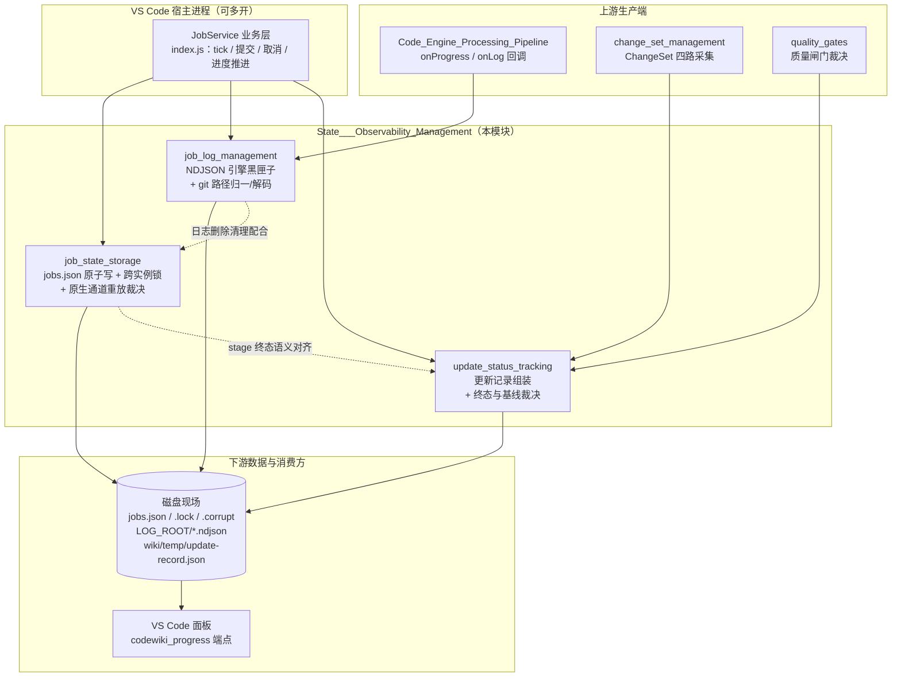

# 状态与可观测性管理（State___Observability_Management）

## 模块定位

`State___Observability_Management` 是 `dsh-codewiki` 系统的**跨进程状态与观测底座**。它把三类原本散落在业务代码里、彼此强耦合的能力抽离为可独立测试的纯函数与存储层：

1. **作业现场持久化**：同一台机器上多个 VS Code 宿主窗口共享同一份 `jobs.json`，负责原子读写、损坏隔离、跨实例心跳与重放裁决；
2. **引擎事件日志**：把只留在内存环形缓冲（最近 40 条）的引擎事件落盘为 NDJSON 黑匣子，进程死后仍可事后复盘；
3. **编译过程事实沉淀**：把 ChangeSet、UpdatePlan、逐篇结果与质量闸门收成一份版本化的更新记录，严格裁决终态与「能否推进编译基线」。

它直接决定三个系统级行为是否成立：同一仓库会不会被两个宿主重复执行、长编译结束后能不能解释「为什么慢 / 为什么 partial」、以及 wiki 基线在什么条件下才允许前移。

## 子模块概览

| 子模块 | 源码入口 | 核心职责 |
| --- | --- | --- |
| [job_state_storage](State___Observability_Management/job_state_storage.md) | `lib/job-store.js` | `jobs.json` 原子写、损坏隔离、跨进程 tick 锁、所有权分类、孤儿接管、原生通道重放快照与裁决 |
| [job_log_management](State___Observability_Management/job_log_management.md) | `lib/job-logs.js` + `lib/git-paths.js` | 引擎事件 NDJSON 追加日志、体量裁剪、尾部读取；git 路径 quotepath 解码与 POSIX 归一化的唯一实现 |
| [update_status_tracking](State___Observability_Management/update_status_tracking.md) | `lib/update-record.js` | 版本化更新记录组装、六类完整性裁决、`done / partial / failed / cancelled` 终态判定、基线推进授权 |

三者在语义上分工互补：

- `job-store.js` 回答「任务在系统里处于什么阶段、归谁所有」；
- `job-logs.js` 回答「这一轮编译的引擎流水是什么」；
- `update-record.js` 回答「这一轮编译**为什么**落成这个结局、哪些变更没被消化」。

## 架构关系

## 关键设计原则

这三个子模块共同坚守几条贯穿的不变量：

1. **观测不打断执行**：日志写入失败返回 `false` 而非抛错，但调用方必须把失败记进 `job.logError`，绝不静默；
2. **fail-closed 的现场读取**：`jobs.json` 损坏或不可读时，幂等判定一律拒绝「该仓库无活动任务」的断言，防止同仓被重复提交；
3. **敏感凭证与函数值绝不出库**：序列化闸门显式抛错，堵住 `JSON.stringify` 静默丢弃函数、残留过期指针的漏洞；
4. **终态四态语义统一**：`done / partial / failed / cancelled` 在 job-store 的孤儿判定与 update-record 的完整性裁决中是同一套集合，取消永远是终态，绝不复活；
5. **只存摘要，不塞整图**：job 文件只存更新记录路径与摘要，原始 ChangeSet、逐篇结果由独立 JSON 文件承载，保持现场精简可 diff。

## 参考文档

- 作业状态持久化：[job_state_storage](State___Observability_Management/job_state_storage.md)
- 任务日志管理与 git 路径工具：[job_log_management](State___Observability_Management/job_log_management.md)
- 更新状态追踪与终态裁决：[update_status_tracking](State___Observability_Management/update_status_tracking.md)
- 上游引擎通道：[Code_Engine_Processing_Pipeline](Code_Engine_Processing_Pipeline.md)
- 宿主侧编排入口：[Extension_Host_Execution_Orchestration](Extension_Host_Execution_Orchestration.md)