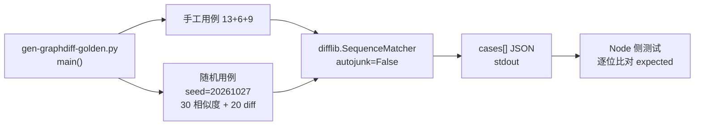
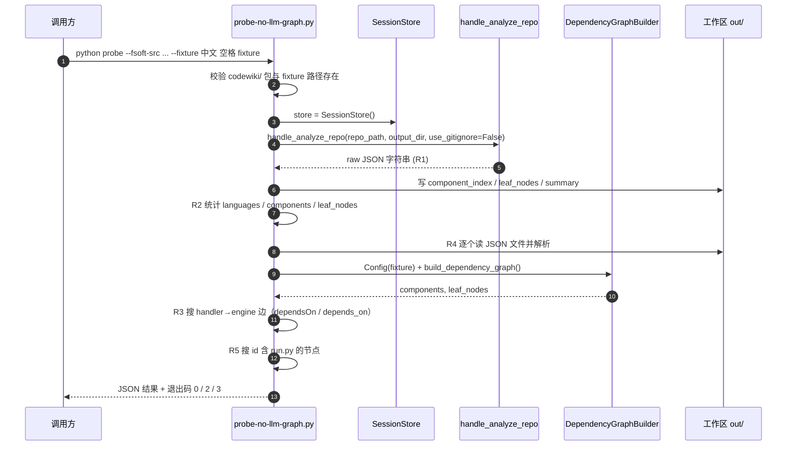
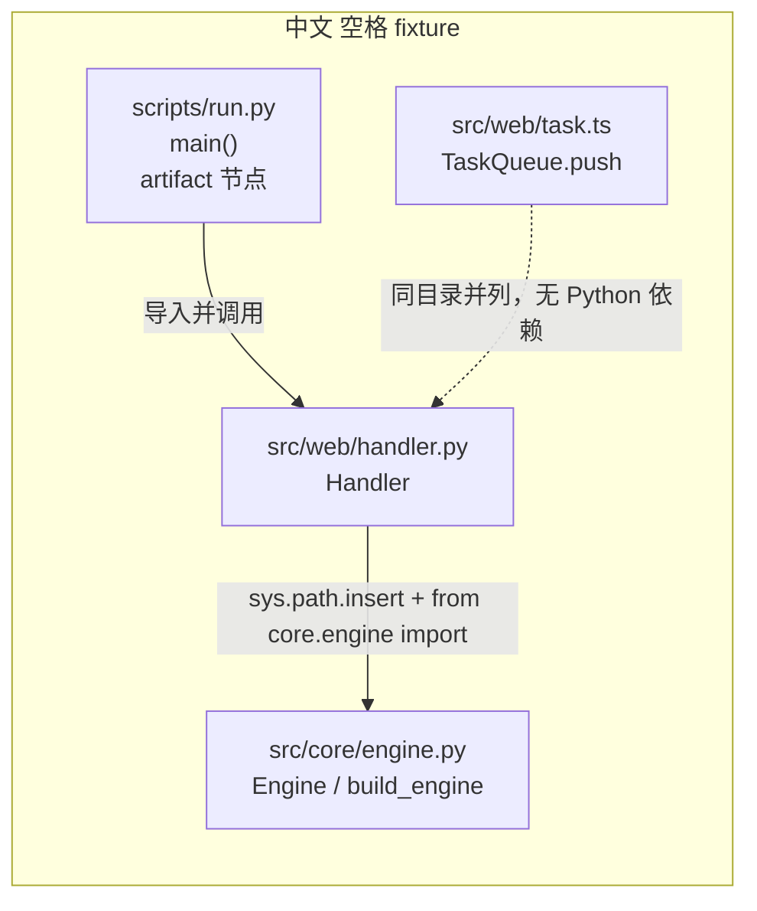
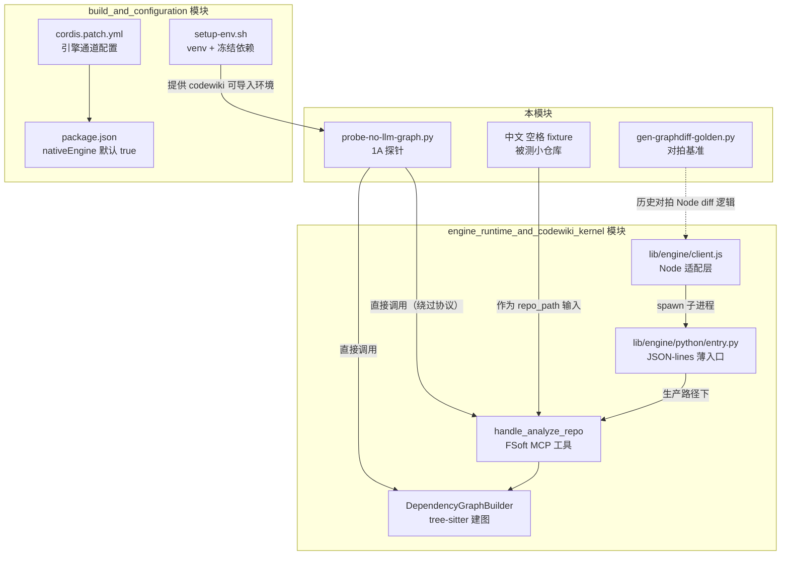

# test_fixtures_and_probes 测试夹具与验收探针

## 简介

本模块承载 dsh-codewiki 迁移工程中两类**与运行时引擎直接对拍**的测试资产：

1. **图 diff 对拍基准生成器** `test-fixtures/gen-graphdiff-golden.py`：用 Python 原生 `difflib` 复现 FSoft 的相似度 / 哈希 / unified diff 语义，产出确定性的 JSON 期望集，供 Node 侧移植代码逐位比对。
2. **非 ASCII 路径下的「无 LLM 依赖图」验收探针** `tools/fsoft-engine/probe-no-llm-graph.py` 及其被测小仓库 `tools/fsoft-engine/fixtures/中文 空格 fixture/`：在不碰任何模型与凭证的前提下，验证原生 FSoft 引擎通道（`nativeEngine: true`）的 `handle_analyze_repo` 在中文 + 空格路径上能正确出节点、出依赖边、出工作区产物。

它们共同回答迁移期最棘手的两类问题：**(a) 算法移植是否与上游逐位一致**；**(b) 原生引擎在最难复现的非 ASCII 路径上能否跑通**。探针与 [build_and_configuration](build-and-configuration.md) 阶段的环境脚本 `tools/fsoft-engine/setup-env.sh` 配套使用，是「阶段 1A」验收的入口；被探的引擎本体属于 [engine_runtime_and_codewiki_kernel](engine-runtime-and-codewiki-kernel.md) 中的 `engine_python_runtime` 与上游 vendored `codewiki`。

---

## 目录结构

```
test_fixtures_and_probes
├── test-fixtures/
│   └── gen-graphdiff-golden.py        # 图 diff 对拍基准生成器（main）
└── tools/fsoft-engine/
    ├── probe-no-llm-graph.py           # 阶段 1A 无 LLM 依赖图验收探针（main）
    └── fixtures/中文 空格 fixture/       # 探针被测的最小多语言小仓库
        ├── scripts/run.py               # artifact 入口脚本（main）
        └── src/
            ├── core/engine.py           # Engine / build_engine
            └── web/
                ├── handler.py           # Handler（依赖 core.engine）
                └── task.ts              # TaskQueue / TaskQueue.push（TypeScript）
```

> 路径中刻意保留**中文字符与空格**（`中文 空格 fixture`），这是整套设计的核心：ASCII 路径永远复现不出 Windows 下 cp936 解码错乱、tree-sitter 路径归一化、Python `sys.path` 拼接等问题。

---

## 组件一：图 diff 对拍基准生成器

### 1.1 设计动机

`difflib.SequenceMatcher` 的匹配块算法存在大量边界情形（空序列、重复 token、`autojunk` 启发式），靠肉眼核对不可信。该生成器在**纯 Python 侧**用上游同款 `difflib` 喂同一批输入，产出结构化期望值（`expected` 字段），再让 Node 侧实现逐一比对，确保移植与上游逐位一致。

### 1.2 三组期望用例

| `kind` | 字段 | 语义 | 覆盖边界 |
|--------|------|------|----------|
| `similarity` | `a`, `b`, `expected` | `body_similarity(a,b)` 浮点相似度 | 空串、完全相同、部分相同、全不同、重复 token、中文字符串、多行空白折叠 |
| `hash` | `code`, `docstring`, `expected` | `body_hash(code, docstring)` 十六进制 SHA1 | 空代码、纯注释、中文、空白折叠、doc 前置拼接 |
| `unified` | `oldText`, `newText`, `label`, `expected` | `unified_body_diff(...)` unified diff 文本 | 无差异、单 hunk、多 hunk、纯新增、纯删除、缺末尾换行 |

实现要点：

- **规范化**：`normalize_body` 把连续空白折叠成单空格再算哈希，与上游「注释/空白改动不触发重写」的语义对齐。
- **doc 前置**：`documented_source` 把 docstring 插到代码前，且不重复粘贴已存在的 doc。
- **token 化**：`_tokens` 用正则 `\w+|[^\w\s]` 把代码切成词与符号两类 token，再交给 `SequenceMatcher(autojunk=False)`——**显式关掉 autojunk**，避免随机 junk 启发式在短序列上引入不确定的匹配。
- **确定性随机**：`rng = random.Random(20261027)` 固定种子，在 13 条手工用例之外追加 30 条随机相似度对 + 20 条随机 diff 对，保证基准集可复现。

### 1.3 产出与消费

生成器直接把 `cases` 数组 `json.dump` 到 stdout（`ensure_ascii=False, indent=1`），不落盘文件。Node 侧测试把这份 JSON 喂给被测模块（历史上的 `lib/graph-diff.js`），逐条断言 `expected` 相等。

> 注：根据 [package.json](../../package.json) 描述，Node 侧的 FSoft 算法重实现（symbols / cluster / graph-diff / incremental / update-planner）已在 0.16.0 phase 7 退役删除。本生成器作为**对拍基准资产**保留，用于回归校验任何未来重新接入的 Node 侧 diff 逻辑，或审计迁移期的历史对拍记录。



---

## 组件二：非 ASCII 路径验收探针 `probe-no-llm-graph.py`

### 2.1 定位与边界

这是**引擎侧**验收，不碰 DSH 插件、不需要任何模型或凭证。FSoft 的 `handle_analyze_repo` 走 tree-sitter 静态分析，是整条迁移链里**唯一完全无模型的一环**——先让它跑通，才能在后续阶段把「模型链路故障」与「图 / artifact 链路故障」分开定位。

### 2.2 命令行接口

```bash
python probe-no-llm-graph.py \
    --fsoft-src <FSoft 仓库根，含 codewiki/ 包> \
    --fixture  <被测小仓库，默认 tools/fsoft-engine/fixtures/中文 空格 fixture> \
    --out      <工作/输出目录，默认 tools/fsoft-engine/out-1a>
```

退出码语义：

| 退出码 | 含义 |
|--------|------|
| `0` | 全部判据通过 |
| `2` | 判据未全部通过（结果 JSON 已输出） |
| `3` | 异常（`--fsoft-src` 缺 `codewiki/`、`--fixture` 不存在、运行时抛错） |

### 2.3 五条验收判据

探针在 stdout 输出一份 JSON 结果，`checks` 对象下含五个布尔判据：

| 判据 | 检查内容 | 为什么要它 |
|------|----------|------------|
| **R1** `R1_analyze_returned` | `handle_analyze_repo` 返回非 error JSON，含 `session_id` 与 `files` | 协议层通了 |
| **R2** `R2_nodes_and_languages` | `total_components > 0`、`total_leaf_nodes > 0`，语言集合含 `python` 与 `typescript` | tree-sitter 两种语言解析器都产出节点 |
| **R3** `R3_dependency_edge` | 依赖图里存在 `web.handler → core.engine` 方向边 | 依赖建图真的工作（不是只出节点） |
| **R4** `R4_workspace_files` | `component_index.json` / `leaf_nodes.json` / `summary.json` 真实存在且可 JSON 解析 | 工作区产物落盘正确 |
| **R5** `R5_artifact_node` | 组件表里存在 id 含 `run.py` 的 artifact 节点 | artifact 采集器把脚本入口收进来了 |

R3 采取**双保险**：除了读 MCP 工具返回，探针还独立构造 `Config` 并直接调 `DependencyGraphBuilder(cfg).build_dependency_graph()`，从 `dependsOn` / `depends_on` 属性里搜 `handler` 节点是否声明了 `engine` 依赖——这样即使 MCP 返回的边表被裁剪，也能从 builder 原始结果兜底判真。

### 2.4 探针执行时序



---

## 组件三：被测小仓库「中文 空格 fixture」

### 3.1 目录与依赖关系

该 fixture 是一个**刻意最小**的多语言仓库，故意把最容易出问题的维度（非 ASCII、空格、Python↔TypeScript 混语言、artifact 脚本）全压在一个目录里。



### 3.2 各文件职责

| 文件 | 关键符号 | 在探针里验证什么 |
|------|----------|------------------|
| `src/core/engine.py` | `Engine`（持有 `_calls` 计数、`run(payload)`）、`build_engine(name)` | 被 web 层依赖的核心模块，应成为叶子节点并被 `handler` 依赖边指到 |
| `src/web/handler.py` | `Handler`（构造 `build_engine("web")`，`handle()` 转交引擎） | 通过 `sys.path.insert` 绕过包结构直接 import，验证跨目录依赖边被建出 |
| `src/web/task.ts` | `TaskQueue`（`push()` 返回队列长度）、`normalize()` | TypeScript 解析器在中文空格路径下仍能出节点（R2 的 typescript 语言证据） |
| `scripts/run.py` | `main(argv)`：实例化 `Handler` 并打印 `handle("ping")` | artifact 采集器识别为脚本入口（R5） |

### 3.3 为什么用这种「薄壳 + 有状态」结构

- `Handler` 只是 `Engine` 的薄壳，但 `Engine.__init__` 持有 `_calls` 内部状态——这避免 fixture 被 tree-sitter 当成「无意义空文件」，同时保证 `handler.py` 的 import 是**真实、可解析**的依赖（不是注释里的假引用）。
- `run.py` 不被任何模块 import，它是独立的可执行脚本——这正是 artifact 节点与普通组件节点的区别：artifact 由「可执行入口」启发式识别，而非依赖关系。

---

## 在迁移体系中的位置

### 4.1 与环境搭建模块的衔接

探针不是独立工具，它依赖 [build_and_configuration](build-and-configuration.md) 建好的独立 venv：

1. `tools/fsoft-engine/setup-env.sh <venv 目录> <FSoft 源码根>` 用 `--no-deps` 按冻结快照落盘依赖，再 editable 安装 `codewiki` 本体，最后 `pip check` + import 冒烟。
2. 探针在同一台机器上以 `--fsoft-src <FSoft 源码根>` 把该源码插进 `sys.path`，直接调 `codewiki.mcp.tools.analysis.handle_analyze_repo` 与 `codewiki.src.be.dependency_analyzer.DependencyGraphBuilder`。

`cordis.patch.yml` 也明确把 `nativeEngine: true` 指向 `tools/fsoft-engine/setup-env.sh` 作为环境准备入口，二者构成「先建环境 → 再跑探针」的阶段 1A 闭环。

### 4.2 与引擎运行时模块的衔接

探针**绕过**了 [engine_runtime_and_codewiki_kernel](engine-runtime-and-codewiki-kernel.md) 的 Node 适配层（`lib/engine/client.js` JSON-lines 协议、`lib/engine/python/entry.py` 薄入口、`lib/engine/manifest.js` 指纹锁），直接在 Python 进程内调 FSoft 原语。这种「绕过协议」的设计是有意的：

- 阶段 1A 只验证 **FSoft 本体在非 ASCII 路径下能出图**；
- Node↔Python 协议（stdout 守卫、UTF-8 编码、心跳、取消语义）在后续阶段由 `test-engine-client.mjs` 等协议测试覆盖；
- 一旦 1A 探针失败，故障域被精确定位在 tree-sitter / 依赖分析 / artifact 采集，而不是跨语言协议。



---

## 复现与排障指南

### 5.1 一次完整的 1A 验收

```bash
# 1. 准备 FSoft 源码与 venv（在插件仓库外）
bash tools/fsoft-engine/setup-env.sh ../.probe-fsoft/venv ../.probe-fsoft/src

# 2. 跑探针（用同一 venv 的 python）
../.probe-fsoft/venv/bin/python tools/fsoft-engine/probe-no-llm-graph.py \
    --fsoft-src ../.probe-fsoft/src \
    --out tools/fsoft-engine/out-1a

# 3. 看退出码与 checks
echo $?
```

### 5.2 典型失败模式

| 现象 | 定位 |
|------|------|
| 退出码 `3` + `--fsoft-src 下没有 codewiki/ 包` | FSoft 源码路径不对，先跑 `setup-env.sh` |
| R1 false + `payload_head` 截断 | `handle_analyze_repo` 自身报错，看 payload 前 2000 字符 |
| R2 false 且语言缺 `typescript` | tree-sitter 的 TypeScript 解析器未装进 venv，查 `pip check` |
| R3 false 且 `edge_count = 0` | `handler.py` 的 `sys.path.insert` 没生效或 import 失败，fixture 自身有问题 |
| R4 false 且某 key `exists: false` | FSoft 版本的产物文件名与探针预期不一致（`component_index` / `leaf_nodes` / `summary`） |
| R5 false 且 `artifact_ids` 为空 | artifact 启发式不识别 `scripts/run.py`，可能是 FSoft 版本漂移 |

### 5.3 探针结果 JSON 字段速查

```json
{
  "ok": false,
  "fsoft_src": "...",
  "fixture": ".../中文 空格 fixture",
  "payload_keys": ["session_id", "files", "stats"],
  "stats": { "total_components": 4, "total_leaf_nodes": 3, "languages": {...} },
  "checks": { "R1_analyze_returned": true, "R2_nodes_and_languages": true,
              "R3_dependency_edge": false, "R4_workspace_files": true,
              "R5_artifact_node": true },
  "workspace_files": { "component_index": {"path": "...", "exists": true, "items": 4} },
  "edge_sample": [ {"id": "web.handler", "dependsOn": ["core.engine"]} ],
  "edge_count": 1,
  "artifact_ids": ["scripts/run.py"]
}
```

---

## 设计取舍小结

1. **为什么 fixture 路径一定要有中文和空格**：ASCII 路径永远复现不出 Windows cp936 误解码、`sys.path` 拼接、tree-sitter 路径归一化的缺陷；`entry.py` 文档明确记载过「中文路径请求行被按 cp936 误解码导致 repo_path 变成乱码」的真实事故。
2. **为什么探针绕过 Node 协议直接调 Python**：把「环境 / 图 / artifact」故障与「跨语言协议」故障分离，是迁移期分阶段验收的核心手段。
3. **为什么对拍基准用 `autojunk=False`**：短代码序列上 `SequenceMatcher` 的 junk 启发式会引入非确定性，关掉它才能拿到逐位可复现的期望。
4. **为什么 fixture 是 Python + TypeScript 混语言**：单语言仓库无法暴露「不同 tree-sitter 解析器在同一路径下的协同问题」，混语言是 R2 判据的前提。
