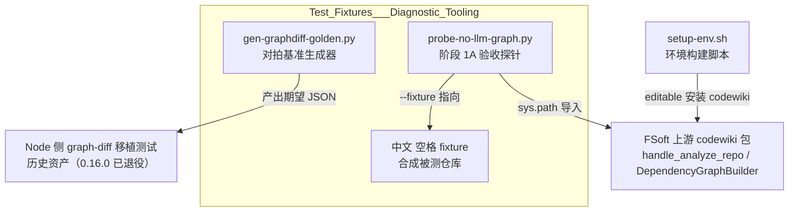
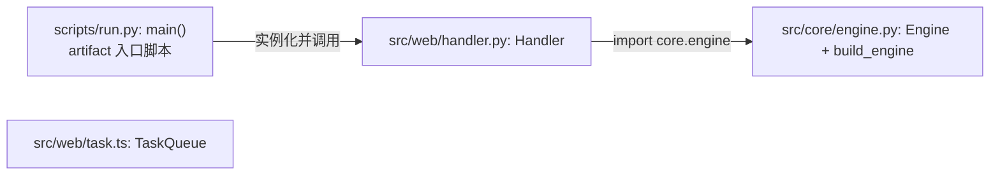
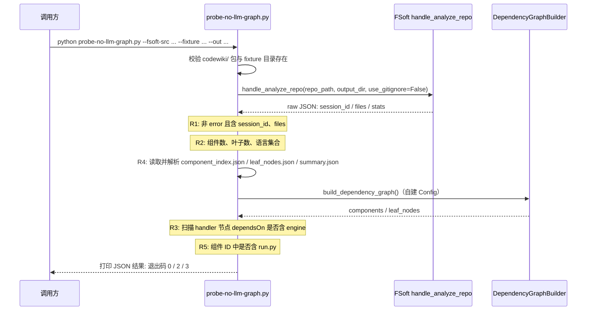
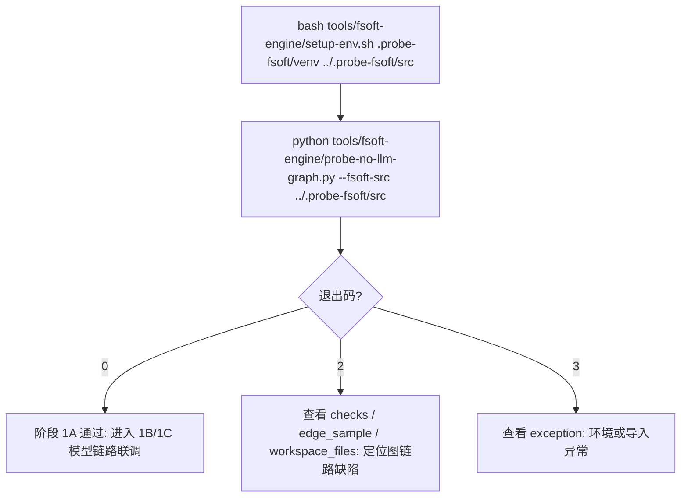

# 测试夹具与诊断工具（Test_Fixtures___Diagnostic_Tooling）

## 简介

本模块是 `@local/dsh-codewiki` 插件（见 `package.json`）在「原生引擎迁移」与「算法移植验证」两条线上的测试底座，**不参与编译流水线的运行时路径**。它包含三类资产：

1. **对拍基准生成器** `test-fixtures/gen-graphdiff-golden.py`：用 Python 原生 `difflib` 与 FSoft 原版函数一次性产出期望 JSON，逐位核对 Node 侧 `graph-diff` 移植是否与上游一致。
2. **合成被测仓库夹具** `tools/fsoft-engine/fixtures/中文 空格 fixture/`：路径名刻意包含中文与空格的小型多语言仓库（Python + TypeScript），专门暴露「非 ASCII / 含空格路径」下采集链路的边界缺陷。
3. **无 LLM 验收探针** `tools/fsoft-engine/probe-no-llm-graph.py`：阶段 1A 验收工具，直接驱动 FSoft 原生引擎的 `handle_analyze_repo`，在不触碰任何模型或凭证的前提下验证依赖图与 artifact 采集是否跑通。

设计动机：tree-sitter 静态分析是整条迁移中唯一**完全无模型**的一环，先把它跑通，才能在后续阶段把「模型链路故障」与「图/artifact 链路故障」分开定位。

## 模块架构与依赖关系



- 探针与夹具都落在 `tools/fsoft-engine/` 目录下；`--fsoft-src` 指向的上游 FSoft 源码树（含 `codewiki/` 包）**不在本插件仓库内**，需由 [Build,_Configuration___Environment_Setup](build-configuration-environment-setup.md) 中的 `tools/fsoft-engine/setup-env.sh` 预先建好 venv。
- 探针验证的「原生引擎静态分析段」在插件侧的进程生命周期封装，见 [Native_CodeWiki_Runtime_Lifecycle_Management](native-codewiki-runtime-lifecycle-management.md) 与 [Python_Parallel_Agent_Execution_Runtime](python-parallel-agent-execution-runtime.md)。

## 组件详解

### 1. 对拍基准生成器 `test-fixtures/gen-graphdiff-golden.py`

核心入口为 `main()`：一次性生成全部用例并 `json.dump` 到 stdout，用固定随机种子 `random.Random(20261027)` 保证跨机器输出逐字节一致。

内置的语义函数（与上游实现口径一一对应）：

| 函数 | 语义 |
|---|---|
| `normalize_body(text)` | 连续空白折叠为单个空格并 strip |
| `documented_source(code, docstring)` | doc 不在 code 中时前置拼接为 `doc\ncode` |
| `body_hash(code, docstring)` | `sha1(normalize_body(documented_source(...)))` |
| `_tokens(text)` | 正则 `\w+|[^\w\s]` 切分 token |
| `body_similarity(a, b)` | `difflib.SequenceMatcher(None, ta, tb, autojunk=False).ratio()`；双空序列 = 1.0、单空序列 = 0.0 |
| `unified_body_diff(old_lines, new_lines, label, n=2)` | `difflib.unified_diff`，头部分别为 `a/{label}` 与 `b/{label}` |

产出的用例按 `kind` 字段分四类：

- **`similarity`（13 个手写 + 30 个随机）**：覆盖双空、单空、全等、部分相同、全不同、重复 token、`autojunk` 敏感场景、中文 token、多空格折叠等边界；随机用例字母表为 `a b c d ( ) + 1 2`，长度 1–25。
- **`hash`（6 个手写）**：含空 code、中文 docstring、多行 code。
- **`unified`（9 个手写）**：覆盖空对空、无变化、单 hunk、多 hunk（`L1..L10` 两行被改）、纯删除、纯新增、**无末尾换行**、补末尾换行。
- **`unified`（20 个随机）**：0–12 行随机行（行内容取自 `L0..L5`）。

> 历史定位：`package.json` 注明 Node 侧算法重实现（symbols / cluster / graph-diff / incremental / update-planner）已于 **0.16.0 阶段 7 退役删除**。该生成器留存为上游 `difflib` 语义的可复现参考，其用例口径仍是理解 FSoft「正文相似度 / 正文哈希 / 统一 diff」语义的基准定义。

### 2. 合成被测仓库夹具 `tools/fsoft-engine/fixtures/中文 空格 fixture/`



| 文件 | 核心组件 | 作用 |
|---|---|---|
| `src/core/engine.py` | `Engine`、`build_engine(name)` | 持状态最小引擎（`_calls` 计数；`run(payload)` 返回 `"{name}:{payload}"`），代表「被上层依赖的核心模块」 |
| `src/web/handler.py` | `Handler` | 通过 `sys.path.insert` 导入 `core.engine`，`handle(payload)` 薄壳转交——必须被建出的 `web.handler -> core.engine` 依赖边（判据 R3） |
| `src/web/task.ts` | `TaskQueue`、`TaskQueue.push` | TypeScript 类（`normalize` 去空白后入队，返回长度），用于验证 TS/JS 分析器在中文空格路径下也能出节点（判据 R2 的 `typescript` 语言集合） |
| `scripts/run.py` | `main(argv)` | artifact 类入口：打印 `Handler().handle(...)` 结果，必须被采集为 artifact 节点（判据 R5） |

夹具的**目录名本身**（中文 + 空格）就是测试输入：任何对路径编码敏感的环节（`sys.path`、glob、JSON 序列化、frontmatter 落盘）都会在此暴露缺陷。

### 3. 验收探针 `tools/fsoft-engine/probe-no-llm-graph.py`

**用法**：

```bash
python probe-no-llm-graph.py --fsoft-src <FSoft 仓库根，含 codewiki/ 包> \
                             [--fixture <被测小仓库>] [--out <工作目录>]
```

| 参数 | 默认值 | 说明 |
|---|---|---|
| `--fsoft-src` | （必填） | FSoft 源码根，其下必须存在 `codewiki/` 目录 |
| `--fixture` | `tools/fsoft-engine/fixtures/中文 空格 fixture` | 被测小仓库路径 |
| `--out` | `tools/fsoft-engine/out-1a` | 工作/输出目录（自动创建） |

探针导入的 `codewiki.mcp.session.SessionStore`、`codewiki.mcp.tools.analysis.handle_analyze_repo`、`codewiki.src.be.dependency_analyzer.DependencyGraphBuilder`、`codewiki.src.config.Config` 全部来自 `--fsoft-src` 指向的上游树；构造 `Config` 时 `llm_base_url` / `llm_api_key` 填 `"not-needed"`，刻意排除模型变量。

#### 验收判据（全部为真才算通过）

| 编号 | 判据名 | 检查内容 |
|---|---|---|
| R1 | `R1_analyze_returned` | `handle_analyze_repo` 返回非 error JSON，且含 `session_id` 与 `files` |
| R2 | `R2_nodes_and_languages` | `total_components > 0`、`total_leaf_nodes > 0`，语言集合同时含 `python` 与 `typescript` |
| R3 | `R3_dependency_edge` | 依赖图中 handler 类节点的依赖声明含 engine（兼容 `dependsOn` 与 `depends_on` 两种字段名） |
| R4 | `R4_workspace_files` | workspace 中 `component_index.json`、`leaf_nodes.json`、`summary.json` 真实存在且 JSON 可解析 |
| R5 | `R5_artifact_node` | 组件 ID 列表中存在含 `run.py` 的 artifact 节点 |

**退出码约定**：`0` = 全部判据通过；`2` = 前置校验失败或判据未过；`3` = 运行异常（JSON 中附 `traceback`）。

#### 执行时序



## 典型使用流程



`setup-env.sh` 的安装策略（`--no-deps` 按冻结快照落盘、editable 安装引擎本体、`pip check` 与 import 冒烟兜底）见 [Build,_Configuration___Environment_Setup](build-configuration-environment-setup.md)。

## 设计要点小结

- **零模型原则**：探针只走 tree-sitter 静态分析，任何失败都可排除模型凭证变量，便于把「图链路」与「模型链路」故障隔离。
- **非 ASCII 路径对抗**：夹具目录名「中文 空格 fixture」本身就是输入，专打路径编码敏感环节。
- **种子可复现**：golden 生成器固定 `random.Random(20261027)`，保证期望值跨机器逐字节一致，difflib 匹配块算法的大量边界情形（空序列、重复 token、autojunk）不靠肉眼核对。
