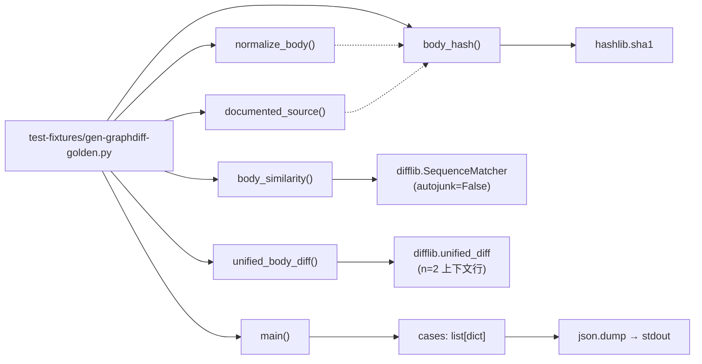
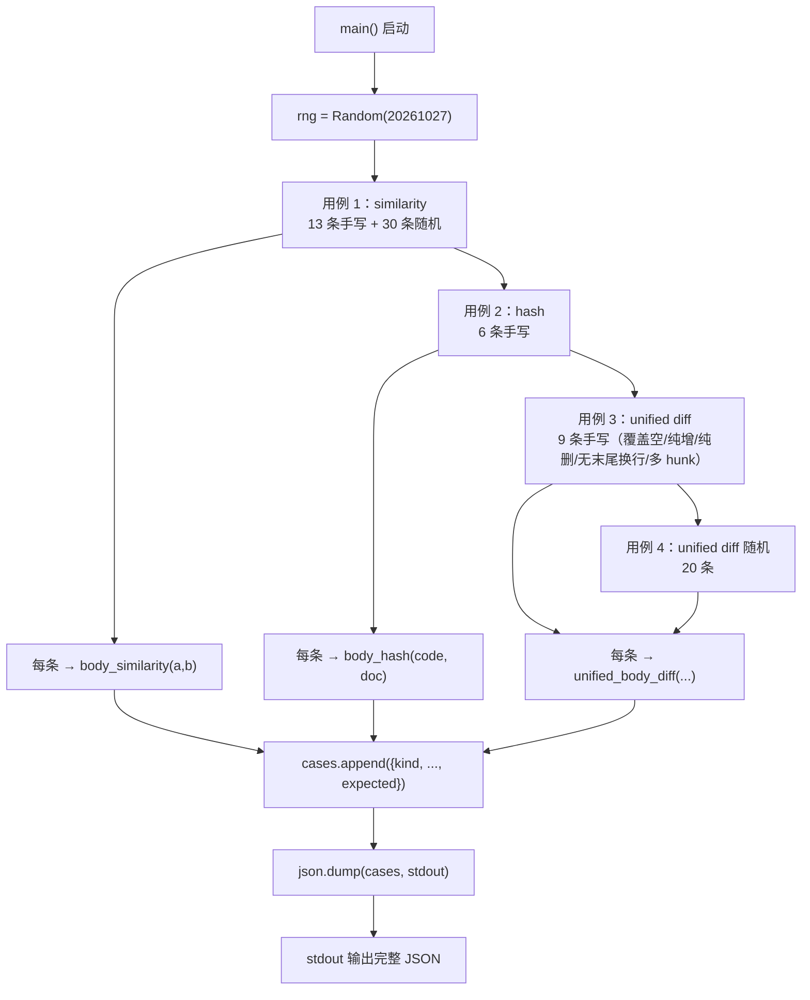
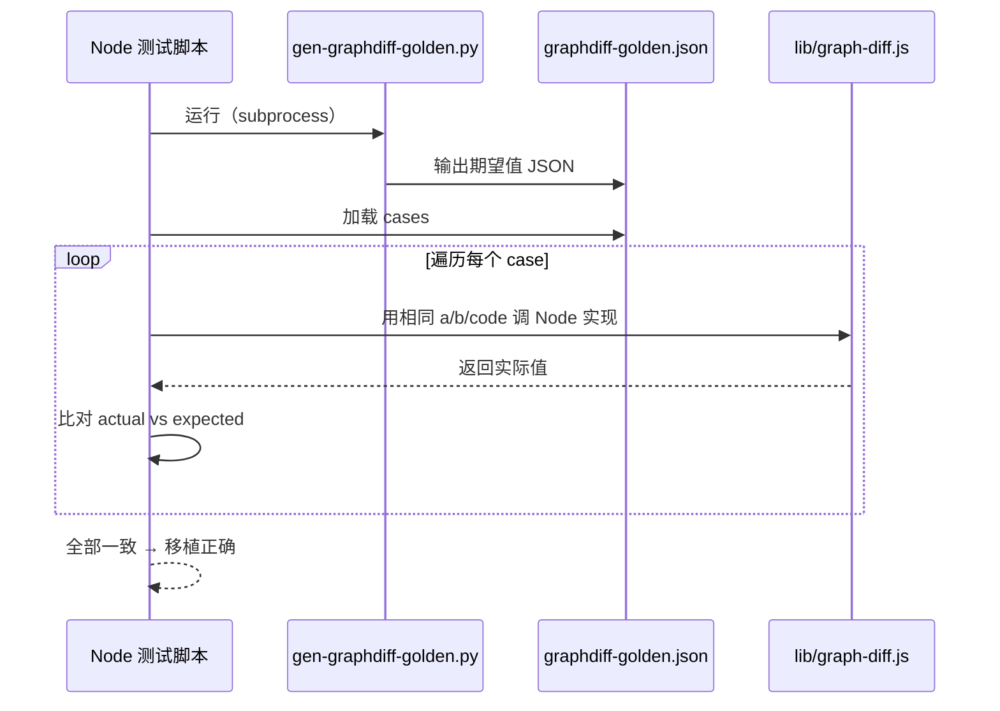
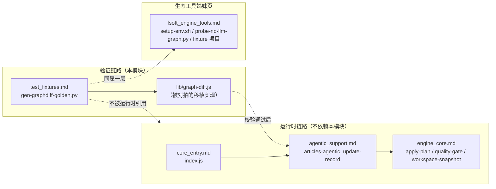

# 测试夹具生成器（test_fixtures）

`test_fixtures` 模块是 [生态工具与验证层](../Ecosystem_Tooling___Validation_Layer.md) 下的子模块，职责单一且明确：**生成图 diff（graph-diff）移植正确性的「对拍黄金集」（golden dataset）**。它通过调用 Python 标准库 `difflib` 与已移植到 Node 侧的 `lib/graph-diff.js` 共享同一批输入，让 Python 原版产出「期望值」（expected），Node 移植实现产出「实际值」（actual），逐字段比对以确认移植未引入算法偏差。

模块仅包含一个文件 `test-fixtures/gen-graphdiff-golden.py`，无任何运行时依赖（只用 Python 标准库），可随时被任意测试脚本或 CI 任务直接执行。

---

## 1. 为什么需要「对拍黄金集」

图 diff 模块承担「模块正文相似度比对」「body 哈希生成」「unified diff 渲染」三类职责，是增量编译（symbolIncremental）判定「接口是否真变了」的底层算法。这类移植容易踩的坑：

| 风险类别 | 典型边界情形 |
|---|---|
| `difflib.SequenceMatcher` 匹配块算法 | 空序列、重复 token、autojunk 开关差异 |
| 分词（tokenize）正则不一致 | `\w+` 与 `[^\w\s]` 的语义在 Python 与 JS 里不同（unicode 类、锚定等） |
| 行尾换行处理 | 末尾无换行、新增纯换行、纯删除空行 |
| 字符串规范化 | 多行空白折叠、docstring 与 code 拼接顺序 |

肉眼核对这些 case 完全不可信，必须把「Python 原版行为」冻结成 JSON 期望输出，让 Node 侧跑同一批输入后比对浮点 / 字符串 / SHA1 是否逐位一致。这就是 `gen-graphdiff-golden.py` 的核心价值。

---

## 2. 核心组件架构

### 2.1 模块结构



### 2.2 函数职责

| 函数 | 职责 | 关键行为 |
|---|---|---|
| `normalize_body(text)` | 折叠空白为单个空格并 `strip()` | 用 `_WS = re.compile(r"\s+")` 把连续空白统一为单空格 |
| `documented_source(code, docstring)` | 决定「正文」拼接顺序：docstring 在前，code 在后 | 若 docstring 已包含在 code 中则不重复拼接，避免双算 |
| `body_hash(code, docstring)` | 输出 `normalize_body(documented_source(...))` 的 SHA1 hex | 作为模块身份指纹，用于增量编译时判定「是否变化」 |
| `body_similarity(a, b)` | 两正文分词后调用 `SequenceMatcher(autojunk=False).ratio()` | 空/空 → `1.0`；一空一非空 → `0.0`；其余按 token 集算相似度 |
| `unified_body_diff(old_lines, new_lines, label, n=2)` | 渲染 unified diff 文本 | `fromfile=a/{label}`、`tofile=b/{label}`；上下文默认 2 行 |
| `main()` | 编排：生成用例 → 计算期望 → JSON 输出 | 用 `random.Random(20261027)` 固定种子，保证每次运行输出稳定 |

---

## 3. 用例生成流程

`main()` 把测试输入分四类装进 `cases` 数组，最后一次性 `json.dump(..., ensure_ascii=False, indent=1)` 写到 stdout：



### 3.1 用例矩阵

| 类别（`kind`） | 输入数 | 关键字段 | 期望（`expected`） | 覆盖边界 |
|---|---|---|---|---|
| `similarity` | 13 手写 + 30 随机 | `a`, `b` | `float` 相似度 | 空串、完全相同、部分相同、全不同、重复 token、中文、多行空白折叠 |
| `hash` | 6 手写 | `code`, `docstring` | `sha1 hex` | 纯空白、docstring 单独、code 与 docstring 重复、中文、多行 |
| `unified` | 9 手写 + 20 随机 | `oldText`, `newText`, `label` | unified diff 字符串 | 双方均空、相同、单 hunk、多 hunk、纯新增、纯删除、无末尾换行、末尾换行增减 |

---

## 4. 调用与产出

### 4.1 直接运行

```bash
python test-fixtures/gen-graphdiff-golden.py > test-fixtures/graphdiff-golden.json
```

输出示例（结构摘要）：

```json
[
 {
  "kind": "similarity",
  "a": "",
  "b": "",
  "expected": 1.0
 },
 {
  "kind": "hash",
  "code": "code()",
  "docstring": "/** doc */",
  "expected": "..."
 },
 {
  "kind": "unified",
  "oldText": "a\nb\nc",
  "newText": "a\nx\nc",
  "label": "m",
  "expected": "--- a/m\n+++ b/m\n@@ -1,3 +1,3 @@\n a\n-b\n+x\n c\n"
 }
]
```

### 4.2 在 Node 测试侧的对拍流程



---

## 5. 与系统其它模块的关系

`test_fixtures` 是**纯验证工具**，不参与运行时编译链路。它的存在只为一类目标：让增量编译判定逻辑（`symbolIncremental`，在 [核心入口](../core_entry.md) 与 [agentic 支持](../agentic_support.md) 中被驱动）有可信赖的算法基准。



> 说明：根据 `package.json` 描述，「Node-side reimplementation of FSoft algorithms (symbols/cluster/graph-diff/incremental/update-planner) was retired and deleted in 0.16.0 phase 7」。本夹具脚本是该历史阶段的遗留验证资产，仍可作为算法对照基准保留；若 `lib/graph-diff.js` 在当前版本已被移除，该脚本可作为**算法参考实现**独立使用，或与上游 FSoft Python 引擎的图 diff 行为做跨语言比对（参见 [FSoft 引擎工具集](fsoft_engine_tools.md) 的 `probe-no-llm-graph.py`）。

---

## 6. 已知约定与注意事项

| 事项 | 说明 |
|---|---|
| 随机种子固定 | `random.Random(20261027)` —— 保证每次重跑输出字节级一致，便于 diff 与版本化管理 |
| `ensure_ascii=False` | 中文 token 直接以 UTF-8 输出，不转 `\uXXXX`，便于人读 |
| `indent=1` | 紧凑 JSON，节省体积 |
| `autojunk=False` | 与 Node 侧实现对齐，禁用 `SequenceMatcher` 的自动 junk 过滤，避免两端默认值不同导致相似度漂移 |
| `splitlines(keepends=True)` | 把行尾换行保留在行内，与 `unified_diff` 的输入契约一致；空字符串直接得到 `[]`，对应「纯新增/纯删除」语义 |
| 无第三方依赖 | 仅 `difflib / hashlib / json / random / re / sys`，可在任意 Python 3.8+ 环境直接跑 |

---

## 7. 参考

- 父模块：[生态工具与验证层](../Ecosystem_Tooling___Validation_Layer.md)
- 同层工具：[FSoft 引擎工具集](fsoft_engine_tools.md)
- 运行时消费方（历史）：[核心入口](../core_entry.md) · [agentic 支持](../agentic_support.md) · [引擎核心](../engine_core.md)
- 打包/配置上下文：[构建与依赖配置层](../Build___Dependency_Configuration_Layer.md)（`package.json` 中关于 0.16.0 Node 算法退役的说明）
