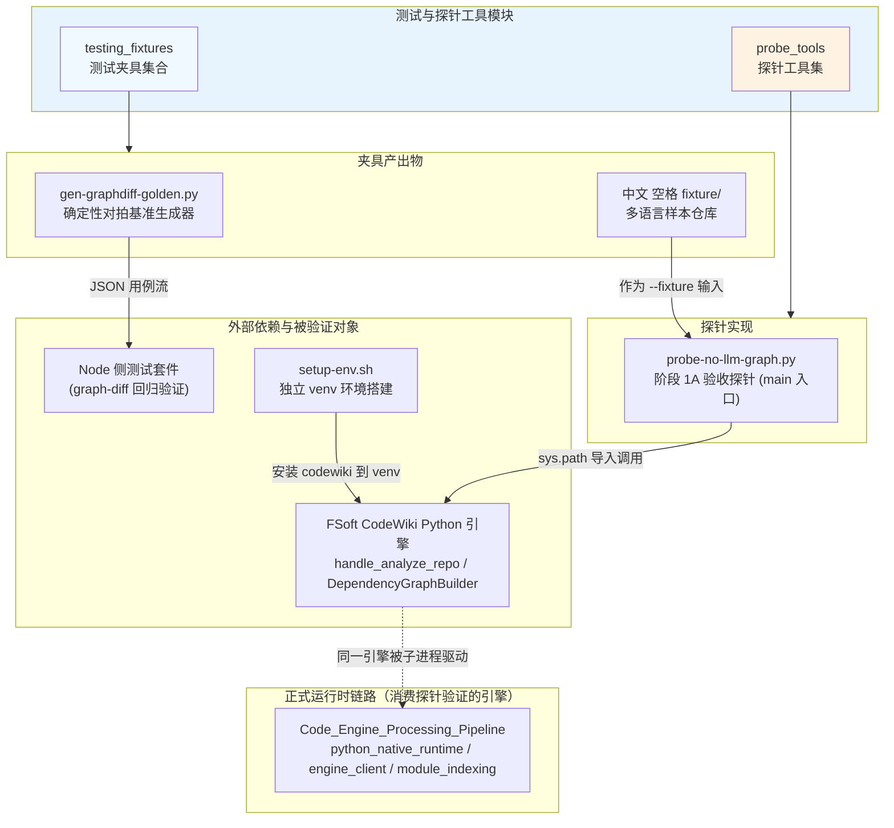
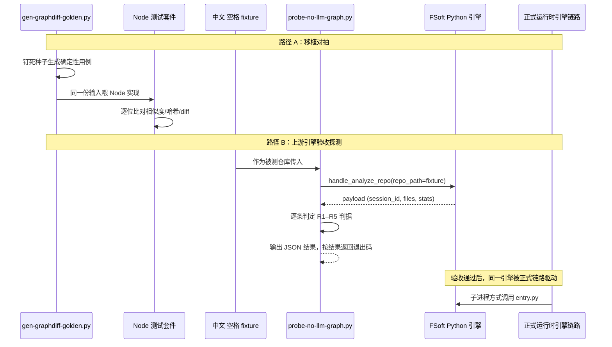

<# 测试与探针工具（Testing___Probing_Tooling）

## 模块概述

`Testing___Probing_Tooling` 是项目中的**开发期验收与对拍工具集**，不参与插件运行时链路，专门服务于引擎正确性保障。它聚焦两个核心验证目标：

1. **移植正确性对拍**：用确定性输入比对 Node 侧算法与上游 Python 原版实现（相似度、内容哈希、统一 diff），捕捉边界情形下的行为差异。
2. **上游引擎原生链路探测**：在**完全不依赖 LLM、不依赖 DSH 插件进程、无需模型凭证**的前提下，验证 FSoft CodeWiki 引擎的依赖图分析链路（`handle_analyze_repo`，基于 tree-sitter 静态分析）在含中文与空格的非 ASCII 路径下能否跑通。

模块由两个子模块构成：**测试夹具集合**提供被探测的目标数据，**探针工具集**执行实际的探测与断言，二者配套形成「被测对象 + 验收执行」的完整闭环。所有产出物为测试输入或验收脚本，不对生产运行时产生任何侵入。

## 架构总览

### 数据流路径

## 核心组件

本模块包含两个核心子模块，详细说明见对应文档：

### 1. [testing_fixtures](testing_fixtures.md)
测试夹具集合，为引擎对拍和上游探测提供确定性输入数据。包含两部分：
- **对拍基准生成器**：使用钉死种子的随机用例，基于 Python `difflib` 原版实现生成相似度、内容哈希、统一 diff 三类测试用例的期望值，输出 JSON 供 Node 侧比对。
- **多语言样本仓库**：目录名本身含中文与空格的最小仓库，同时覆盖 Python AST 提取、TypeScript 分析、跨目录依赖边、脚本入口 artifact 采集四个关键验证维度。

### 2. [probe_tools](probe_tools.md)
探针工具集，当前核心是 `probe-no-llm-graph.py` 阶段 1A 验收探针。它直接在独立 venv 中导入上游 FSoft 引擎，绕过插件进程与 LLM 链路，执行 R1–R5 共五条验收判据（分析返回、节点与语言统计、依赖边建图、workspace 文件落盘、artifact 节点采集），输出结构化 JSON 结果并按结果返回不同退出码，用于分层排障：先确认无模型的图分析链路跑通，再在后续阶段分离定位模型链路故障。

## 在整体系统中的定位

本模块是 [Code_Engine_Processing_Pipeline](Code_Engine_Processing_Pipeline.md) 的**质量保障外围**：正式引擎流水线负责代码分析、模块索引与计划执行，而本模块的夹具与探针在引擎交付前验证其正确性。
- 探针验证的 `handle_analyze_repo` / `DependencyGraphBuilder` 正是 [python_native_runtime](python_native_runtime.md)、[engine_client](engine_client.md)、[module_indexing](module_indexing.md) 在正式运行时所驱动的上游 Python 引擎能力。
- 探针运行依赖 [build_deployment_config](build_deployment_config.md) 中的 `setup-env.sh` 脚本搭建的独立 venv 环境（冻结依赖快照 + editable 安装 codewiki + 依赖检查），确保探测在依赖闭合的环境中运行。
- 对拍基准仍作为回归保护，防止已退役 Node 侧算法的残留实现被误用。