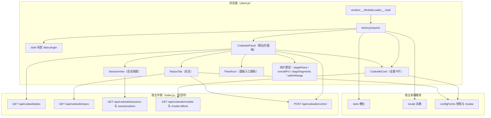
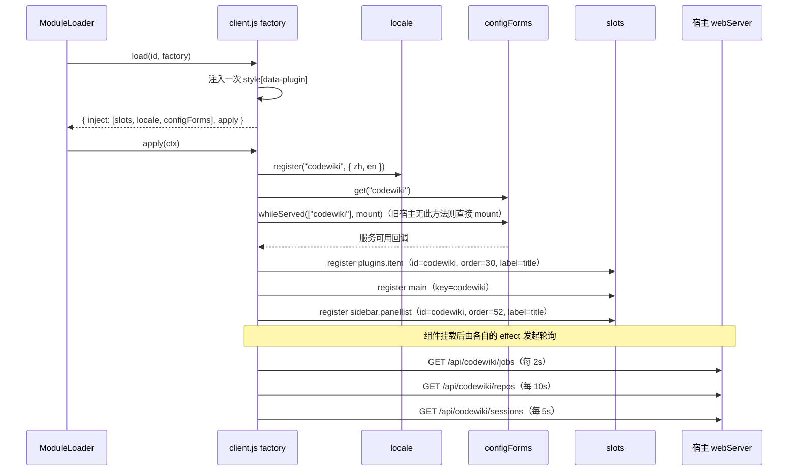
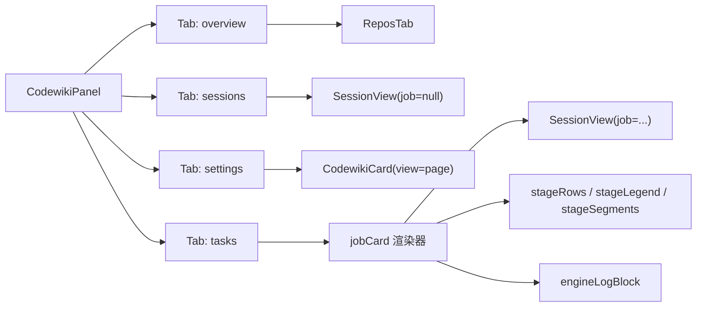
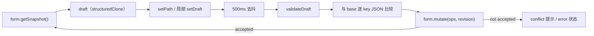
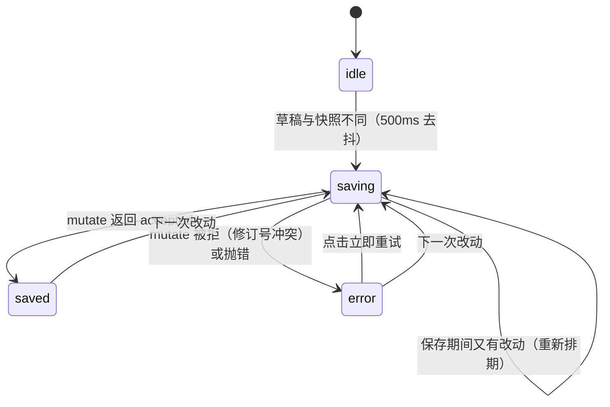
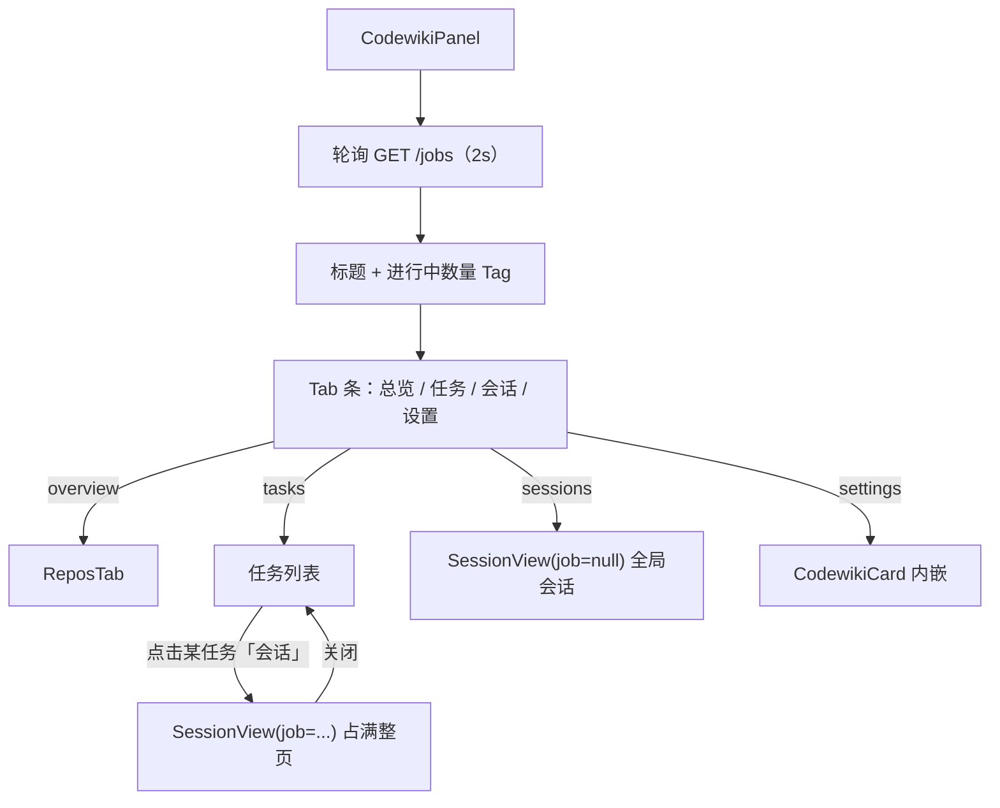
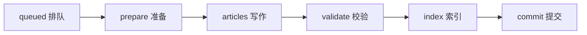
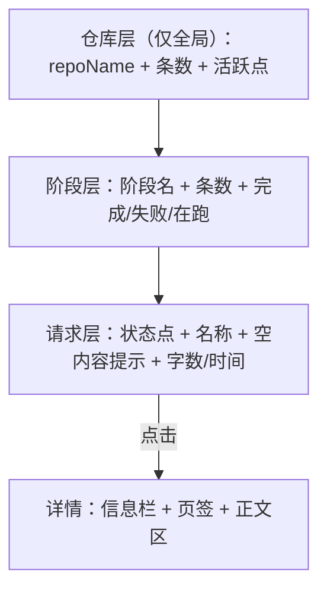
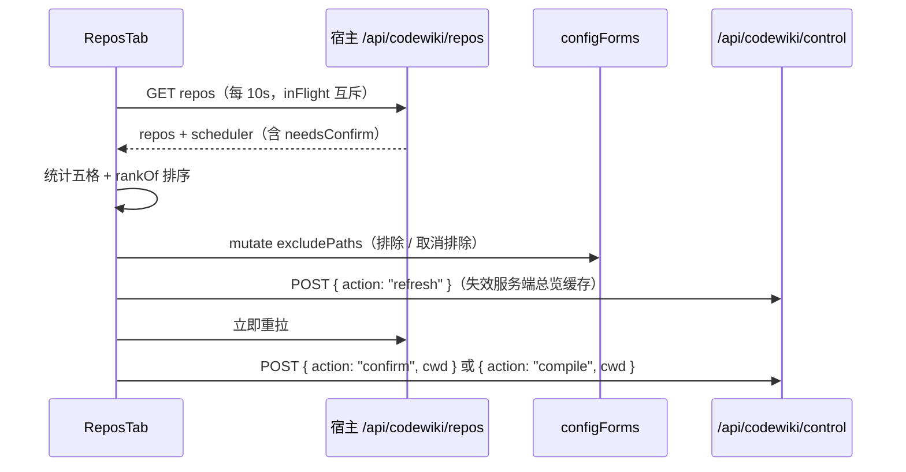

# ui-client（浏览器半侧客户端）

`ui-client` 是 `@ikliml666/dsh-codewiki` 插件的**浏览器半侧**，实现文件只有一个：`client.js`。它通过 `window.__ModuleLoader__.load({ id: '@ikliml666/dsh-codewiki', factory })` 注册到宿主前端的模块加载器，向外提供两个界面挂载点：

1. **设置表单**（`plugins.item`，`id = codewiki`）——插件页里的配置卡片，读写宿主 `configForms` 的 `codewiki` 命名空间；
2. **侧边栏面板**（`main` + `sidebar.panellist`，`key/id = codewiki`，`order = 52`）——编译任务进度、取消、仓库总览、编译会话（LLM 请求记录）与设置页。

客户端**不直接执行编译**。所有数据都来自宿主半侧的只回环 HTTP 端点（`/api/codewiki/*`），所有配置都经宿主 `configForms` 服务持久化并热生效。编译流水线本身见 [Job_Orchestration___State_Management.md](job-orchestration-state-management.md)，引擎与产物契约见 [Documentation_Generation_Engine.md](documentation-generation-engine.md)。

---

## 1. 模块定位

| 维度 | 说明 |
| --- | --- |
| 运行环境 | 浏览器（`package.json` 中 `dsh.client.platform = "web"`） |
| 注册标识 | `id` 必须等于 `package.json` 的 `name`（`@ikliml666/dsh-codewiki`），client-modules 按 `nearestPackage` 的 name 校验注册者 |
| 导出 | `package.json` 的 `exports["./client"] = "./client.js"` |
| 依赖的宿主服务 | `slots`（槽位注册）、`locale`（词典）、`configForms`（配置快照 / 变更） |
| 依赖的宿主 UI 库 | `react`、`@deepseek-ai/dsh-client-ui-primitives`（`Switch`、`Button`、`Input`、`Tag`、`MarkdownText`、`SegmentedTabs`） |
| 与宿主半侧的耦合方式 | 仅 HTTP：`GET` 拉取状态、`POST /api/codewiki/control` 下发动作 |
| 国际化 | 自带 `zh` / `en` 两份词典，注册到 `locale` 的 `codewiki` 命名空间 |

模块的 `apply(ctx)` 只做三件事：注册词典、挂载设置卡片、挂载侧边栏面板；其余全部是纯组件与纯计算函数。

---

## 2. 架构总览

要点：

- **挂载点即权限边界**。设置卡片只在宿主为该命名空间提供服务时出现（`configForms.whileServed`），插件未加载 / 停用时插件页不显形；面板则始终由 `main` 槽位驱动。
- **面板是"只读视图 + 少量动作"**。读：jobs / repos / sessions / models；写：`configForms.mutate`（配置）与 `POST control`（取消、编译、确认、刷新缓存）。
- **计算全部在前端完成**。总进度、阶段分段宽度、ETA、吞吐都基于服务端 payload 的原始字段在浏览器侧推导，服务端只提供事实（阶段、耗时、篇数、tps、用量）。

---

## 3. 挂载与注册流程

实现细节：

- 词典在 `ctx.effect` 中注册，返回 disposer 由宿主统一回收；`zh` / `en` 是**函数**，返回新的对象字面量（词典值必须是字符串，若为函数 `t()` 会回退返回键名）。
- 面板的 `main` 与 `sidebar.panellist` 两个注册放在同一个 `ctx.effect` 里，disposer 逐个 `try/catch` 调用，避免重复卸载抛错。
- `PANEL_ORDER = 52`，刻意排在 `dsh-hindsight-on-demand`（50）之后。
- 样式表以 `style[data-plugin="@ikliml666/dsh-codewiki"]` 去重，HMR / 重复加载时不会堆叠。

---

## 4. 组件结构

| 组件 | 角色 | 主要数据来源 |
| --- | --- | --- |
| `CodewikiCard` | 设置页完整表单；`view='summary'` 时退化为一行简介 | `configForms` 快照、`/models`、`/model-efforts` |
| `CodewikiPanel` | 侧边栏面板壳：标题、Tab 条、任务/总览/会话/设置分派 | `/jobs` |
| `ReposTab` | 总览：统计条、调度摘要、仓库清单与动作 | `/repos`、`configForms`、`POST control` |
| `SessionView` | 编译会话：三层分组列表 + 请求详情 | `/sessions`、`/sessions/item` |
| `PanelIcon` | `sidebar.panellist` 入口图标（摊开的书） | 无 |
| `Skeleton` | 加载骨架（3 条不同宽度呼吸条） | 无 |
| `Spark` | tok/s 微趋势线（纯 SVG polyline） | 面板侧滚动窗口 |
| `zh` / `en` | 词典工厂 | 无 |
| `mount` | 设置卡片槽位注册器 | `slots`、`configForms` |
| `line` | 引擎日志单行格式化（`engineLogBlock` 内） | `job.nativeLogs` |
| `row` | 会话列表单行（`SessionView` 内） | `/sessions` |
| `tokLabel` | token 数按量级缩写（`M` / `k` / 原值），`SessionView` 内 | 会话记录 |
| `charLabel` | 字符数缩写：不足 1000 按实际字数，否则 `k ch`，`SessionView` 内 | 会话记录 |
| `isEmptyish` | 判定「输出 / 思考 / 工具」三者全空，`SessionView` 内 | 会话记录 |
| `toOption` | 思考档位 → `<option>`（目录对象与裸字符串统一取 id） | `/model-efforts` |
| `byUpdated` | 任务排序比较器（`updatedAt`/`createdAt` 倒序） | `/jobs` |

---

## 5. 设置卡片：`CodewikiCard`

### 5.1 数据流

- **快照订阅**：`pull()` 读快照并按 `snap.revision` 覆盖草稿——只有宿主值真的换了修订号才覆盖，避免保存回读时把用户正在输入的内容冲掉。
- **可自动保存字段**由 `SAVE_KEYS` 白名单控制（新增字段必须同时进 `SAVE_KEYS` 与渲染，否则改了不会落盘）：

  `enabled`、`binaryPath`、`maxConcurrency`、`moduleConcurrency`、`serialProjects`、`parallelProjects`、`articleLanguage`、`updateReminder`、`autoCommit`、`workspaceOnly`、`techdocs`、`batchProvider`、`batchModel`、`batchReasoningEffort`、`effortByStage`、`excludePaths`、`autoUpdate`、`autoUpdateMin`、`requestLimit`、`emptyStreakLimit`、`nativeEngine`、`nativeEnginePython`、`nativeEngineEntry`、`nativeEngineTimeoutMs`、`updateRung`、`updateTauNb`、`updateTauGrow`、`updateTauFull`、`updateTauTree`

- **校验**：`maxConcurrency` 必须是 1–8 的整数；`requestLimit` 必须是 1–1000 的整数；`emptyStreakLimit` 必须是 0–20 的整数（`0` = 关闭），但该键缺省（老配置里从未写过这个键）时**不参与校验**——不能让一个没设置过的字段拦住所有保存。校验不过的草稿不提交，错误常显在底部状态行并提供「立即重试」。
- **串行提交**：`savingRef` 保证同一时刻只有一次 `mutate` 在飞；`pendingRef` 保留最新草稿，保存期间再改动会在 finally 里重新排期。
- **卸载兜底**：卸载时 `flush()` 一次，面板切走 / 折叠不会丢掉刚改的值。

### 5.2 自动保存状态机

界面上的保存条（`[data-dscw-bar]`）只用一个小圆点 + 一行小字表达状态（`idle` / `saving` / `saved` / `error`），刻意不放「保存 / 放弃」按钮——自动保存让这类失误结构性消失。只读配置下额外显示 `readonlyHint`，此时 `flush` 直接返回。

### 5.3 分组与字段

表单以卡片栅格（`[data-dscw-cards]`，宽屏 3 列、≤1020px 两列、≤660px 单列）组织六个分组，每个分组是一张 `[data-dscw-sec]` 卡片：

| 分组 | 字段 |
| --- | --- |
| 运行（`secRun`） | `enabled`、`updateReminder`、`autoCommit`、`workspaceOnly`、`techdocs` |
| 并发与语言（`secScale`） | `maxConcurrency`、`moduleConcurrency`、`serialProjects`、`parallelProjects`（串行时禁用）、`articleLanguage`、`binaryPath` |
| 原生引擎（`secNative`） | `nativeEngine`、`nativeEnginePython`、`nativeEngineEntry`、`nativeEngineTimeoutMs` |
| 增量策略（`secIncremental`） | `updateRung`（空/3/3b/2/1/0）、`updateTauNb`、`updateTauGrow`、`updateTauFull`、`updateTauTree` |
| 编译模型（`secCompile`） | `batchProvider` / `batchModel` / `batchReasoningEffort`（`modelTrio` 联动）、`requestLimit`、`emptyStreakLimit`（空产出熔断，`0` = 关闭，默认 3）、`effortByStage`（graph / articles / proofread / validate 四档） |
| 调度与排除（`secSchedule`） | `autoUpdate`、`autoUpdateMin`、`excludePaths`（textarea） |

**模型级联**：`/models` 可用时提供商与模型是下拉（目录外的值保留为 `__custom` 选项，避免静默丢配置）；不可用时整组退化为手填 `Input`，`catalogUnavailable` 提示错误但不阻断保存。`/model-efforts` 返回的档位是 `{ id, name, description }` 对象；若模型目录未声明档位，则回退到 `GENERIC_EFFORTS`（`off`、`low`、`medium`、`high`、`xhigh`、`max`）——选了模型不支持的档位由宿主侧 `llmChat` 剥档重试，不会失败。

**`emptyStreakLimit`（空产出熔断）**：模型通道连续这么多次「上游返回 200 却既无正文也无工具调用」就停发请求，避免把额度烧在注定失败的调用上；已写好的文章照常落盘。`0` = 关闭，默认 3，合法区间 0–20。

**`techdocs` 开关**：与同组其它开关的判定方向相反——其余开关只在显式关掉时才关（`!== false`），它只在显式 `true` 时才开（默认关闭）。开启后每轮额外导出一份 Backstage TechDocs 站点到 `.codewiki/_techdocs/`（约 37 个文件，不进 `cw` 索引），属于附加产物而非正式文章。

---

## 6. 侧边栏面板：`CodewikiPanel`

### 6.1 Tab 与视图切换

- **单任务会话**（任务行「会话」按钮）占满整页并隐藏外层滚动（`data-dscw-p-fixed`），因为会话页要自己分配「列表 + 详情」的高度；**全局会话**留在 Tab 内渲染，顶部 Tab 条保持可见，随时能切走。
- 轮询用 `inFlight` 互斥：上一次请求未回包时不重叠拉取；卸载后不再 `setState`。

### 6.2 任务列表组织

- 按 `cwd` 分组，组内 `unshift`（最新在前）；`byUpdated` 决定活动任务的展示顺序。
- **进行中**（`stage` 在 `ACTIVE_STAGES` 内，**包含 `queued`**）全部展开在顶部；无进行中任务时只把最近更新的一个当"门面"，其余进入「历史任务」折叠区。排队任务之所以也算进行中，是为了让「单项目串行」下的等待者可见——它占着队列位置，用户需要能取消它。
- 历史区**按仓库二次折叠**（`[data-dscw-p-repofold]`）：同一仓库几十轮平铺会把别的仓库挤出视野。
- 并发多个任务时，区段标签右侧给出 `poolSummary`：平均进度 + 最慢任务（排队中的任务不计入平均，单独报数量）。

### 6.3 任务卡信息层次

单张任务卡（`[data-dscw-p-job]`）的排布顺序即信息优先级：

1. 头部行：类型 Tag（`kindFull` / `kindStale` / `kindResume`）、仓库名（仅活动区）、阶段标签、右侧动作（吞吐徽标、会话、取消）；
2. 进度行：大号百分比 + 分段进度条 + 当前阶段说明（含实时阶段计时与引擎阶段百分比）；
3. 图例行：颜色 ↔ 阶段绑定；
4. 次要信息流水线（`[data-dscw-p-subline]`）：篇数、失败数、用量、最新一条备注；
5. 排队可见性：`queueAhead` 渲染「在等：A → B」；
6. 折叠区：活动流（除最新一条外）、引擎日志（最近 40 条）、逐篇清单；
7. 尾部：错误文本、`wikiPath` + 复制路径按钮。

---

## 7. 进度计算模型

进度是纯前端推导，输入全部来自 `/jobs` 返回的 `jobSummary`（见 `index.js::jobSummary`：`stage`、`stageTimings`、`nativeStage`、`nativeStageTimings`、`nativePercent`、`taskList`、`batchProgress` 等）。

### 7.1 六步与权重

| 阶段 | 权重（`STAGE_WEIGHTS`） | 色相（`STAGE_HUE`） |
| --- | --- | --- |
| `queued` | 0 | 210 |
| `prepare` | 0.24 | 196 |
| `articles` | 0.46 | 262 |
| `validate` | 0.21 | 32 |
| `index` | 0.05 | 152 |
| `commit` | 0.04 | 220 |

- 总进度 = Σ(阶段权重 × 阶段内完成度)，**封顶 99**；只有 `done` / `partial` 显示 100。
- 阶段内完成度 `stageFraction` 的优先级：已跑过的阶段 = 1 → 当前阶段优先用引擎自报 `nativePercent` → 退而用 `taskList` 完成率 → 否则 0。
- `LEGACY_STAGE` 把历史任务里的 `plan` / `crosscut` / `review` 分别映射到 `prepare` / `articles` / `validate`，否则 `indexOf` 得 -1 会让步骤条整条熄灭。
- `partial` 与 `done` 一样视为"所有阶段都跑过了"，只有 `failed` / `cancelled` 才把最后计时的阶段标红 / 标黄。

### 7.2 引擎八段与面板六步的换算

引擎契约（`lib/engine/contract.js` 的 `ENGINE_STAGES`，`stage_map.py` 里保持同一份枚举）包含 `env`、`graph`、`cluster`、`articles`、`proofread`、`validate`、`index`、`baseline`、`commit`；代码注释里常称"八段契约"，因为 `env` 由 doctor 动作承担、不在生成流程内。面板步骤条是粗粒度六步，两者通过 `NATIVE_TO_STEP` 对齐：`env/graph/cluster → prepare`，`proofread/validate → validate`，`baseline → index`。

引擎自报的百分比是"整轮"百分比，而 `prepare` 覆盖 FSoft 阶段 1+2，所以三段读数区间不同（界值来自 `lib/engine/python/stage_map.py` 的 `FSOFT_STAGE_WEIGHTS` × `FSOFT_PROGRESS_CEILING = 90`）：

| 引擎子阶段 | 区间 `ENGINE_PCT` | 预估权重 `PREPARE_WEIGHT` | 色相 `PREPARE_HUE` |
| --- | --- | --- | --- |
| `env` | 0–100 | 0.08 | 184 |
| `graph` | 0–36 | 0.62 | 196 |
| `cluster` | 36–54 | 0.30 | 208 |

`withinRange(stage, pct)` 把整轮百分比归一化到该子阶段的 0–1。**不归一化的话 `graph` 跑完只显示 36%，看上去永远没跑完。**

### 7.3 分段进度条

`stageSegments` 生成一条 `[data-dscw-p-segbar]`，每个阶段一格：

- **进行中**：段宽 = 该阶段在总进度里的权重（与总进度条同口径），段内填充 = 阶段完成度；
- **终态**：段宽 = 该阶段真实耗时（`stageTimings`），一眼看出时间花在哪一步；
- 未执行到的阶段不占宽度也不上色，剩余部分留成透明 spacer（`__ahead`），保证总宽不随阶段推进而跳；
- 每段 `min-width: 3px`——校验这类几百毫秒的阶段若被压成亚像素就等于看不见；
- `prepare` 正在跑且引擎报的是 `env` / `graph` / `cluster` 时，这一格按 `prepareRows` 拆成三等分，段宽取真实耗时（没有耗时则用预估权重补齐）。

老任务（0.5.0 之前没有 `stageTimings`）在终态下退回纯色填充条，不画一条全 0 的空白带。

### 7.4 吞吐与用时

- **实时通道**：`job.tps > 0` 时显示 `tok/s` + `Spark`（面板侧保留最近 30 个采样点）。
- **批量通道**：有 `batchSubmittedAt` 时，用相邻两次轮询的 `batchProgress.completed` 差分算瞬时速率，再以 `0.6 / 0.4` 做 EWMA 平滑，得到「篇/分 + ETA」；尚无完成样本时只显示已执行时长。
- **用时拆分**：`elapsedSplit` 把总时长拆成「排队」与「执行」（`stageTimings.queued`，正在排队时按 `createdAt` 实时计算），避免 2 小时排队被看成"编译跑了 2 小时"。

---

## 8. 会话视图：`SessionView`

`job` 为 `null` 时走全局聚合接口（跨任务），否则只看单个任务。三层信息结构：

- **分组顺序**按真实流程（`STAGE_ORDER`：`queued → env → graph → cluster → prepare → articles → proofread → validate → index → baseline → commit → done`），不按时间——同一仓库里"先解析、再写作、后校对"是固定次序，按时间排会让同一阶段反复跳。
- **轮询**：列表 5s；用 payload 指纹（`total | active 摘要 | 每条 session 的状态与字数`）比对，内容没变就不进 state，避免打断滚动位置与焦点。
- **详情**：默认落在「输出」页签（prompt 是给模型的指令，人点开多半想看模型答了什么）；`prompt` 按 `[system]` / `[user]` / `[assistant]` / `[tool]` 头切块渲染；`reasoning` 与 `tools` 页签按需出现；未 `finishedAt` 时每 2s 续拉，能看到输出逐段长出来。
- **空内容提示**在行上就说明原因，且**进行时与完成时是两套说法**：思考非空 → `sessHintThinking`（思考中）/ `sessHintThinkingDone`（内容在思考里）；只调了工具 → `sessHintTools`（仅工具调用）/ `sessHintToolsDone`（本轮在调工具）；三者全空且仍在跑 → `sessLive`；否则 `sessHintEmpty`。完成态的行不能挂「思考中」这类现在进行时——`✓ done` 的行那样写读起来像还在跑或卡住了，而 agentic 写作的正文本来就由工具调用直接落盘，这类行是完成而非空转。`data-empty` 也改由 `isEmptyish`（输出 / 思考 / 工具三者全空）判定，并且只在非 `running` 时才置位，避免把这类完成行当成空行显示成更灰的字。
- **字数与 token 缩写**：字符数不足 1000 的行按实际字数显示（`charLabel`：`73 ch` 而不是 `Math.round(73/1000)` 得到的 `0k ch`）；token 数按量级缩写（`tokLabel`：≥1e6 用 `M`、≥1000 用 `k`、更小按原值），否则 420 会被写成 `0k`。
- **用量标注来源**：输入量区分实测与估算——只有记录里 `inputTokensMeasured === true`（上游回了 `usage`）才显示 `sessStatIn`，缺该字段的旧记录一律按估算显示 `sessStatInEst`，并带 `sessTokEstimatedHint` 提示「这是按 prompt 字符折算的估算值，不是账单口径」；输出量统一 `sessStatOutTok`。估算按中文 1 字 1 token、其余 3.5 字符 1 token 折算，与实测能差出不少，不标注来源用户就没法判断这个数能不能拿去对账。
- **分页**：单任务上限 2000 条、全局上限 500 条，每次 +80。
- **MarkdownText** 需要 `labels`（代码块头直接读 `labels.code.copyLabel`），`MD_LABELS` 只提供真正会被读到的几项。

会话记录的产生侧（`index.js::beginSessionRecord`，按流式 delta 累积输出 / 思考 / 工具调用，保留 24h）属于宿主模块，详见 [Job_Orchestration___State_Management.md](job-orchestration-state-management.md)。该记录同时决定「入 tok」这一栏的口径：`inputTokens` 初值是按 prompt 字符折算的估算，上游回 `usage` 时被覆盖成实测值（含缓存读写）并置 `inputTokensMeasured = true`；面板据此区分实测与估算，缺该字段的旧记录按估算显示。

---

## 9. 总览：`ReposTab`

- **统计五格**（`[data-dscw-p-stat]`）：待确认、有变更、编译中、干净、仓库总数。已排除的仓库不参与任何一格计数——否则"干净"会把人工排除的仓库算成已完成。
- **排序 `rankOf`**：待确认（0）→ 有变更（1）→ 其他（2）→ 干净（3）→ 出错（4）→ 已排除（5）；同档内"有最近任务"优先。需要人动手的排前面，干净的下沉。
- **调度摘要**：开关、扫描间隔、上次扫描时间、下次扫描（上次 + 间隔，显示为约值）、本轮扫描 / 提交 / 工作区外跳过 / 待确认计数。
- **动作**：`confirmCompile`（首次编译确认）、`compile`（有变更时手动更新）、`toggleExclude`（写 `excludePaths`，与设置卡同一保存链路）。

服务端 30s 缓存与 `needsConfirm` 的实时求值逻辑在宿主侧，见 [Job_Orchestration___State_Management.md](job-orchestration-state-management.md)。

---

## 10. 数据接口一览

| 端点 | 方法 | 客户端调用点 | 频率 | 用途 |
| --- | --- | --- | --- | --- |
| `/api/codewiki/jobs` | GET | `CodewikiPanel` | 2s | 任务列表（`jobSummary` 数组 + `queueAhead`） |
| `/api/codewiki/repos` | GET | `ReposTab` | 10s | 仓库 wiki 状态 + 调度器状态 |
| `/api/codewiki/sessions` | GET | `SessionView` | 5s | 会话列表（可按 `jobId` 过滤，带 `limit`） |
| `/api/codewiki/sessions/item` | GET | `SessionView` 详情 | 2s（未完成时） | 单条请求全文（prompt / output / reasoning / tools） |
| `/api/codewiki/models` | GET | `CodewikiCard` | 挂载时一次 | 提供商与模型目录 |
| `/api/codewiki/model-efforts` | GET | `CodewikiCard` | provider/model 变化时 | 思考档位与默认档 |
| `/api/codewiki/control` | POST | `CodewikiPanel` / `ReposTab` | 动作触发 | `cancel` / `compile` / `confirm` / `refresh` |

补充说明：

- 所有端点仅接受回环请求，非回环返回 403（宿主侧 `guard`）。
- `/api/codewiki/logs` 端点存在（按需读取完整 NDJSON），但面板**不调用**它：卡片只渲染 `job.nativeLogs` 的最近 40 条与 `job.logFile` 路径，避免 2s 轮询变成大文件下载。日志落盘细节见 `lib/job-logs.js`（`DSH_CODEWIKI_LOG_DIR`、单文件上限 `DSH_CODEWIKI_LOG_MAX_BYTES`，默认 2MB）。
- 客户端不做鉴权与凭证处理，模型凭证由宿主按 `batchProvider` 解析。

---

## 11. 样式系统

全部样式集中在一个 `<style>` 标签里（约 200 条规则），以 `data-dscw-*` 属性选择器命名空间化，不引入 CSS 文件或 CSS-in-JS 运行时：

- **主题变量**：统一用宿主 CSS 变量（`--dsw-alias-label-primary`、`--dsw-alias-bg-layer-1/2`、`--dsw-alias-border-l2/l3`、`--dsw-alias-brand-primary`、`--dsw-alias-state-*`），深浅主题都无需改样式。
- **阶段色相**：通过 `--seg-hue` 内联变量 + `hsl(var(--seg-hue) 58% 52%)` 使用固定色相，段色不随主题变，保证五个阶段彼此可分辨。
- **动效降级**：`@media (prefers-reduced-motion: reduce)` 关闭呼吸与骨架动画。
- **窄容器适配**：卡片栅格 3 → 2 → 1 列；卡片内一律单列到底（最窄 340px，再切标签列会把输入框压到 200px 以下）。

---

## 12. 与其他模块的边界

| 关注点 | 所在模块 |
| --- | --- |
| 任务生命周期、队列、取消、自动调度、`configForms` 服务端命名空间、`/api/codewiki/*` 端点实现 | [Job_Orchestration___State_Management.md](job-orchestration-state-management.md) |
| 引擎契约、质量门、增量落地、文章写入集合 | [Documentation_Generation_Engine.md](documentation-generation-engine.md) |
| 阶段映射表 `stage_map.py`、Python 运行时、vendored codewiki | [Execution_Runtime___Vendored_Engine.md](execution-runtime-vendored-engine.md) |
| 打包（`files`、`exports`、`dsh.client`、`dsh.bundle`）、bundle patch、引擎环境脚本 | [Build___Development_Infrastructure.md](build-development-infrastructure.md) |

客户端与宿主半侧的**唯一契约**是 `jobSummary` 的字段形状与上述七个端点的 payload。改动任一侧的字段名都会静默降级（面板显示 `—` 或空），因此两侧必须同步演进。

---

## 13. 维护注意事项

1. **新增设置字段**：同时修改四处——`SAVE_KEYS`、表单渲染、`zh()` / `en()` 词典、宿主 `Config` schema；漏掉词典会让 `t()` 回退显示键名，漏掉 `SAVE_KEYS` 则改动不会落盘。
2. **词典键名核对**：词典值必须是字符串，函数值会让 `t()` 回退返回键名。曾经出现过代码引用了 `requestLimit`、`requestLimitHint`、`invalidRequestLimit` 与 `autoUpdateLabelHint`、而 `zh` / `en` 里只定义了 `autoUpdateHint` 这类相邻键名的漂移；现已补齐（`requestLimit*`、`invalidRequestLimit`、`emptyStreakLimit*`、`invalidEmptyStreakLimit`、`sessStatIn` / `sessStatInEst` / `sessStatOutTok` / `sessTokEstimatedHint`、`sessHintThinkingDone` / `sessHintToolsDone` 均在两份词典中定义，自动更新的提示统一用 `autoUpdateHint`）。改动相关区域时仍建议一并核对，避免界面出现裸键名。
3. **阶段名演进**：新增引擎阶段时必须同时更新 `NATIVE_STAGE_KEYS`、`NATIVE_TO_STEP`、`STAGE_ORDER`，否则新阶段会落到"未标注阶段"分组或不计入总进度。
4. **权重守恒**：`STAGE_WEIGHTS` 除 `queued` 外总和应为 1（0.24 + 0.46 + 0.21 + 0.05 + 0.04）。漏一步或比例错，百分比会在相邻两步之间凭空跳点。
5. **轮询纪律**：任何新轮询都要有 `inFlight` 互斥、`alive` 守卫与指纹比对，否则面板在慢网络下会重叠请求并打断滚动。
6. **组件 id 一致性**：`NS`、`KEY`、`package.json` 的 `name`、`cordis.patch.yml` 的 `id` 必须保持 `codewiki` 语义一致；bundle 装法下 `name` 必须是裸包名（不带子路径），因为 client 半边的激活扫描只认裸包名行。
