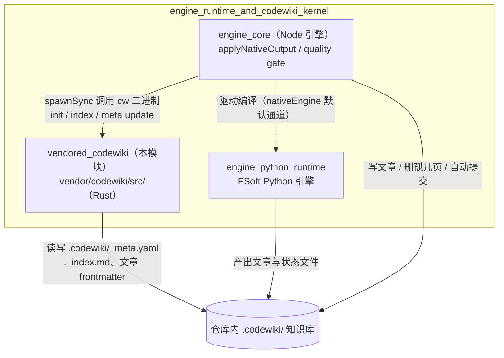
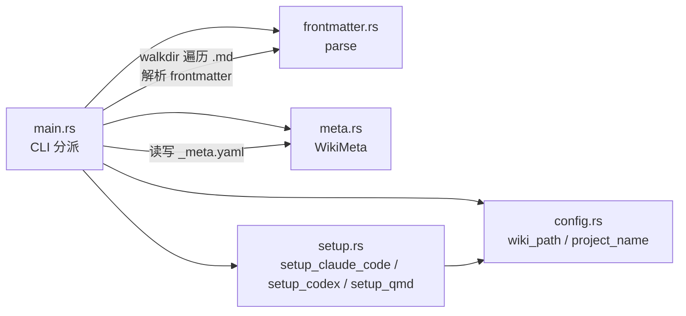
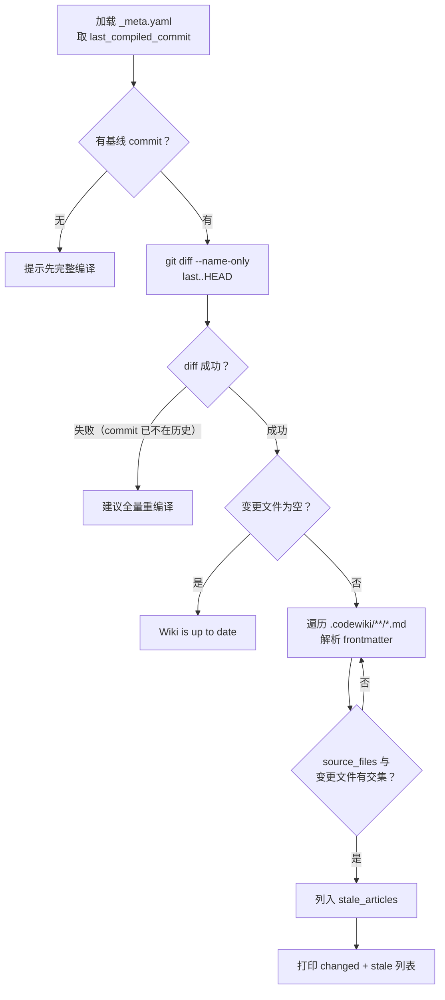
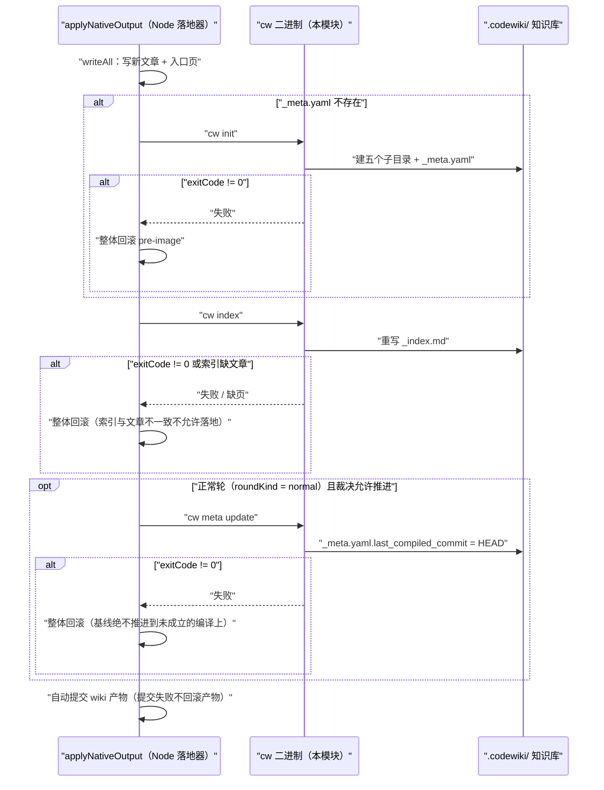
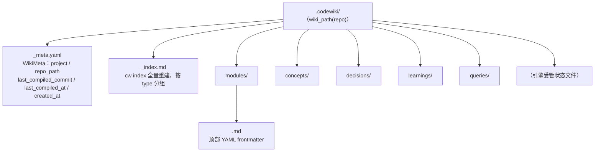

# vendored_codewiki（vendored `cw` CLI 内核）

## 简介

`vendored_codewiki` 是引擎运行时模块树中**直接随仓库 vendored 进来的上游 Rust CLI**——`cw`（CodeWiki 的命令行前端）。它不是编译流水线的执行引擎（那是 Python 原生引擎通道的职责，见 [engine_python_runtime]），而是一个围绕仓库内 `.codewiki/` 知识库的**生命周期管理工具**：建库（`init`）、检测过期（`status`）、重建索引（`index`）、推进编译基线（`meta update`）、以及把 codewiki 技能安装到各类 agent 工具中（`setup` / `uninstall`）。

Node 侧引擎落地器在每轮编译写盘后，会按固定顺序回退调用这个二进制（`cw init` → `cw index` → `cw meta update`），因此 `cw` 的行为契约（退出码、索引收录规则、基线文件格式）直接决定落地事务能否成功。本模块的源码位于 `vendor/codewiki/src/`，由 Cargo 编译出 `cw.exe` 供插件调用（见 [build_configuration_and_test_verification_tooling]）。

## 在系统中的位置

要点：`cw` 与 Python 引擎**分工明确**——Python 引擎负责「编译出什么」（符号分析、聚类、文章写作），`cw` 负责「库怎么记账」（骨架、索引、基线、agent 安装）。Node 落地器是两者之间的事务协调者。

## 模块组成

`vendor/codewiki/src/` 共 5 个源文件，在 `main.rs` 中以 `mod` 声明：

| 源文件 | 核心组件 | 职责 |
| --- | --- | --- |
| `main.rs` | `Cli`、`main`、`capitalize` | clap 命令行解析与全部 8 个子命令的实现 |
| `config.rs` | `project_name` | 路径与项目名推导：`wiki_home()`、`wiki_path()`、从 git remote 推导项目名 |
| `frontmatter.rs` | `ArticleFrontmatter` | 解析文章顶部的 YAML frontmatter（`title` / `type` / `source_files` / `tags`） |
| `meta.rs` | `WikiMeta` | `_meta.yaml` 的读写序列化、git HEAD commit 读取 |
| `setup.rs` | `claude_home` | 把 codewiki 技能/指令安装到 Claude Code、Codex、QMD |

### `ArticleFrontmatter` 的字段约定

文章（`.codewiki/**/*.md`）顶部必须有 `---` 包裹的 YAML 段，`frontmatter::parse` 负责解析：

| 字段 | serde 键 | 含义 |
| --- | --- | --- | `title` | `title` | 文章标题，缺省时 `cw index` 用相对路径代替 |
| 类型 | `type`（rust 侧改名 `article_type`） | 文章分类（module / concept / decision / learning / query），索引按它分组 |
| 来源文件 | `source_files` | 该文章覆盖的源码路径列表，是 `cw status` 判定「过期文章」的唯一依据 |
| 标签 | `tags` | 自由标签 |

> **静默跳过语义**：`parse` 只在同时满足「以 `---` 开头」且「能找到闭合 `\n---`」时返回 `Some`；YAML 反序列化失败则直接 `?` 报错——但 `cmd_index` 与 `cmd_status` 中对解析结果用的是 `if let Ok(Some(fm))` 过滤，**解析失败的文章会被静默跳过且退出码仍为 0**。Node 落地器正是依赖这一事实，写盘后比对「索引是否真的收录了每篇新文章」来兜底（详见下文「集成契约」）。

## 命令参考

`Cli` 经 clap 分派为如下子命令（`main.rs`）：

| 命令 | 行为 | 谁会调用 |
| --- | --- | --- |
| `cw init` | 在当前仓库建 `.codewiki/` 骨架（`modules/ concepts/ decisions/ learnings/ queries/` 五个子目录）并写 `_meta.yaml`；已存在则打印状态并退出 0 | Node 落地器（检测到无 `_meta.yaml` 时） |
| `cw status` | 对比 `last_compiled_commit..HEAD` 的变更文件，扫描所有文章的 `source_files` 列出过期文章 | 人工 / agent 会话起点 |
| `cw meta update` | 把当前 HEAD commit 与时间戳写入 `_meta.yaml`（即「基线推进」） | Node 落地器（仅正常轮） |
| `cw index` | 全量重建 `_index.md`：按 `type` 分组、按标题排序，生成 `[[path\|title]]` 形式的 wikilink | Node 落地器（每轮写盘后） |
| `cw projects` | 列出 `~/.codewiki/` 下已初始化的项目（见下文 Fork 偏差） | 人工 |
| `cw path` | 打印当前仓库的 `.codewiki` 绝对路径 | 人工 / 脚本 |
| `cw setup <target>` | 安装技能到 `claude-code` / `codex` / `qmd` | 人工初始化 |
| `cw uninstall <target>` | 从 Claude Code / Codex 卸载 | 人工 |

### `cw status` 的过期判定流程

## 集成契约：Node 落地器如何驱动 `cw`

[engine_core] 下的 `native_apply_and_quality_gate::applyNativeOutput` 在一次编译落地事务中，对 `cw` 的调用顺序与回滚语义如下（二进制路径来自 `deps.cwBinary` → 环境变量 `DSH_CODEWIKI_CW` → 兜底 `'cw'`；每次调用走 `defaultRunCw`，默认超时 120s）：

三条关键契约：

1. **`cw init` 幂等性**：已存在 `.codewiki/` 时打印信息并退出 0，这让落地器可以无条件先跑一次。
2. **索引即正确性判据**：`cw index` 退出码 0 但文章未被收录（frontmatter 解析静默跳过）时，落地器会反查 `_index.md` 与实际写集的差异并整体回滚——因此 `frontmatter::parse` 的解析规则（以及 `serde_yaml` 对冒号、裸值的解析行为）是生产契约的一部分。
3. **基线即记账**：`cw meta update` 失败会让已写文章全部回滚，避免「文章比基线新」导致下一轮重复消费。`delete-only` / `normalize` 两类无变化轮**不允许**推进基线。

## Fork 修改点（与上游的差异）

本仓库是对上游 FSoft-AI4Code/CodeWiki 的 fork，源码内以注释显式标注了两处刻意修改：

1. **wiki 落地位置改为仓库内**（`config.rs::wiki_path`）：上游把 wiki 放在 `~/.codewiki/<project>/`（全局目录），本 fork 改为 `<repo>/.codewiki`，使 wiki 产物与代码同仓库版本控制、可自动提交。
2. **Windows 路径分隔符规范化**（`main.rs::rel_path_string`）：上游 `Path::display` 在 Windows 输出 `\`，会污染 stale 列表与 `_index.md` 的 `[[...]]` 链接；fork 统一替换为 `/`。

### Fork 带来的残留不一致

由于核心路径改写为仓库内布局，两处仍沿用上游假设的逻辑变得名不副实：

- `cmd_projects` 仍扫描 `wiki_home()`（即 `~/.codewiki/`）列项目——在本 fork 下该目录不再被 `init` 使用，因此此命令通常报「No wikis found」。
- `setup.rs` 内嵌的 `CODEX_AGENTS_SECTION` 技能文本仍指示 agent 读写 `~/.codewiki/<project>/` 路径，与实际仓库内 `.codewiki/` 布局不符（`SKILL_MD` 来自 `include_str!("../skills/codewiki-session.md")`，是源码树外的嵌入文件）。
- `setup_qmd` 也把 `wiki_home()`（`~/.codewiki/`）注册为 QMD collection，而非各仓库内的 `.codewiki/`。

维护者若调整这些命令，需要同时考虑 Node 侧落地器对 `_meta.yaml` / `_index.md` 位置的硬编码假设。

## 存储布局

Fork 布局下，一个仓库编译完成后的 `.codewiki/` 结构为：

`WikiMeta` 字段与 `meta.rs` 一一对应：`project`（init 时由 `config::project_name` 从 `git remote get-url origin` 的最后一段推导，去掉 `.git` 后缀，失败时退回目录名）、`repo_path`（绝对路径字符串）、`last_compiled_commit` / `last_compiled_at`（由 `cw meta update` 写入）、`created_at`（init 时间）。

## 构建与配置

- `cw` 二进制的交付与查找顺序由插件配置 `binaryPath` 控制（见 `cordis.patch.yml`：「留空优先用 PATH 里的 `cw`，找不到再用插件自带 `bin/cw.exe`」）；`applyNativeOutput` 的 `DSH_CODEWIKI_CW` 环境变量是更高优先级的覆盖入口。
- 本模块是 Rust 源码 vendored 进仓库，**不随 `tools/fsoft-engine/setup-env.sh` 建立的 Python venv 安装**——那是 Python 引擎通道（FSoft 本体）的环境，由 [engine_python_runtime] 使用，见 [build_configuration_and_test_verification_tooling]。两者互不依赖。

## 相关模块

- [engine_core]：`cw` 的唯一生产调用方（落地事务中的 `init` / `index` / `meta update` 三步）。
- [native_apply_and_quality_gate]：`applyNativeOutput` 所在的子模块，本文的集成契约部分即描述它与 `cw` 的边界。
- [engine_python_runtime]：与本模块并列的编译执行通道，产出文章由 `cw index` 收录、由 `cw meta update` 记账。
- [build_configuration_and_test_verification_tooling]：插件打包与环境脚本（`cordis.patch.yml` 的 `binaryPath` 配置、Python venv 脚本）。
