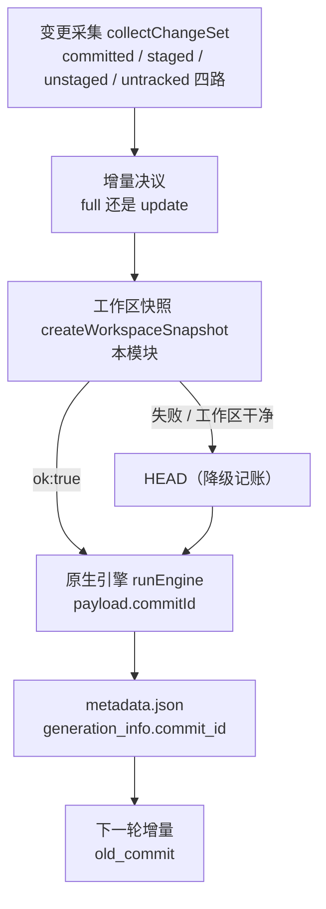
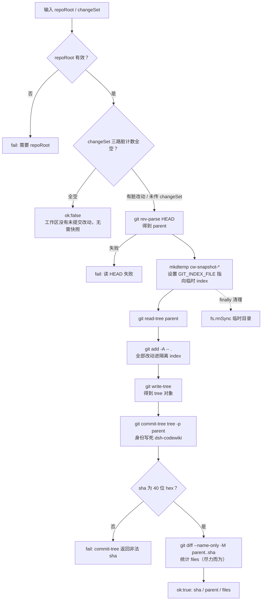
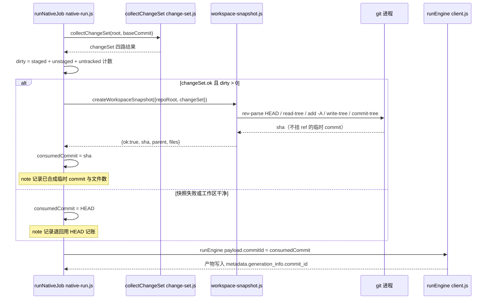
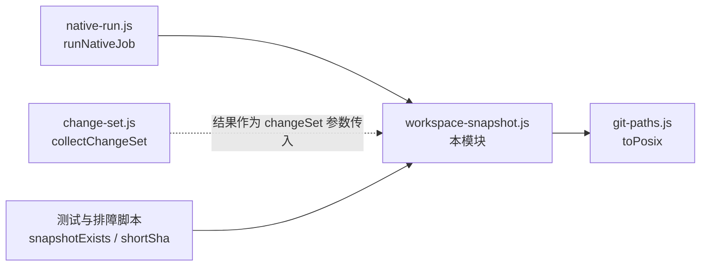

# 工作区快照管理（Workspace Snapshot Management）

## 简介

本模块由单一文件 `lib/engine/workspace-snapshot.js` 实现，对外导出三个函数：`createWorkspaceSnapshot`、`snapshotExists`、`shortSha`。它的核心职责是：**把工作区里所有未提交的改动（staged / unstaged / untracked 三路）合成一个真实存在、但不挂任何 ref 的临时 git commit**，交给原生引擎当本轮产物的「内容对账基线」使用。

它是父模块 [原生引擎运行时生命周期管理](native-codewiki-runtime-lifecycle-management.md) 下的四个并列子模块之一，由编排层 `runNativeJob` 在「增量决议之后、引擎启动之前」调用（对应 `lib/engine/native-run.js` 的 1.9 段）。

### 它要解决的问题

原生引擎（FSoft）只从 `<old_commit>..<new_commit>` 取 committed diff，未提交改动天然不进它的 `update_record`。而引擎实际读取的是**工作区文件**——内容是对的，但 `metadata.json` 的 `commit_id` 只能写 HEAD。于是工作区脏时出现两个后果：

1. **内容与账本对不上**：文章写的是工作区的内容，记账却指向 HEAD；下一轮增量拿这个 commit 当 `old_commit`，就会把这批未提交改动当成「已消化」，变化被悄悄丢掉。
2. **质量门只能如实报错**：「工作区有 N 个未提交源码改动」——无法回答「这批产物到底对应哪个状态」。

工作区快照解掉第 1 条；第 2 条刻意留给质量门自己表述（它仍然判 `partial`，因为快照不是仓库历史里的提交，不能当前移的基线——那是对的）。

## 在系统中的定位



上图展示了快照在原生编译裁决链中的位置：它处于「证据决议」与「引擎执行」之间，是 `runNativeJob` 把「本轮产物对应哪个提交」写进引擎 payload 之前的最后一道对齐工序。完整的裁决链（env → 增量决议 → 快照 → 引擎 → 质量门 → 落地）见 [原生运行时进程执行与监控](native-runtime-process-execution-monitoring.md) 与 [引擎子系统总览](codewiki-engine-subsystem.md)。

## 核心组件

### `createWorkspaceSnapshot({ repoRoot, changeSet })`

造一个「含工作区改动」的临时 commit（不写 ref）。

**入参**：

| 参数 | 类型 | 说明 |
| --- | --- | --- |
| `repoRoot` | string | 仓库根（必填，否则 `ok:false`） |
| `changeSet` | object | `collectChangeSet` 的结果；**只用来判断「有没有东西要快照」**（统计 `staged` / `unstaged` / `untracked` 三路条数），不参与构造内容 |

**返回值**（统一形状，失败永不抛异常）：

```
{ ok:boolean, sha:string, parent:string, files:number, skipped:string[], error:string }
```

- `ok:true` 时：`sha` 为 40 位十六进制的临时 commit，`parent` 为 HEAD，`files` 为与 HEAD 树的差异文件数（尽力统计，人读证据）。
- `ok:false` 时：`error` 携带原因，调用方应退回「用 HEAD 记账」的旧行为并记 note——**绝不因为造不出快照而让一次编译失败**。

### `snapshotExists({ repoRoot, sha })`

用 `git cat-file -t <sha>` 校验该对象确实存在且类型为 `commit`。注释明确写了它的用途：**给测试与排障用，不参与任何裁决**。输入必须是合法的 40 位 hex，否则直接返回 `false`。

### `shortSha(sha)`

`toPosix(String(sha)).slice(0, 12)`——把快照 sha 截成 12 位前缀，专供日志 / note 显示。其中 `toPosix` 来自 [共享基础设施工具集](shared-infrastructure-utilities.md) 的 `lib/git-paths.js`，是全仓库路径分隔符归一的唯一实现。

## 工作机制详解

### 独立 index 的四步管道

快照的全部秘密在于：**不碰用户的真实 index，而是用一个临时的 `GIT_INDEX_FILE` 走完一遍低层 git 对象流水线**：



涉及的 git 调用一览：

| git 命令 | 作用 | 备注 |
| --- | --- | --- |
| `rev-parse HEAD` | 取 parent | HEAD 读不出来直接 fail |
| `read-tree <parent>` | 把 HEAD 树装进隔离 index | 与用户 index 完全隔离 |
| `add -A -- .` | 新增 / 删除 / 改名全部入快照 | `-- .` 钉住当前目录，避免 CWD 被设到子目录时漏路径 |
| `write-tree` | 生成 tree 对象 | 无输出即 fail |
| `commit-tree <tree> -p <parent>` | 生成临时 commit | 用 `-c user.name=... -c user.email=...` 内联身份，不改全局配置；**不带任何 ref 更新** |
| `diff --name-only -M parent..sha` | 统计变更文件数 | 失败不影响快照成立 |
| `cat-file -t <sha>` | 校验快照真实存在 | 仅 `snapshotExists` 使用 |

### 三条不污染仓库的性质

头注释把设计约束写得非常明确，这三条性质是整个模块可信度的根基：

1. **用户仓库一个字节都不动**：分支、HEAD、工作区、真实 index 全部原样。`add -A` 作用在临时 index 上，所以用户已 staged 的东西既不会被顺手提交，暂存区也不会被清掉。
2. **sha 是真实可达 commit**：tree 与 commit 对象都落进 `.git/objects`，可被 `rev-parse` / `cat-file` 校验。引擎把它写进 `metadata.generation_info.commit_id` 后，下一轮能拿它做 `old_commit`。
3. **不挂任何 ref**：因此它不能作为已提交基线推进，`gc` 后自然消失。

### 干净工作区不造快照

如果传入了 `changeSet` 且 `staged + unstaged + untracked` 计数为 0，函数直接返回 `ok:false`（`error: '工作区没有未提交改动，无需快照'`）。理由：HEAD 本身就是准确的对应关系，多造一个内容相同的 commit 只会让 `metadata` 指向一个没人认识的 sha。

### 失败降级契约

所有失败路径（缺 `repoRoot`、读 HEAD 失败、`write-tree` 无输出、sha 格式非法、任意 git 调用抛错）都收敛为 `ok:false + error`，由 `runNativeJob` 记一条 note「工作区快照未成立，本轮退回用 HEAD 记账」。快照是**对齐精度的改进，不是编译成立的前提**——把「git 太旧 / 对象只读」升级成编译失败属于本末倒置。

## 与其他模块的交互时序



`runNativeJob` 侧的关键接线事实：

- 调用受 `changeSet.ok && dirty > 0 && deps.snapshot !== false` 三道闸门控制（`deps.snapshot` 供测试注入假实现或禁用）。
- 结算变量刻意分开命名：`baseCommit` 是**增量起点**（cw 受管基线），`consumedCommit` 是**本轮产物对应的内容状态**，两者绝不能混成一个变量。
- 快照结果会写进结果证据 `inc.workspaceSnapshot` 与 `inc.consumedCommit`，随每一个终态分支（包括失败/取消）一起出去，供面板与排障查看「这一轮到底对齐到了哪个 commit」。

## 依赖关系



- **内部依赖**：Node 内置模块（`child_process.execFileSync`、`fs`、`os`、`path`）与 `lib/git-paths.js` 的 `toPosix`。
- **数据上游**：`changeSet` 由 [Agentic 文章处理库](agentic-article-processing-library.md) 的 `collectChangeSet` 产出，经编排层传入；本模块只读它的三路计数。
- **唯一生产调用方**：`runNativeJob`，见 [原生运行时进程执行与监控](native-runtime-process-execution-monitoring.md)。
- **语义边界**：快照产物虽然写进了引擎的 `commit_id`，但基线能否推进仍由 [原生输出质量门](native-output-quality-gating.md) 与 [原生运行时状态与并发治理](native-runtime-state-concurrency-governance.md) 依据「基线可达性 / 受管状态」裁决——快照存在本身**不构成**基线推进许可。

## 设计约束速查

| 约束 | 含义 |
| --- | --- |
| 不写任何 ref | HEAD / 分支 / 工作区 / 真实 index 零改动 |
| 对象落 `.git/objects` | 真实可达 commit，可被 `cat-file` 校验 |
| gc 后自然消失 | 快照不可作为已提交基线推进 |
| 失败永不阻塞编译 | `ok:false + error` → 退回 HEAD 记账 |
| 干净工作区不造快照 | 避免 `metadata` 指向无人认识的 sha |
| 快照不豁免 partial | 质量门仍按「快照不是历史提交」如实表述 |
