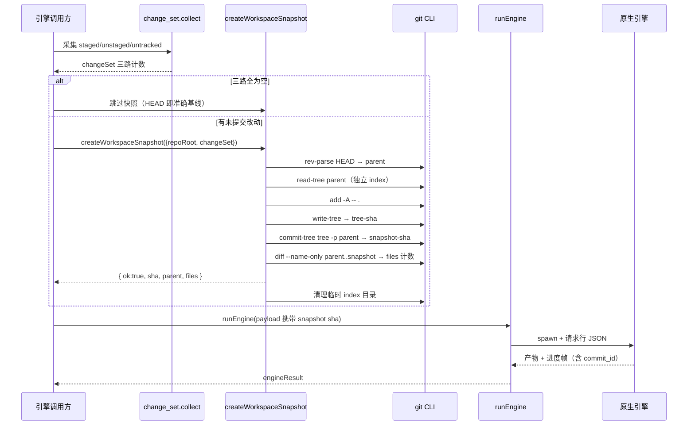
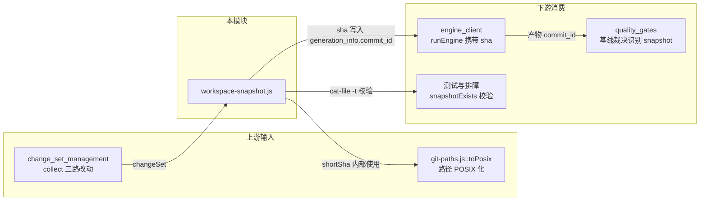

# 工作区快照（workspace_snapshots）

## 简介

`workspace_snapshots` 模块位于 `lib/engine/workspace-snapshot.js`，是 Code 引擎原生通道的「输入对齐」组件。它解决的核心问题是：**引擎只从 `<old_commit>..<new_commit>` 这样的 committed diff 取数，而用户的未提交改动（staged / unstaged / untracked）天然不会出现在任何 git 提交里**。

模块的做法是：用一个 **完全独立的临时 index 文件**（`GIT_INDEX_FILE`）走 `read-tree → add -A → write-tree → commit-tree` 流水线，合成一棵包含全部工作区改动的树对象并生成一个真实 commit，其 parent 指向当前 HEAD，**但不写任何 ref**。由此得到的 sha 是一个真实可达的 git 对象，可以安全地写进引擎产物 `metadata.generation_info.commit_id`，让下一轮增量编译拿它当 `old_commit` 时不会漏掉这些改动。

与本模块平级的兄弟模块负责引擎的其余部分（客户端进程管理、契约校验、质量门、产物落地等），见 [code_engine_module](code-engine-module.md) 的模块总览。

---

## 背景：为什么需要快照

### 引擎的取数边界

引擎（FSoft 原生通道）只认 committed diff，工作区里未提交的改动不会进入它的 update_record。插件侧的 [change_set_management](change-set-management.md) 模块（`lib/change-set.js`）能采到 committed / staged / unstaged / untracked 四路改动，但采集之后只是**记账**——存在 `state.json` 的 unconsumed 字段里，引擎本身并没有一个「本轮消费到哪」的对象可以对齐：

- 引擎读的是工作区文件（**内容是对的**）；
- 但产物 `metadata.json` 的 `commit_id` 只能写 HEAD（**记账是错的**）。

这造成两个后果：

1. **对应关系造假**：工作区脏时，文章写的是工作区的内容，记账却指向 HEAD。下一轮增量拿这个 HEAD 当 `old_commit`，就会**漏掉上一轮的未提交改动**，形成重复消费与产物漂移。
2. **质量门无法回答「产物对应哪个状态」**：它只能报一句「工作区有 N 个未提交源码改动」。

### 本模块解决到哪一步

本模块解掉第 1 条：把未提交的四路改动合成一个真实 commit 交给引擎记账。第 2 条交给质量门自己表述——因为快照不是仓库历史里的提交、不能当前移基线，质量门仍会判 partial，这是**正确行为**（详见 [quality_gates](quality-gates.md) 的基线裁决逻辑）。

---

## 核心组件

模块对外导出三个函数：

| 函数 | 职责 | 返回 |
| --- | --- | --- |
| `createWorkspaceSnapshot({ repoRoot, changeSet })` | 合成含工作区改动的临时 commit（不写 ref） | `{ ok, sha, parent, files, skipped, error }` |
| `snapshotExists({ repoRoot, sha })` | 校验某 sha 是否为 git 可识别的 commit（测试与排障用，不参与裁决） | `boolean` |
| `shortSha(sha)` | 把 40 位 sha 截断为 12 位前缀，供日志 / note 展示 | `string` |

### createWorkspaceSnapshot

执行流程：

1. **前置校验**：缺少 `repoRoot` 直接返回 `ok:false`。
2. **空工作区短路**：如果传入了 `changeSet` 且 `staged + unstaged + untracked` 三路计数为 0，则不造快照——因为 HEAD 本身就是准确的对应关系，多造一个内容相同的 commit 只会让 metadata 指向一个没人认识的 sha。
3. **读 parent**：`git rev-parse HEAD`，失败即 `fail`。
4. **独立 index 流水线**：在 `os.tmpdir()` 下创建 `cw-snapshot-*` 临时目录，设 `GIT_INDEX_FILE` 指向其中的 `index`：
   - `read-tree <parent>`：把 HEAD 的树载入临时 index；
   - `add -A -- .`：让新增 / 删除 / 改名全部进快照（`-- .` 限定在仓库根当前目录，防止 CWD 设在子目录时漏路径）；
   - `write-tree`：生成树对象 sha；
   - `commit-tree <tree> -p <parent>`：用临时身份 `user.name=dsh-codewiki` 生成 commit，message 中注明「不挂 ref、gc 后自然消失、不可作为已提交基线推进」。
5. **sha 格式校验**：必须匹配 `/^[0-9a-f]{40}$/`，否则判失败。
6. **统计证据**（可选）：`git diff --name-only -M <parent>..<sha>` 数出变更文件数，仅作人读证据，不参与判据；统计失败不影响快照成立。
7. **清理**：`finally` 中删除临时目录——tree 与 commit 对象已经落进 `.git/objects`，index 只是中间产物。

**失败语义**：快照失败一律返回 `ok:false + error`，调用方应退回「用 HEAD 记账」的旧行为并记 note，**绝不因为造不出快照就让一次编译失败**。

### snapshotExists

用 `git cat-file -t <sha>` 判断目标对象类型是否为 `commit`。输入必须是仓库根 + 40 位 sha，任何异常（对象已被 gc 回收、不是 commit 等）都返回 `false`。它的定位是**测试与排障工具**，不参与引擎的任何裁决路径。

### shortSha

通过 `toPosix`（来自 [git 路径工具](job-log-management.md)，`lib/git-paths.js`）把 Windows 反斜杠路径统一成 POSIX 风格后取前 12 位，供日志与 note 展示。

---

## 架构与位置

```mermaid
flowchart LR
    CS["change_set 采集<br/>lib/change-set.js::collect"]
    SNAP["createWorkspaceSnapshot<br/>workspace-snapshot.js"]
    CLIENT["runEngine<br/>engine_client"]
    ENGINE["原生引擎进程<br/>python_native_runtime"]
    GATE["gateNativeOutput<br/>quality_gates"]

    CS -- "staged/unstaged/untracked 三路" --> SNAP
    SNAP -- "临时 commit sha 写入 payload" --> CLIENT
    CLIENT -- "spawn + 协议帧" --> ENGINE
    ENGINE -- "产物 metadata.commit_id" --> GATE
    GATE -- "基线裁决 baseline-uncommitted" --> OUT["终态 done / partial / failed"]
```



**角色定位**：快照处在「输入采集」与「引擎调用」之间，是一次**记账基线上的修正**，不改变引擎本身的任何取数逻辑。

---

## 数据与对象关系

```mermaid
flowchart TD
    subgraph 用户仓库状态
        HEAD["HEAD（已提交基线）"]
        IDX["真实 .git/index<br/>不动"]
        WS["工作区文件<br/>含未提交改动"]
    end

    subgraph 快照流水线 GIT_INDEX_FILE 指向临时 index
        RT["read-tree HEAD"]
        AD["add -A -- ."]
        WT["write-tree → tree-sha"]
        CT["commit-tree -p HEAD → snapshot-sha"]
    end

    OBJ[".git/objects<br/>tree + commit 对象落盘"]
    META["引擎产物 metadata.json<br/>generation_info.commit_id = snapshot-sha"]
    NEXT["下一轮 old_commit = snapshot-sha"]

    HEAD --> RT
    RT --> AD
    WS --> AD
    AD --> WT
    WT --> CT
    HEAD --> CT
    CT --> OBJ
    OBJ --> META
    META --> NEXT
    CT -.->|"不写任何 ref"-> NOREF["HEAD / 分支 / 暂存区<br/>一个字节都不动"]
```

关键性质：

- **不污染用户仓库**：用户的分支、HEAD、工作区、真实 index 全程不被触碰。独立 `GIT_INDEX_FILE` 保证 `add -A` 不会把用户已 staged 的东西顺手提交、也不清空暂存区。
- **真实可达对象**：sha 在 `.git/objects` 里，可以被 `rev-parse` / `cat-file` 校验（`snapshotExists` 就是证据）。
- **非基线**：不挂任何 ref，因此 gc 后自然消失，**不能作为已提交基线推进**。质量门正是利用这一点判 `partial`。

---

## 执行流程（时序）



---

## 依赖关系



| 依赖方向 | 模块 / 文件 | 关系说明 |
| --- | --- | --- |
| 上游 | `lib/change-set.js`（[change_set_management](change-set-management.md)） | 提供 `staged / unstaged / untracked` 三路计数，用于空工作区短路 |
| 上游 | `lib/git-paths.js::toPosix`（[job_log_management](job-log-management.md)） | `shortSha` 内部对路径风格做归一化 |
| 下游 | [engine_client](engine-client.md)（`runEngine`） | 把快照 sha 通过请求 payload 交给引擎，并落进产物 metadata |
| 下游 | [quality_gates](quality-gates.md)（`gateNativeOutput`） | 基线裁决识别「commit_id 不是已提交基线」，据此判 `baseline-uncommitted` / partial |
| 下游 | [native_state_management](native-state-management.md) | 产物落盘后，`metadata.generation_info.commit_id` 与 state 目录文档共同构成下一轮增量输入 |

---

## 设计要点与不变量

1. **失败绝不阻塞编译**：任何一步失败（读 HEAD、read-tree、add、write-tree、commit-tree）都返回 `ok:false`，调用方退回 HEAD 记账旧路径。快照是「记账修正」，不是「编译前置条件」。
2. **空工作区不造快照**：避免 metadata 指向一个内容与 HEAD 相同、却无人认识的 sha。
3. **独立 index 是安全的基石**：`GIT_INDEX_FILE` 隔离了用户暂存区，使得 `add -A` 可以无顾忌地收全部改动而不产生副作用。
4. **不写 ref 是有意的**：快照 sha 可以消费、不能推进基线。这保证了「partial 不推基线」的终态语义不被绕过。
5. **临时产物即清即走**：`finally` 中删除 `cw-snapshot-*` 目录；git 对象虽留在 `.git/objects`，但无 ref 引用，gc 后自然回收。
6. **统计是证据不是判据**：`files` 计数失败被静默吞掉，不影响 `ok:true` 的结论。

---

## 与质量门的边界

质量门（[quality_gates](quality-gates.md)）在 `assessBaseline` 中会检查「产物 commit_id 是否可作为已提交基线推进」。快照 commit 因不挂 ref，会被识别为 `baseline-uncommitted` 类 stale，导致：

- `outcome = 'partial'`（有 blocking 项）；
- `baselineEligible = false`（不推进基线）。

这是正确且期望的行为：本轮文章虽然写的是工作区真实状态，但**未提交的改动不应被记账成「已消化」**。用户提交之后，下一轮快照就会退化为 HEAD 短路路径，基线自然推进。

---

## 相关页面

- 父模块：[code_engine_module](code-engine-module.md)
- 引擎调用：[engine_client](engine-client.md)
- 产物裁决：[quality_gates](quality-gates.md)
- 原生状态落盘：[native_state_management](native-state-management.md)
- 输入采集（上游）：[change_set_management](change-set-management.md)
