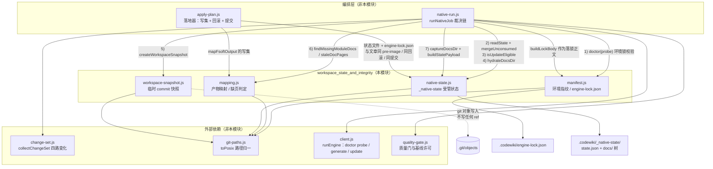
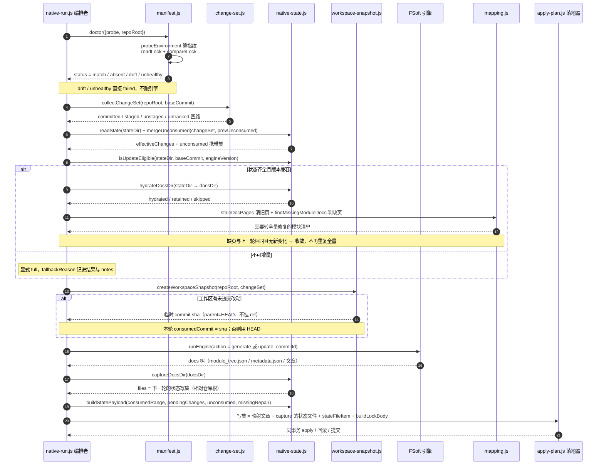
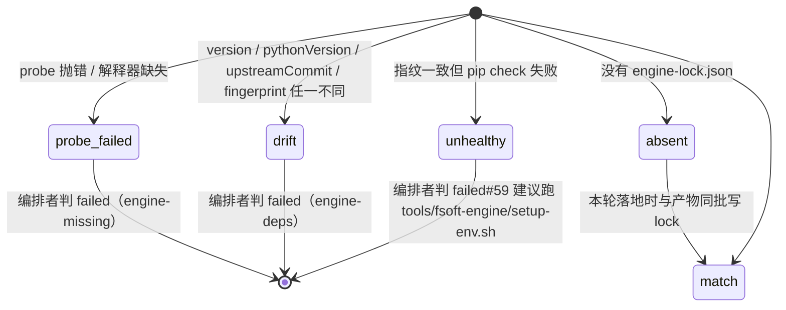
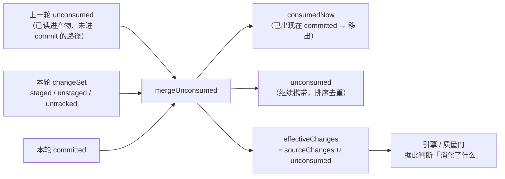

# 工作区状态与完整性（workspace_state_and_integrity）

## 简介

`workspace_state_and_integrity` 是原生引擎通道的**状态与完整性底座**。原生引擎（外部 FSoft）每轮编译都在临时目录里产出一棵全新的 docs 树，本模块回答四个决定「产物可信、变化不丢」的问题：

1. **环境可信吗？** —— 本轮跑的引擎版本 / Python 版本 / 上游源码 commit 与上次落盘的 lock 一致吗（`manifest.js`）。
2. **产物该落在哪？** —— 把 FSoft 的 docs 树翻译成本仓库 `.codewiki/` 的五类文章，不臆造归属、不静默丢弃（`mapping.js`）。
3. **下一轮还能增量吗？** —— 把上一轮的模块树 / 依赖图 / metadata / 文章完整持久化进 `.codewiki/_native-state/`，跨轮水合与采集（`native-state.js`）。
4. **未提交改动有账吗？** —— 工作区脏时合成一个不挂 ref 的临时 commit，让引擎记账（commit_id）与产物内容对齐（`workspace-snapshot.js`）。

它本身**不跑引擎、不裁决终态**：裁决链与步骤编排由 [native_process_runtime](native-process-runtime.md)（`lib/engine/native-run.js`）负责，质量裁决由 [result_contract_and_quality_gates](result-contract-and-quality-gates.md) 负责。本模块只提供「只读诊断 + 纯函数映射 + 可审计状态文件」。

## 模块组成

| 文件 | 职责 | 关键导出 |
| --- | --- | --- |
| `lib/engine/manifest.js` | 引擎环境指纹与 lock 比对 | `doctor`, `probeEnvironment`, `fingerprintOf`, `readLock`, `compareLock`, `buildLockBody`, `writeLock`, `UPSTREAM_COMMIT` |
| `lib/engine/mapping.js` | FSoft 产物 → CodeWiki 写集映射；缺页 / 陈页判定 | `mapFsoftOutput`, `findMissingModuleDocs`, `staleDocPages`, `moduleSlug`, `moduleDocRelPath` |
| `lib/engine/native-state.js` | 跨轮受管状态的水合、采集、凭据组装、未消化变化合并 | `stateDocFiles`, `readState`, `isUpdateEligible`, `hydrateDocsDir`, `captureDocsDir`, `buildStatePayload`, `mergeUnconsumed`, `archiveDocsTree`, `graphFileName` |
| `lib/engine/workspace-snapshot.js` | 工作区未提交改动合成临时 commit | `createWorkspaceSnapshot`, `snapshotExists`, `shortSha` |

## 架构与依赖关系

要点：

- **所有路径比较都经 `toPosix`**（[job_repository_infrastructure](job-repository-infrastructure.md) 的 `lib/git-paths.js`），Windows 反斜杠归一全仓库只有一处实现。
- **落锁不直接写盘**：`buildLockBody` 返回正文，由 [native_apply_plan](native-apply-plan.md) 的落地器放进 apply 写集——这样 `.codewiki/engine-lock.json` 与文章共享同一份 pre-image，失败一起回滚，不会产生「无变化轮凭空多一个 commit」。
- **状态目录以 `_` 开头**（`.codewiki/_native-state/`）：`cw index` 递归 `.codewiki/` 时只收录首段非 `_` 的 `.md`，持久化的原始文章才不会被收进索引变成第二份副本。

## 核心流程：一轮编译中的状态流转

## 环境指纹与锁定（manifest.js）

### 指纹算法

`fingerprintOf(facts)` 只吃**决定产物内容**的三项因素，SHA-256 取前 16 位：

- 引擎 `version`（pyproject 里写死的版本号）
- `pythonVersion`
- `upstreamCommit` —— 显式常量 `UPSTREAM_COMMIT = '1b4af43d6d20c8dbd758fe1d5f888cc6947ed11d'`

设计上的两个关键取舍：

1. **上游 commit 必须显式声明、必须进指纹**。FSoft 是外部引擎，`codewiki 2.0.0` 这个版本号在用源码直接安装时不跟随源码变化；上游换了 commit 而版本号不动，指纹只看版本就会误报 match。`engine.commit`（引擎自报的运行现场）**不参与判定**——它取自被编译仓库的 HEAD，不是 FSoft 源码自己的 commit。
2. **`pip check` 的 ok 不进指纹**。依赖闭合是「能不能跑」的闸门，不是「产物会是什么」的输入；把它算进指纹会让每次修依赖都像换了引擎。

### 比对状态机

`doctor()` 是**只读诊断**：不抛错（probe 失败变成 `ok:false, status:'probe-failed'`）、不装依赖、不联网。环境修复的职责在 [build_packaging_configuration](build-packaging-configuration.md) 的 `tools/fsoft-engine/setup-env.sh`（`--no-deps` 按冻结快照落盘 → editable 装引擎本体 → `pip check` → import 冒烟）。

## 产物映射（mapping.js）

把 FSoft docs 树翻译成 CodeWiki 写集，是迁移边界上唯一的「格式翻译」，四条硬规则：

1. **不臆造 `source_files`**：只认 `componentFiles` / 组件 id 中 `::` 前的文件部分；拿不到就是空数组 + warning。0.14.0 的增量归属闸门靠 `source_files` 判定，编造它会让未消化的变化被静默基线化。
2. **不静默丢弃**：任何没被映射的页进 `unmapped`，带可机读原因。
3. **不覆盖**：slug 冲突（`A_B` 与 `A-B` 都 → `a-b`）时两页都进 `unmapped`。
4. **不改技术内容**：只搬路径与类型，正文一字不动；FSoft 原始树另存（`archiveDocsTree`），留档到仓库外临时目录作为事实来源。

页面落地与上游 `doc_layout` 同一口径：`hierarchical` 落在 `<父路径...>/<模块名>.md`，`flat` 落在根部。`findMissingModuleDocs`（树里有模块但没有对应页）与 `staleDocPages`（页在但已不属于当前树）是增量轮转全量修复的判据；whole-repository 模式下模块树为空时，页是真产物但 `sourceFiles` 留空、`attribution='unattributed'`。

## 跨轮受管状态（native-state.js）

### 为什么需要这一层

FSoft 的组件级增量（`rung=3`）要读上一轮的四样东西才能算出「改了什么」：`module_tree.json`、`temp/dependency_graphs/<repo>_dependency_graph.json`、`metadata.json`、上一轮的文章。而 docsDir 是每轮新建的临时目录——不持久化它们，第二轮的 `_update_options()` 必然返回 None，「每轮都在全量、又慢又贵，却一路绿到底」。

### 三条不变量

1. **只有完整成功才推进基线**：partial / failed / cancelled 一律不把本轮状态写成下一轮基线；`state.json` 只记「本轮开始时的已消费范围」与「本轮看见的变化」，本轮结局的权威在 `.codewiki/_meta.yaml`。
2. **状态不完整 → 显式 full**：缺图 / 缺 module_tree / 版本不符 / 基线不可达，`isUpdateEligible` 返回 `eligible:false` + 具体 `reason`，绝不假装 clean。
3. **水合是复制不是移动**：源（仓库内、受 git 管理）与目标（临时 docsDir）任何一侧被写坏都不影响另一侧。

### 未消化变化的携带（mergeUnconsumed）

这条链路消灭第二类丢变化：引擎读工作区文件（内容是对的），但 cw 基线只推进到 HEAD；未提交改动在 `git diff base..HEAD` 里出现之前，每轮无条件并入变化集。`stateFingerprint` 去掉 `updatedAt` 再比对，保证「无变化的一轮」不产生真实提交。

## 工作区快照（workspace-snapshot.js）

用**独立 index 文件**（`GIT_INDEX_FILE`）走 `read-tree → add -A → write-tree → commit-tree`，得到一个含全部工作区改动的树对象，parent 指向 HEAD，**不写任何 ref**：

- 用户的分支、HEAD、工作区、真实 index 一个字节都不动；
- 产出的 sha 是真实可达 commit（可被 `cat-file -t` 校验），落进 `metadata.generation_info.commit_id` 后，下一轮能拿它做 old_commit；
- 它不挂在任何 ref 上，gc 后自然消失，**不能**作为已提交基线推进（质量门仍可因此判 partial）。

失败语义：造不出快照一律 `ok:false`，退回「用 HEAD 记账」的旧行为并记 note——快照是对齐精度的改进，不是编译成立的前提。

## 与其他模块的关系

- **编排与裁决**：[native_process_runtime](native-process-runtime.md) 固定了 `env(doctor + lock) → 增量决议 → 水合 → 引擎(full|update) → gate → apply` 的直线裁决链；本模块的所有导出都在这条链上被调用，自身不持有终态。
- **落地同事务**：[native_apply_plan](native-apply-plan.md) 的落地器消费 `captureDocsDir`、`stateFileItem`、`buildLockBody` 产出的写集——状态文件与文章同 pre-image、同回滚、同提交。
- **引擎进程与探测**：[engine_client](engine-client.md) 的 `runEngine(action:'doctor')` 提供 `probeEnvironment` 需要的探测事实（版本 / Python / pip check）。
- **变化集来源**：[agentic_orchestration_and_article_pipeline](agentic-orchestration-and-article-pipeline.md) 的 `lib/change-set.js` 提供四路 `collectChangeSet`，是 `mergeUnconsumed` 与快照判脏的输入。
- **质量裁决**：[result_contract_and_quality_gates](result-contract-and-quality-gates.md) 消费本模块输出的 `engineLock`、`incremental`、`workspaceSnapshot` 现场证据来判 partial 与基线许可。
- **路径基础设施**：[job_repository_infrastructure](job-repository-infrastructure.md) 的 `toPosix` / `decodeGitPath` 是所有路径归一的唯一实现（含中文仓库名的依赖图文件名 `graphFileName` 用 Unicode `\p{L}\p{N}` 逐字符对齐上游 `sanitize_repo_name`）。

## 排障速查

| 现象 | 判据位置 | 含义 |
| --- | --- | --- |
| 编译 failed，`stage:'env'` | `compareLock` 返回 `drift` | 引擎版本 / Python / 上游 commit 与 lock 不一致，需确认后重写 lock |
| 编译 failed，提示 `pip check` | `compareLock` 返回 `unhealthy` | 依赖不闭合，跑 `tools/fsoft-engine/setup-env.sh` |
| 每轮都在全量 | `isUpdateEligible` 的 `reason` | 看缺的是 `module_tree.json`、依赖图还是引擎版本变了 |
| 缺页修好了但仍 partial | `findMissingModuleDocs` / `staleDocPages` | 产物目录里有不属于当前模块树的旧页被清退后仍判 unmapped |
| 无变化轮也产生 commit | `stateFingerprint` | `state.json` 实质内容没变就不该重写时间戳 |
